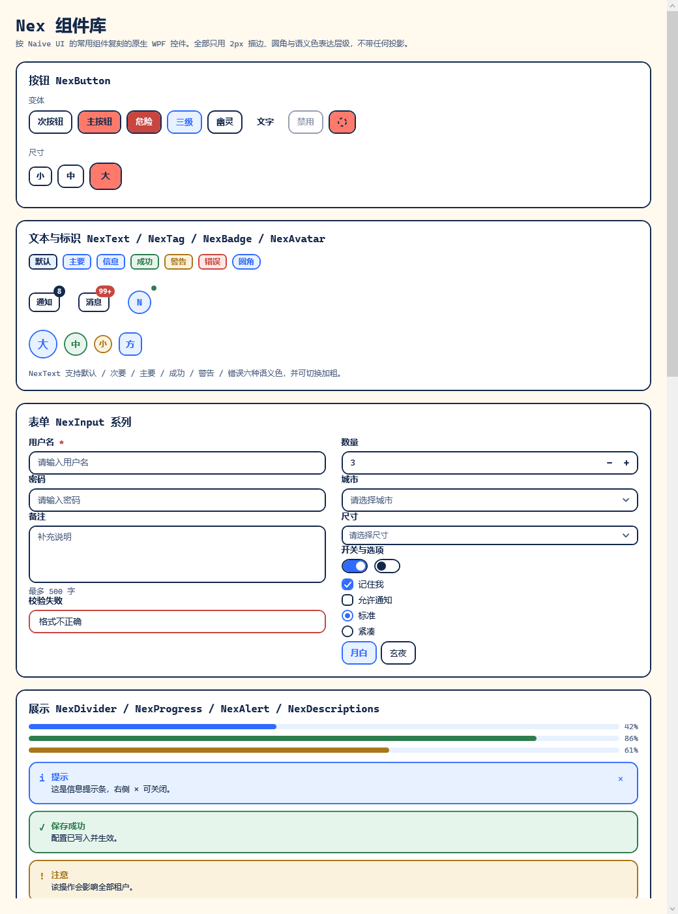
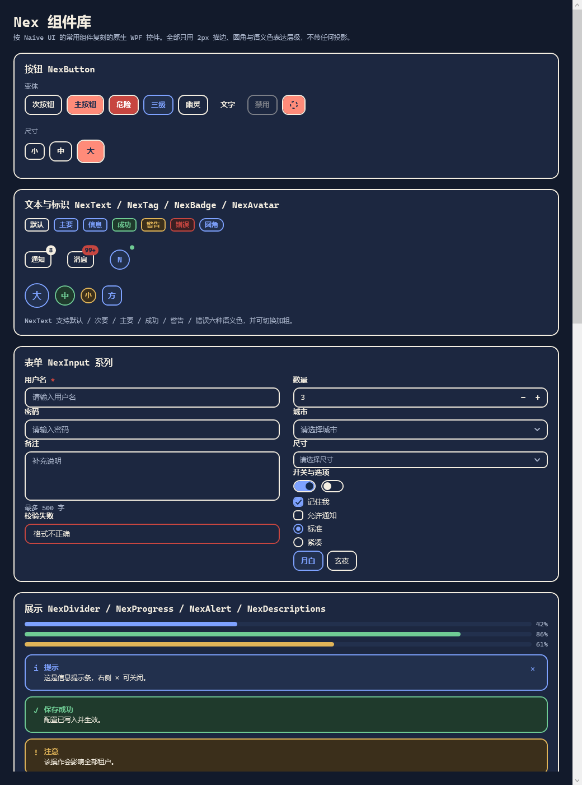

# Sim.Admin.Wpf.Client

Windows 桌面工作区，复用现有 Web API 的账号、双重验证、账号安全、审批、授权、系统管理、通知和偏好接口。界面提供与 Web 一致的四套风格：纸上海洋、玄青·鎏金、竹月·清雅、朱缃·典章；每套均有月白和玄夜配色。

## 运行

需要 Windows 和 .NET 10 SDK。先启动并初始化 API，然后在仓库根目录执行：

```powershell
dotnet run --project client/Sim.Admin.Wpf.Client/Sim.Admin.Wpf.Client.csproj
```

项目独立构建，不加入用于 Linux 容器和跨平台后端 CI 的 `api/Sim.slnx`。

后端 API 地址由随程序发布的 `appsettings.json` 配置（`Api:BaseUrl`，默认 `https://localhost:7777`，构建时复制到输出目录）。本地证书须由系统信任；客户端不跳过 TLS 验证。登录页只保留账号密码，登录失败等错误以窗口顶部居中的消息提示显示，不再有常驻状态栏。登录卡的「记住我」在勾选并成功登录后用 Windows DPAPI（当前用户作用域）加密保存账号密码到 `%LOCALAPPDATA%\Sim.Admin.Wpf.Client\remembered-login.dat`，下次启动或退出后自动回填；同名文件不包含明文，取消勾选并成功登录会删除它。`rememberMe` 同时传给登录/双重验证完成接口，用于服务端刷新令牌寿命。

## 结构和能力

- `Sim.Admin.Wpf.Client/App.xaml`：全局语义色、基础控件样式，并合并 `Theme/CustomControls.xaml` 组件库样式入口。
- `Sim.Admin.Wpf.Client/appsettings.json`：后端 API 地址配置（`Api:BaseUrl`），随构建复制到输出目录，缺失或为空时登录会给出提示。
- `Sim.Admin.Wpf.Client/Theme/ThemeManager.cs`：四套风格 × 明暗的 WPF 配色，按 `web/src/config/themes.ts` 和 `web/src/styles/theme-variables.css` 同步；包含成功、警告、信息、悬停、遮罩，以及表格表头/分隔线（`PageDeepBrush`/`LineBrush`）等语义色。
- `Sim.Admin.Wpf.Client/Theme/CustomControls.xaml`：组件库样式入口，合并 `Controls.Base.xaml`、`Controls.Inputs.xaml`、`Controls.Display.xaml`、`Controls.Container.xaml`、`Controls.Overlay.xaml`；原生 `ListBox`/`TreeView`/`ScrollBar` 也由 `Controls.Base.xaml` 的隐式样式统一为纸面外观与组件字族。
- `Sim.Admin.Wpf.Client/Controls`：基础控件 `CustomButton`、`CustomCard`、`CustomDataGrid`、`CustomFormField`、`CustomPromptDialog`、`CustomText`、`CustomFoundation`（尺寸与语义枚举）。
- `Sim.Admin.Wpf.Client/Controls/Inputs`：`CustomInput`、`CustomTextarea`、`CustomPasswordInput`、`CustomInputNumber`、`CustomSelect`、`CustomCheckBox`、`CustomRadio`、`CustomRadioButton`、`CustomSwitch`、`CustomFormItem`。
- `Sim.Admin.Wpf.Client/Controls/Display`：`CustomTag`、`CustomBadge`、`CustomAvatar`、`CustomDivider`、`CustomProgress`、`CustomSpin`、`CustomSkeleton`、`CustomEmpty`、`CustomResult`、`CustomAlert`、`CustomDescriptions`。
- `Sim.Admin.Wpf.Client/Controls/Container`：`CustomMenu`、`CustomTabs`、`CustomCollapse`、`CustomPagination`、`CustomSteps`、`CustomTimeline`。
- `Sim.Admin.Wpf.Client/Controls/Overlay`：`CustomModal`、`CustomDrawer`、`CustomPopconfirm`、`CustomMessage`，以及 `Theme/Controls.Overlay.xaml` 中的 `ToolTip`/`ContextMenu` 样式。
- `Sim.Admin.Wpf.Client/Features/Components`：组件库预览窗口，集中展示上述控件的变体、尺寸与交互。
- `Sim.Admin.Wpf.Client/Features/Security`：账号安全页。
- `Sim.Admin.Wpf.Client/Features/Approval`：审批中心、详情窗口、待办处理弹窗。
- `Sim.Admin.Wpf.Client/Features/Authorization`：授权管理工作区（用户/角色/权限/模块/路由）。
- `Sim.Admin.Wpf.Client/Features/Common`：可复用用户选择器。
- `Sim.Admin.Wpf.Client/Features/Management`：通用管理页、字段编辑器、角色/模块/权限选择器。
- `Sim.Admin.Wpf.Client/Features/SystemManagement`：系统配置、数据字典、业务编号、定时任务、文件存储、通知管理、组织架构与租户管理页。
- `Sim.Admin.Wpf.Client/Services/ApiClient*.cs`：HTTP 请求、会话刷新、注销，以及认证、审批、系统、存储、通知和授权管理接口。
- `Sim.Admin.Wpf.Client/Business`：业务装配入口——`IBusinessClientModule` 契约、`BusinessClientContext` 会话上下文、空的 `BusinessModuleRegistration` 组合根与 `BusinessSources.props` 源码清单。
- `Sim.Admin.Wpf.Client/Converters/ApprovalStatusConverter.cs`：审批实例、任务、流程和动作状态的中文展示。

文字默认继承窗口的 `InkBrush`；主行动按钮统一使用 `CustomButton` 的 `Primary`/`Danger` 变体，其背景与前景分别来自当前主题的 `ActionBrush`/`ActionTextBrush` 与 `DangerBrush`/`DangerTextBrush`。新增深色按钮时沿用这一配对，避免全局文字样式覆盖按钮前景色。

登录后的工作区采用与 Web 后台同构的壳层：左侧 252px 的 `CustomMenu`（`n-menu` 复刻）为手风琴菜单，顶层分组可展开/收起且同一层级只展开一个，叶节点与子项单选并驱动内容区切换；展开时子菜单按实测内容高度播放 0.3s 高度 + 淡入动画，收起反向收缩，chevron 以 0.2s 缓动旋转；菜单顺序与 Web 一致（工作台、审批、系统管理、授权管理）；左下角为个人信息条（头像通过鉴权下载显示、失败回退首字，显示名与角色，右侧电源图标按钮退出登录），点击个人信息展开个人菜单，内含个人资料、账号安全、通知中心与主题；个人资料页顶部可点击圆形头像框选图、裁剪并上传本人头像，上传后同步刷新侧栏头像。顶栏品牌右侧以面包屑显示当前模块层级（分组 / 叶节点），不再显示页面标题与后端地址，右侧只保留明暗图标按钮；授权/系统/审批的模块不再使用顶部标签页，`AuthorizationWorkspace`/`SystemWorkspace`/`ApprovalWorkspace` 只负责按 key 懒加载模块页。`CustomDataGrid` 按 `n-data-table` 复刻：`PageDeepBrush` 浅色表头（14px、44px 高）、1px `LineBrush` 横竖分隔线、`PageBrush` 斑马纹、46px 行高、行悬停与 Naive 复选列，表格自身不描边（外框由所在卡片承担）。业务页表格卡片不再显示与内容区页头重复的标题，工具栏不提供编辑按钮（双击行进入编辑），只服务复选框勾选；`CustomDataGrid` 首次加载把列宽固化为绝对值：未设宽度的列使用 `DefaultColumnWidth`（默认 120）或列级 `MinWidth`，剩余空间平均分给数据列；`MinimumColumnWidth`（默认 60，页面可按需覆盖）是拖拽下限。拖拽列宽只改变当前列，总宽超出视口时表格横向滚动；勾选列与全选由 `CustomDataGrid.EnableSelection` 统一生成（对应 Web 表格的 selectable）：44px 固定宽度、固定在表格左侧（`FrozenColumnCount=1`）、三态全选表头、不可排序/拖拽，勾选状态由组件按 `RowKeyPath`（默认 `Id`，对应 row-key）维护，页面通过 `CheckedItems` / `CheckedChanged` 读取，直接使用原数据对象，光标选中不计入；复选列上的双击只切换勾选，不触发行编辑；用户 / 角色中内置记录不提供删除，勾选含内置记录时工具栏删除保持禁用；表格中的状态标志（启用、内置、当前会话、在线、主组织、已读等）使用 `NaiveStatusCheckBoxStyle`，不可点击、不可聚焦，只作展示；「操作」列（编辑 + 定义动作 + 删除）通过 `CustomDataGrid.FrozenRightColumn` 固定在右侧：组件用同源只读副表渲染，同步数据源、垂直滚动、选中行、斑马纹与行高，宽度按本页最宽一行的按钮组自适应，冻结区左侧绘制 1px 分隔线与普通列衔接，主表在剩余区域内横向滚动；表头支持点击排序与升降序指示器，列宽拖拽手柄显示 2px 指示线并在悬停/拖拽时变主色；所有非复选列均可拖拽调整宽度；无横向滚动条时缩小某列由右侧相邻列自动补宽，末列不会被缩出空白，扩大列宽不压缩邻列、超出视口即横向滚动；横向滚动条横跨整张表宽，但仍只滚动非冻结列。初次加载按冻结列后的实际视口分配列宽，冻结列变宽时自动收窄或补齐，既不出现空白填充列，也不产生无意义横向滚动。分页页脚提供可输入的每页条数下拉框：可选 20/50/100/200/500，默认 20，手输值钳制在 20–500，切换后回到第 1 页并按新条数请求 `skipCount`/`maxResultCount`。登录页复刻 Web 后台的左右分屏：左侧 `ActionBrush` 品牌面板占满高度（品牌锁定、欢迎标语、版权），右侧 `PageBrush` 区域右上角只放月亮/太阳明暗图标按钮，中央为 430px 登录卡；登录时隐藏全局顶栏，登录后恢复。登录页不再提供主题风格选择与组件库入口；个人菜单中的「主题」打开四套风格的「选择主题」窗口，顶栏月亮/太阳图标切换明暗，两者都写回用户偏好，登录页与顶栏的明暗按钮同步当前状态。

### 组件库（Naive UI 复刻）

桌面端按 [Naive UI 组件列表](https://www.naiveui.com/zh-CN/components) 的常用组件建立了原生 WPF 控件库，命名空间 `Sim.Admin.Wpf.Client.Controls.{Inputs,Display,Container,Overlay}`，样式全部集中在 `Theme/Controls.*.xaml`，由 `Theme/CustomControls.xaml` 合并进 `App.xaml`。

| 控件族 | 组件 | 对应 Naive UI |
| --- | --- | --- |
| 基础 | `CustomButton`、`CustomCard`、`CustomText`、`CustomDataGrid` | `n-button`、`n-card`、`n-text`、`n-data-table` |
| 表单 | `CustomInput`、`CustomTextarea`、`CustomPasswordInput`、`CustomInputNumber`、`CustomSelect`、`CustomCheckBox`、`CustomRadio`、`CustomRadioButton`、`CustomSwitch`、`CustomFormItem` | `n-input`、`n-input-number`、`n-select`、`n-checkbox`、`n-radio`、`n-switch`、`n-form-item` |
| 展示 | `CustomTag`、`CustomBadge`、`CustomAvatar`、`CustomDivider`、`CustomProgress`、`CustomSpin`、`CustomSkeleton`、`CustomEmpty`、`CustomResult`、`CustomAlert`、`CustomDescriptions` | `n-tag`、`n-badge`、`n-avatar`、`n-divider`、`n-progress`、`n-spin`、`n-skeleton`、`n-empty`、`n-result`、`n-alert`、`n-descriptions` |
| 容器 | `CustomMenu`、`CustomTabs`、`CustomCollapse`、`CustomPagination`、`CustomSteps`、`CustomTimeline` | `n-menu`、`n-tabs`、`n-collapse`、`n-pagination`、`n-steps`、`n-timeline` |
| 浮层 | `CustomModal`、`CustomDrawer`、`CustomPopconfirm`、`CustomMessage`，以及 `ToolTip`/`ContextMenu` 样式 | `n-modal`、`n-drawer`、`n-popconfirm`、`useMessage`、`n-tooltip` |

组件库统一约束：

- **不使用任何投影**：没有 `Effect`/`DropShadowEffect`，也没有用偏移第二层 `Border` 模拟硬投影；层级只由 2px `EdgeBrush` 描边、圆角和语义色表达。`MainWindow` 原先把外层深色 `Border` 当投影用的写法已移除。
- 颜色只引用 `DynamicResource` 语义键（`PageBrush`、`PageDeepBrush`、`InkBrush`、`MutedBrush`、`LineBrush`、`EdgeBrush`、`PrimaryBrush`、`ActionBrush`、`SuccessBrush`、`WarningBrush`、`DangerBrush` 及对应 `*SoftBrush`、`HoverBrush`、`OverlayBrush`），四套风格 × 明暗切换实时生效。
- 尺寸统一为 `CustomControlSize` 三档：Small / Medium / Large，对应高度 30 / 36 / 42 与圆角 8 / 10 / 12。
- 不定义全局隐式 `TabItem` 样式；`CustomTabs` 通过 `ItemContainerStyle` 局部引用 keyed 样式，既有页面的标签页外观不受影响。
- 浮层一律是带主题内容的普通 WPF 窗口，不使用透明阴影窗；`CustomModal`/`CustomPopconfirm` 返回是否确认，`CustomMessage` 在右下角堆叠并在数秒后自动关闭。

组件库窗口不提供界面入口，用命令行直接打开并可指定配色：

```powershell
dotnet run --project client/Sim.Admin.Wpf.Client/Sim.Admin.Wpf.Client.csproj -- --gallery
dotnet run --project client/Sim.Admin.Wpf.Client/Sim.Admin.Wpf.Client.csproj -- --gallery --dark
```

预览窗口截图（离屏渲染，纸上海洋月白 / 玄夜）：





### 认证与会话

客户端调用 `POST /api/system/user/login`；需要双重验证时调用 `POST /api/system/user/send-two-factor-code` 和 `POST /api/system/user/complete-two-factor-login`。Access Token 失效时，客户端读取 `GET /api/system/user/antiforgery-token`，携带 `X-XSRF-TOKEN` 与进程内 Refresh Cookie 调用 `POST /api/system/user/refresh-token`，原请求最多重试一次。注销使用防伪令牌调用 `POST /api/system/user/revoke-refresh-token`。Access Token、Refresh Cookie 和密码只在当前进程内存中使用；关闭程序后需要重新登录，切换服务器地址会清除现有会话。

### 账号安全

账号安全页提供：

- 修改密码：`POST /api/system/user/change-password`，成功后退出并要求重新登录。
- 双重验证状态：`GET /api/system/user/two-factor-status`。
- 身份验证器启停：`POST /api/system/user/begin-authenticator-setup`、`confirm-authenticator-setup`、`disable-two-factor`；启用时展示密钥、绑定链接和一次性恢复码。
- 邮件/短信启停：`POST /api/system/user/request-message-two-factor-setup`、`confirm-message-two-factor-setup`、`disable-two-factor`。
- 登录会话：`GET /api/system/user/my-login-sessions`、`POST /api/system/user/revoke-my-login-session/{sessionId}`；注销当前会话后立即退出。
- 注销账号：`POST /api/system/user/delete-my-account`，需依次输入密码和确认短语。

### 审批中心

审批中心包含待办、已办、我提交的、抄送我的、流程定义和实例监控六个列表，接口分别为 `GET /api/approval/instance/my-pending`、`my-handled`、`my-submitted`、`my-cc`、`GET /api/approval/flow-definition` 和 `GET /api/approval/monitor`。列表支持关键字/流程编码筛选、分页（每页 20–500 条可调）、查看详情和抄送标记已读。流程定义列表支持按编码、名称、说明筛选，新建含“开始 → 发起人审批 → 结束”默认图的草稿，并调用服务端发布前校验；可在原生 WPF 编辑窗口查看流程详情，在画布新增/拖动节点、从仅在节点悬停时显示的四边连接点拖线连接节点；连接点随节点拖动，连线可选直线、正交线或贝塞尔曲线，双击或右键编辑/删除节点与连线，并维护基本设置、审批/抄送/网关节点及条件 JSON，保存草稿并调用服务端校验；已发布或停用版本只读。

节点/连线编辑使用可滚动的原生输入弹窗。长表单高度以流程编辑窗口为上限，字段区滚动，确认与取消按钮保持在底部。

详情窗口读取 `GET /api/approval/instance/{id}` 或 `GET /api/approval/monitor/{id}`，展示业务字段、节点进度、处理记录、附件和抄送。可执行：

- 同意/驳回：`approve/{taskId}`、`reject/{taskId}`。
- 退回上一步/发起人：`return-to-previous/{taskId}`、`return-to-initiator/{taskId}`。
- 转交/加签：`transfer/{taskId}`、`sign/{taskId}`。
- 撤回/重新提交/催办：`{id}/withdraw`、`{id}/resubmit`、`{id}/urge`。
- 实例终止（监控）：`POST /api/approval/monitor/{id}/terminate`。
- 附件上传/下载：`{id}/upload-attachment`、`upload-task-attachment/{taskId}`、`attachment-download/{attachmentId}`。
- 流程定义发布/停用/升版/删除：`{id}/publish`、`disable`、`version`、`DELETE /{id}`。

### 授权管理

授权管理复用通用管理页，覆盖用户、角色、权限、模块和路由；模块支持分配路由，路由支持 JSON 元数据编辑。用户支持重置默认密码和分配角色；角色支持分配模块和权限，两个入口位于该行「操作」列，内置角色不显示分配入口。角色模块/权限使用 `role-module/role-modules/{id}`、`role-module/assign-modules-to-role/{id}`、`permission/permissions-by-role/{id}`、`role/assign-role-permissions/{id}`。分配角色、模块、权限和路由共用选择弹窗，弹窗底部提供筛选框，分配权限时同时按名称与权限码匹配；分配路由按 `parentId` 渲染为可级联勾选的树，筛选时保留命中项的祖先路径。

### 系统管理与通知

- 租户管理：支持创建（按模板选择模块/路由/权限并展示初始管理员凭据）、编辑、启用/停用、删除和分配查看（`/api/system/tenant`、`/{id}`、`/templates`、`/{id}/assignments`）。
- 组织架构：提供部门树、子部门创建/编辑/删除和成员添加/移除（`/api/system/organization/tree`、`/organization`、`/organization/{id}`、`/organization/members/{unitId}`、`/organization/member`）。
- 系统配置、数据字典、业务编号：标准增删改查；字典项按 `dictionaryId` 过滤并维护。
- 定时任务：`GET/POST /api/system/schedule-task`、`PUT /api/system/schedule-task?group=&key=`、`DELETE /{id}`、`POST /{id}/trigger-now`；支持 Http、Command、ServiceMethod 三种类型。
- 文件存储：`GET/PUT /api/system/file-storage-configuration`、`POST /test`；支持本地、S3 兼容、腾讯云 COS、阿里云 OSS 的保存与连通性测试。
- 通知管理：`GET /api/system/notification-administration` 及 `save-provider`、`save-template`、`save-rule`、`save-webhook`、`deliveries`、`{id}/test-provider`；渠道、模板、规则、Webhook 可增改，投递记录只读，渠道支持发送测试。

通用管理页支持文本、长文本、数字、布尔、选项、JSON 和列表字段；列表页可配置 `CreatePath`/`UpdatePath`/`DeletePath` 与 HTTP 方法，以适配非标准 REST 契约。

## 业务客户端接入

业务仓在 `client/<业务>/` 编写 WPF 页面与 API 封装，不创建独立工程：

1. 实现 `IBusinessClientModule`（`Business/IBusinessClientModule.cs`），`Key` 与后端业务根路径一致，菜单 key 使用 `<业务>.<页面>`；
2. 在 `Business/BusinessModuleRegistration.cs` 的 `Modules` 追加模块；
3. 在 `Business/BusinessSources.props` 追加 `client/<业务>/` 的 `Compile`/`Page` 通配；
4. 工作区通过 `BusinessClientContext.Api` 调用后端，会话失效调用 `EndSession`。

业务菜单分组接在平台菜单之后，首次点击叶节点时懒创建标签页并按 `ShowAsync` 导航；基座仓 `Modules` 为空，行为与未接入业务时一致。`MainWindow`、客户端 csproj 与 `Services/` 由基座维护，业务仓不修改。

## 尚未原生 WPF 复刻

以下 Web 能力仍需后续按原生 WPF 补齐：E2EE 与通行密钥、外部登录绑定。流程草稿的新建、筛选、画布新增/拖动节点、悬停显示四边连接点、拖动节点时连接点跟随、端点拖线与切换直线/正交线/贝塞尔曲线、双击和右键编辑/删除、保存与校验已在原生 WPF 窗口接入；节点和连线直接在画布维护；节点按画布纵向/横向位置保存顺序，同一起点的分支可在连线右键菜单调整优先级，新节点生成默认纵向坐标。当前页面不会伪装这些入口。Naive UI 中尚未纳入组件库的部分（`n-tree`、`n-date-picker`、`n-dropdown`、`n-dynamic-input`、`n-menu` 的折叠与子菜单形态、`n-modal` 的卡片/预设变体等）按需再补，不引入第三方 UI 包。

## 验证

```powershell
dotnet build client/Sim.Admin.Wpf.Client/Sim.Admin.Wpf.Client.csproj
dotnet run --project client/Sim.Admin.Wpf.Client/Sim.Admin.Wpf.Client.csproj -- --gallery
```

组件库验收：`--gallery`（可加 `--dark`）打开预览窗口，逐项核对按钮变体与尺寸、输入/数字/下拉/开关/复选/单选、标签与徽标、进度与提示条、描述列表、加载与骨架屏、空状态与结果页、标签页/折叠面板/分页、导航菜单、数据表格、步骤条与时间线，以及弹窗/抽屉/二次确认/消息提示；切换四套风格与玄夜后确认无投影、描边与语义色随主题变化。工作区验收：登录后核对左侧手风琴菜单的展开互斥、子项选中与页面联动、顶栏的分组/叶节点面包屑、顶部月亮/太阳图标切换明暗、左下角个人信息菜单（头像、个人资料/账号安全/通知中心三项、主题选择弹窗、电源图标退出），以及表格在四套主题下的表头配色、行分隔线与行悬停。

联调时分别验证：API 探针、普通及双重验证登录、会话过期后的单次刷新、个人资料读取与保存、主题偏好同步、改密与双重验证启停、登录会话注销、审批列表与详情动作、流程定义新建/画布新增节点与四边拖线/切换三种线型/双击编辑/删除/保存/校验/发布/停用/升版、用户重置密码/角色分配、角色的行内模块与权限分配、选择弹窗筛选、路由分配树与父级级联勾选、租户创建/编辑/启停/删除/分配查看、字典项维护、组织树与成员增删、定时任务创建/保存/触发/删除、存储配置保存与连通性测试、通知渠道/模板/规则/Webhook 保存与测试。需要真实 API 和已初始化数据库；客户端不内置演示数据。
