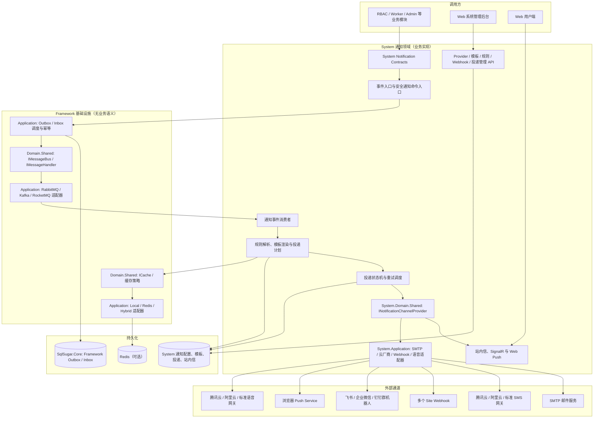
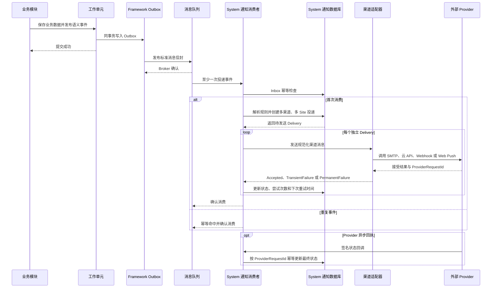

# 系统通知平台总体设计与实施基线

> 状态：首版基线已实施；生产联调与增强项见第 20 节
>
> 设计日期：2026-07-28
>
> 适用范围：`api`、`web`
>
> 结论：消息队列和缓存归属 Framework 基础设施层；通知领域、渠道编排、运行配置和渠道适配器归属 System 模块；Host 只做组合。

> 2026-07-30 实施说明：实现优先复用现有项目，在明确出现依赖隔离、部署裁剪或独立发布需要时允许拆分适配项目。RabbitMQ、Kafka、RocketMQ 分别使用 RabbitMQ.Client、Confluent.Kafka、Apache RocketMQ.Client；Redis 使用 StackExchange.Redis；SMTP 使用 MailKit；腾讯/阿里短信与语音使用厂商官方 SDK。浏览器通知首版为站内信 + 鉴权 SignalR 前台实时失效事件 + API 权威读取 + Notification API；API 仅在收到实时变更事件或展开面板时读取，SignalR 断线会自动重连。后台 Service Worker Web Push、多实例 SignalR backplane、Provider 回执端点、熔断与完整可观测性仍属于后续生产增强。

## 1. 目标与非目标

本方案统一建设以下能力：

1. SMS：腾讯云、阿里云和部署方标准 HTTP SMS 网关，提供后台配置、测试和投递记录。
2. 邮件：通用 SMTP，提供后台配置、测试和投递记录。
3. Webhook：一个事件可同时投递给多个 Site，每个 Site 独立签名、重试、熔断和审计。
4. 站内与协作通知：站内信、SignalR 实时提醒、浏览器 Web Push、飞书/企业微信/钉钉群机器人 Webhook。
5. 消息队列：RabbitMQ、Kafka、RocketMQ 可替换适配器。
6. 缓存：Local、Redis，并允许生产环境组合成 L1 Local + L2 Redis。
7. 语音外呼：腾讯云、阿里云和标准 HTTP 语音网关。

首版代码与数据库模型已经实施，RBAC 验证码已迁移到 System 安全通知端口。各 Provider 的账号开通、签名/模板报备、费用、运营商合规和生产联调仍属于上线范围。

## 2. 现状与设计约束

### 2.1 仓库现状

- 后端是 .NET 10 模块化单体，业务模块按 `Domain.Shared`、`Domain`、`Application.Contracts`、`Application`、`SqlSugar` 分层。
- 架构测试已经限制 framework 反向引用业务模块、业务 Application 跨模块只引用 Contracts/Domain.Shared、模块 SqlSugar 不引用 Host。
- System 已经采用“数据库运行配置 + Data Protection 加密 Secret + 不回显”的文件存储配置模式，可复用于通知配置。
- System 已经拥有 Quartz、动态任务、执行历史和启动初始化能力，可承担通知重试扫描、清理和回执补偿。
- RBAC 的旧 `IVerificationMessageSender` 已成为转调 `ISecurityNotificationSender` 的薄桥接，不再持有 SMTP/SMS 配置。
- Web 顶栏已接入站内信数据、显式已读/未读状态、未读数和鉴权 SignalR 实时刷新；新未读消息在页面聚焦时弹站内通知卡片，隐藏或失焦时使用已授权的浏览器 Notification API，二者互斥。后台 Service Worker Web Push 尚未实现。
- Redis 缓存适配已落地，但当前限流仍为单实例内存实现；共享限流需单独评审其原子配额和故障语义。

### 2.2 必须保持的边界

- 业务模块发布“发生了什么”，不能选择腾讯云、SMTP 或某个 Webhook URL。
- Framework 只理解消息、缓存、重试、序列化和健康状态，不理解短信、邮件、站内信等业务概念。
- System 负责事件到通知的转换、模板、规则、用户偏好、Provider 选择、投递状态和通知渠道实现。
- 云厂商 SDK、SMTP、Webhook 格式和 Web Push 库不进入业务模块，也不进入 Framework 抽象项目。
- Host 选择并注册一个消息队列 Provider、一个缓存模式和需要启用的通知 Provider 实现；任何业务项目不得引用 Host。
- MQ/Redis 连接属于部署级配置，使用环境变量或 Secret 管理，不放到后台页面热切换。通知 Provider 的运行配置属于 System，允许后台维护。

## 3. 总体架构

可编辑图源：

- [`diagrams/notification-platform-architecture.mmd`](../../diagrams/notification-platform-architecture.mmd)
- [`diagrams/notification-delivery-sequence.mmd`](../../diagrams/notification-delivery-sequence.mmd)



核心依赖方向：

```text
业务模块 Application
  -> Sim.System.Application.Contracts

Sim.System.Application
  -> Sim.System.Domain.Shared 中的通知 Provider 抽象
  -> Sim.Framework.Domain.Shared 中的消息与缓存抽象

Sim.System.Application 中的 Provider 实现
  -> Sim.System.Domain.Shared 中的通知 Provider 抽象
  -> 第三方 SDK / HTTP 协议

Sim.Framework.Application
  -> Sim.Framework.Domain.Shared 中的消息与缓存抽象

Sim.SqlSugar.Core
  -> Sim.Framework.Domain.Shared 中的 Outbox / Inbox 存储抽象

Host
  -> 组合 Framework Application、SqlSugar 存储实现与 System Provider 实现
```

## 4. 建议的项目和代码组织

### 4.1 Framework

不为 Messaging、Caching 的每个逻辑层重新创建平行项目，优先映射到当前 Framework 分层：

| 逻辑能力 | 复用项目 | 目录 |
| --- | --- | --- |
| `Messaging.Abstractions` | `Sim.Framework.Domain.Shared` | `Messaging/` |
| `Messaging` | `Sim.Framework.Application` | `Messaging/` |
| `Messaging.SqlSugar` | `Sim.SqlSugar.Core` | `Messaging/` |
| `Caching.Abstractions` | `Sim.Framework.Domain.Shared` | `Caching/` |
| `Caching` | `Sim.Framework.Application` | `Caching/` |

```text
api/framework/
├── Sim.Framework.Domain.Shared/
│   ├── Messaging/
│   │   ├── IMessageBus.cs
│   │   ├── IMessageHandler.cs
│   │   ├── MessageEnvelope.cs
│   │   ├── MessagePublishOptions.cs
│   │   └── Persistence/
│   │       ├── IMessageOutboxStore.cs
│   │       └── IMessageInboxStore.cs
│   └── Caching/
│       ├── ICache.cs
│       ├── CacheEntryPolicy.cs
│       └── CacheKey.cs
├── Sim.Framework.Application/
│   ├── Messaging/
│   │   ├── Dispatching/
│   │   ├── Serialization/
│   │   ├── HealthChecks/
│   │   └── Providers/
│   │       ├── RabbitMQ/
│   │       ├── Kafka/
│   │       └── RocketMQ/
│   └── Caching/
│       ├── Local/
│       ├── Redis/
│       ├── Hybrid/
│       └── Serialization/
└── Sim.SqlSugar.Core/
    └── Messaging/
        ├── Entities/
        ├── Repositories/
        └── Migrations/
```

约束：

- `Sim.Framework.Domain.Shared/Messaging` 与 `Caching` 只保存纯抽象、值对象和稳定常量，不引用 ASP.NET Core、SqlSugar、Redis 或任一 Broker SDK。
- `Sim.Framework.Application/Messaging` 只依赖 Outbox/Inbox 存储抽象，不引用 `Sim.SqlSugar.Core`。
- `Sim.SqlSugar.Core/Messaging` 实现 `IMessageOutboxStore`、`IMessageInboxStore` 和 Framework Outbox/Inbox 持久化，不引用任何业务模块。
- RabbitMQ/Kafka/RocketMQ 和 Local/Redis/Hybrid 先按目录隔离在现有 `Sim.Framework.Application`。Host 只激活配置选中的实现，未选中的实现不得自动注册或启动连接。
- 只有出现无法规避的 SDK 版本冲突、原生运行时冲突、发布体积或安全隔离证据时，才另行评审拆分 Provider 项目；不在首版设计中预先扩张解决方案项目数。
- Framework 只暴露最小公分母语义：发布、消费、确认、重试元数据、消息头、消费者组和健康状态；厂商特有延迟消息、事务消息、Tag/Partition 等能力不能泄漏给业务代码。

模块注册沿用现有入口：

- `FrameworkApplicationModule`：注册消息调度、选中的 Broker Provider、Local/Redis/Hybrid 缓存和健康检查。
- `SqlSugarCoreModule`：注册 Outbox/Inbox Store、实体映射与迁移贡献者。
- `AdminHttpApiHostModule`：只提供部署配置并组合以上模块，不包含消息或缓存业务逻辑。

### 4.2 System

System 同样复用现有五层项目，不增加 `Notification.Abstractions` 或厂商 Provider 项目：

```text
api/modules/system/
├── Sim.System.Application.Contracts/Notifications/
│   ├── INotificationEventPublisher.cs
│   ├── ISecurityNotificationSender.cs
│   ├── IUserNotificationService.cs
│   ├── INotificationProviderConfigurationService.cs
│   ├── INotificationTemplateService.cs
│   ├── INotificationRuleService.cs
│   ├── IWebhookEndpointService.cs
│   └── INotificationDeliveryService.cs
├── Sim.System.Domain.Shared/Notifications/
│   ├── Abstractions/
│   │   ├── INotificationChannelProvider.cs
│   │   ├── NotificationChannelRequest.cs
│   │   ├── NotificationChannelResult.cs
│   │   └── ProviderCapabilities.cs
│   ├── NotificationChannels.cs
│   ├── NotificationDeliveryStatuses.cs
│   ├── NotificationEventNames.cs
│   └── NotificationPermissions.cs
├── Sim.System.Domain/Notifications/
│   ├── Entities/
│   └── Managers/
├── Sim.System.Application/Notifications/
│   ├── Ingress/
│   ├── Planning/
│   ├── Templates/
│   ├── Rules/
│   ├── Delivery/
│   ├── Inbox/
│   ├── BrowserPush/
│   ├── Callbacks/
│   ├── Configuration/
│   └── Providers/
│       ├── Standard/
│       │   ├── Smtp/
│       │   ├── StandardSmsHttp/
│       │   ├── StandardVoiceHttp/
│       │   ├── GenericWebhook/
│       │   ├── Feishu/
│       │   ├── WeCom/
│       │   └── DingTalk/
│       ├── TencentCloud/
│       │   ├── Sms/
│       │   └── Voice/
│       └── Aliyun/
│           ├── Sms/
│           └── Voice/
└── Sim.System.SqlSugar/Notifications/
    ├── Repositories/
    └── Mappings/
```

通知实际实现全部集中在现有 `Sim.System.Application/Notifications`，并按“标准协议 / 腾讯云 / 阿里云”目录隔离。Provider 只实现 `Sim.System.Domain.Shared` 中的通知 SPI，不直接访问数据库；配置查询、Secret 解密、模板和状态编排由 System Application 核心服务完成。SqlSugar 相关仓储/映射只进入现有 `Sim.System.SqlSugar`。

`SystemApplicationModule` 负责注册通知编排与选中的渠道 Provider；`SystemSqlSugarModule` 负责通知仓储/映射。Host 不逐个注册短信、邮件或 Webhook 类型，避免组合根感知渠道内部结构。

### 4.3 Web

```text
web/src/modules/systemManagement/
├── api/notifications/
└── views/notifications/
    ├── overview/
    ├── providers/
    ├── templates/
    ├── rules/
    ├── webhooks/
    └── deliveries/

web/src/modules/notifications/
├── api/
├── components/NotificationCenter.vue
├── composables/useNotificationRealtime.ts
├── stores/notification.ts
└── push/serviceWorkerRegistration.ts
```

`systemManagement` 是管理员配置域；`notifications` 是当前用户通知中心，两者不能复用管理员权限接口。

## 5. 核心契约

### 5.1 两种入口

普通业务事件与安全通知的时效、隐私和失败语义不同，因此不强行使用一个接口。

```csharp
public interface INotificationEventPublisher
{
    Task PublishAsync(
        NotificationEvent notificationEvent,
        CancellationToken cancellationToken = default);
}

public interface ISecurityNotificationSender
{
    Task<SecurityNotificationResult> SendAsync(
        SecurityNotificationCommand command,
        CancellationToken cancellationToken = default);
}
```

- `INotificationEventPublisher`：用于审批待办、任务失败、系统告警等普通事件；与业务事务一起写 Outbox，异步投递。
- `ISecurityNotificationSender`：用于登录二次验证、找回密码和绑定验证；走高优先级即时发送，返回“已被 Provider 接受 / 明确失败 / 状态未知”，不把验证码放入消息队列或长期投递表。
- RBAC 的 `IVerificationMessageSender` 在迁移期可以作为薄桥接，内部转调 `ISecurityNotificationSender`；完成调用方迁移后删除 SMTP/SMS 直接实现。

### 5.2 标准事件信封

`NotificationEvent` 至少包含：

| 字段 | 说明 |
| --- | --- |
| `EventId` | 全局唯一事件 ID，也是首层幂等键 |
| `EventName` / `Version` | 稳定事件名与契约版本，例如 `sim.system.user.password-reset-requested.v1` |
| `OccurredAtUtc` | 事件发生时间 |
| `TenantId` | 可空；与未来多租户隔离一致 |
| `CorrelationId` / `CausationId` | 链路关联 |
| `Subject` | 资源类型与资源 ID，不放完整实体 |
| `Recipients` | 用户 ID、角色、显式地址或 Webhook 订阅提示 |
| `Data` | 模板白名单变量，不放实体快照、Token 或任意对象 |
| `Priority` | `Low`、`Normal`、`High`、`Critical` |
| `ExpiresAtUtc` | 过期后不再发送 |
| `IdempotencyKey` | 业务幂等键；默认使用 `EventId` |

所有事件必须先登记 `NotificationEventDefinition`，声明变量 Schema、允许的渠道、默认敏感级别和默认保留期。禁止通过管理接口提交任意事件名、任意模板变量或任意目标 URL。

### 5.3 渠道 SPI

```csharp
public interface INotificationChannelProvider
{
    string Channel { get; }
    string Provider { get; }
    ProviderCapabilities Capabilities { get; }

    Task<NotificationChannelResult> SendAsync(
        NotificationChannelRequest request,
        CancellationToken cancellationToken = default);
}
```

Provider 只接收已经解析好的、渠道规范化的请求和本次使用的解密后配置，不查询规则、模板或实体。返回值统一为：

- `Accepted`：Provider 已接受，可能仍需异步回执。
- `Delivered`：同步通道已经确认完成，例如站内信落库或普通 Webhook 2xx。
- `TransientFailure`：可安全重试。
- `PermanentFailure`：配置、号码、模板或权限错误，不应自动重试。
- `Unknown`：请求超时或连接中断，无法判断 Provider 是否接受；默认不自动切换 Provider，避免重复发送和重复计费。

同渠道 Provider 切换只遵循下面的确定性规则：

| 当前结果 | 是否尝试下一 Provider | 原因 |
| --- | --- | --- |
| `Delivered` / `Accepted` | 否 | 已完成或已接单 |
| `PermanentFailure` | 默认否；仅规则显式允许时切换 | 模板、号码或资质错误通常不会因换 Provider 自动解决 |
| `TransientFailure` 且能确认未接单 | 是 | 可以安全降级 |
| `Unknown` | 否，进入人工/回执核对 | 防止重复触达与重复计费 |

## 6. 事件到投递的处理流程



可靠性语义固定为“至少一次传输 + 应用幂等”，不宣称跨数据库、Broker 和第三方 Provider 的端到端 exactly-once。

### 6.1 重试分层

- Broker 层只处理消费者崩溃、连接中断等消息传输故障，使用较小重投次数，最终进入 DLQ。
- 通知业务重试由 `system_notification_delivery.NextAttemptAtUtc` 驱动，Quartz 内置任务扫描到期投递并重新发布发送命令。
- 不依赖 RabbitMQ 延迟交换机、Kafka 特殊 Topic 或 RocketMQ 延迟消息等厂商特性，从而保持 Provider 可替换。
- 普通通知默认建议 5 次：30 秒、2 分钟、10 分钟、30 分钟、2 小时，并加入抖动；可按渠道覆盖。
- 安全验证码不做跨分钟后台重试。只允许在单次请求预算内、且能够确定未被 Provider 接受时进行有限重试。

### 6.2 投递状态

```text
Created -> Queued -> Sending -> Accepted -> Delivered
                    |          |            |
                    |          +-> Failed / Expired
                    +-> RetryScheduled -> Queued
                    +-> Failed / DeadLettered / Cancelled
```

`Accepted` 只表示外部平台接单，不等于终端已送达。短信、语音、部分邮件 Provider 的最终 `Delivered/Failed` 必须由签名回执更新。所有状态转换使用乐观并发版本，避免回调、重试和人工重投相互覆盖。

## 7. 渠道设计

### 7.1 SMS

Provider：

- `tencent_sms`
- `aliyun_sms`
- `standard_http_sms`

统一请求包含规范化手机号、逻辑模板键、模板参数、签名映射、业务幂等键和回执地址。云厂商的模板 ID、签名名称放在 `ProviderTemplateBinding`，业务模板不能保存厂商模板编号。

“标准 SMS”没有全球统一发送协议，本方案把它定义为部署方可配置的 HTTPS JSON 网关契约，并支持：

- URL、HTTP 方法、静态 Header、认证方式、请求字段映射和成功码映射。
- HMAC/Bearer/Basic 三类认证；Secret 加密保存。
- 固定域名或部署白名单，不接受每次发送时传 URL。
- 可选状态回调；没有回调时只能记录 `Accepted`，不能伪造 `Delivered`。

实现时优先使用官方 SDK。阿里云官方文档明确说明短信发送 API 本身不提供幂等能力，因此 Sim 必须以 Delivery 幂等键、防并发状态机和“状态未知不盲重试”防止重复发送。

### 7.2 邮件

Provider `smtp` 已使用 MailKit，并通过中央包版本、锁文件、漏洞和许可证门禁管理；不再使用 `System.Net.Mail.SmtpClient`。

配置项：

- Host、Port、TLS 模式、用户名、密码。
- From Address、From Name、Reply-To。
- 连接/命令超时、最大并发、单封大小限制。
- 是否允许 HTML；HTML 模板必须经过严格模板渲染和固定清洗策略。

附件首期不开放。后续需要附件时只接受 System 内容文件 ID，发送时检查授权、类型和总大小，不接受任意本地路径或外部 URL。

### 7.3 多 Site Webhook

这里把 Site 定义为“接收本系统事件的逻辑外部站点/系统”，不等同于 Tenant。一个 Tenant 可以配置多个 Site，一个 Site 也可以订阅多个事件。

数据关系：

```text
EventDefinition * <-> * WebhookEndpoint
                       ├── SiteCode
                       ├── Endpoint URL
                       ├── Current/Previous Secret
                       ├── Event Filter
                       ├── Network Policy
                       └── Independent Delivery Policy
```

同一事件匹配 N 个 Site 时，投递计划创建 N 条独立 Delivery。某一 Site 失败不会回滚或阻塞其他 Site；每条记录有自己的请求 ID、签名、尝试次数、熔断状态和最终结果。

标准请求头：

```text
X-Sim-Event: <event-name>
X-Sim-Event-Version: <version>
X-Sim-Delivery-Id: <guid>
X-Sim-Timestamp: <unix-seconds>
X-Sim-Signature: v1=<hex-hmac-sha256>
X-Sim-Key-Id: <secret-key-id>
```

签名原文为 `<timestamp>.<raw-body>`。接收方应校验时间窗口、签名、`DeliveryId` 幂等和事件版本。Secret 轮换保留 current/previous 两把密钥及明确失效时间。

安全边界：

- 默认只允许 HTTPS、公网地址、禁止重定向，并在连接前后做 DNS/IP 校验。
- 内网站点必须由部署配置维护域名/CIDR 白名单；不能仅凭后台管理员输入绕过 SSRF 防护。
- Webhook URL 本身按 Secret 处理，加密入库、读取时只返回掩码。
- 请求体有大小上限，不包含数据库实体、认证 Token、密码、验证码或未声明字段。

### 7.4 站内信与浏览器通知

站内信是权威数据源：

- `system_user_notification` 保存用户通知、已读状态、业务跳转目标和过期时间。
- Web 顶栏展示未读数与最近通知，通知中心提供分页、单条已读、全部已读。
- `TargetRoute` 只能是受控的内部路由名和参数，不保存任意 `javascript:` 或外部跳转 URL。

实时链路：

- 登录用户通过鉴权 SignalR 的 `Clients.User(userId)` 接收无正文的 `notificationChanged` 失效事件；完整内容仍由认证 API 拉取。
- 先落库，再推送实时提醒；SignalR 失败不影响站内信可见性。
- Web 自动重连；通知 API 仅在收到实时变更事件或展开面板时读取。单实例直接使用 SignalR，多实例自建部署仍需 Redis backplane 或等效跨实例广播，并遵守连接路由要求。

浏览器后台通知使用标准 Web Push：

- 用户主动点击后请求通知权限，不在页面加载时弹权限框。
- Service Worker 通过 Push API 接收消息并调用通知 API。
- 每台浏览器保存独立 Push Subscription；endpoint 是能力 URL，连同密钥加密保存并严格防 CSRF。
- 410/404 回应自动禁用订阅；VAPID 私钥不回显，轮换必须支持过渡期。
- Push 只携带通知 ID 和最小摘要；点击后由认证 API 拉取完整内容。

### 7.5 飞书、企业微信、钉钉

首期只支持“群机器人 Webhook”，不混入需要 OAuth、通讯录权限或单聊能力的企业应用机器人。

- `feishu_bot`：文本/富文本/卡片适配，支持签名 Secret。
- `wecom_bot`：文本/Markdown 等群机器人支持格式。
- `dingtalk_bot`：文本/Markdown/卡片适配，支持加签模式。

三个 Provider 都复用渠道规范化消息，但各自负责长度限制、格式降级、@人标识和限流响应解析。Webhook 地址及 Secret 加密保存；管理页面明确提示这是群级能力，不能承诺按系统用户精准送达。

### 7.6 语音外呼

Provider：

- `tencent_voice`
- `aliyun_voice`
- `standard_http_voice`

首期只支持审核通过的语音通知/语音验证码模板，不支持任意文本、自由号码主叫、录音上传或双向呼叫。统一请求包含被叫号码、逻辑模板键、变量、播放次数上限、有效期和回执地址。

标准 HTTP 语音网关用于对接获得企业合同和合规能力的运营商/聚合平台。中国移动、电信、联通并不存在一个可假定通用且对所有企业开放的直连接口，因此不在核心层写死运营商协议。

上线前必须具备：

- 被叫授权/业务合法依据、退订或拒接策略。
- 可配置免打扰时段、日/周频控、黑名单与紧急事件例外审批。
- 主叫号码、模板和资质审核。
- 回执验签、呼叫状态、失败原因和费用对账。
- 敏感变量最小化；验证码、身份证号、完整手机号不得进入日志。

## 8. 通知配置、模板与规则

### 8.1 通知配置

一条通知配置选择渠道和 Provider（供应商实现），并维护启停、优先级、非敏感设置与加密凭据。建议使用通用主表和分离 Secret：

`system_notification_provider_config`

| 字段 | 说明 |
| --- | --- |
| `Id` / `Code` | 稳定配置标识，例如 `sms-primary` |
| `Channel` / `Provider` | `sms/tencent_sms` 等 |
| `DisplayName` | 管理端显示名 |
| `Enabled` / `Priority` | 启停与同渠道顺序 |
| `SettingsJson` | 非敏感、经过 Provider Schema 验证的设置 |
| `ProtectedSecretsJson` | Data Protection 加密后的 Secret |
| `TimeoutSeconds` / `MaxConcurrency` | 隔离外部依赖 |
| `Version` | 乐观并发与缓存失效 |
| `LastTestAtUtc` / `LastTestStatus` | 最近测试摘要 |

读取 DTO 只返回 `HasSecret` 和掩码，不回传密文或明文。更新 DTO 使用“空值保留、`ClearSecret=true` 显式清除”的现有文件存储配置模式。Data Protection 多实例共享密钥环是生产前置条件。

每个 Provider 的 `SettingsJson` 与 `ProtectedSecretsJson` Schema 都由代码静态登记，后台按 Schema 渲染表单，服务端再次校验。不能把任意 JSON、任意 HTTP Header 或任意 URL 直接保存后交给 Provider 执行。

通知配置变更后发布技术事件 `sim.system.notification-provider-config-changed.v1`，各实例清除配置缓存。消息总线不可用时依靠短 TTL 最终刷新，不让配置保存依赖 Broker 成功。

### 8.2 模板

`system_notification_template`

- 唯一键：`EventName + Channel + Culture + TemplateKey + Version`。
- 邮件保存 Subject/Body；站内信保存 Title/Body/TargetRoute；机器人保存规范化 Markdown/Card Model；SMS/语音保存变量 Schema 和逻辑模板键。
- 厂商审核模板编号存到 `system_notification_provider_template_binding`，不混进业务模板。
- 使用 System 已有 Scriban 能力，但启用严格变量、成员白名单、长度限制和渲染超时。
- 模板发布后不可原地覆盖历史版本；编辑产生 Draft，发布生成新版本，以便投递记录可追溯。
- 至少支持 `zh-Hans` 和 `en`；找不到用户文化时按事件定义的默认文化降级。

### 8.3 规则

`system_notification_rule` 决定：

- 哪个事件启用哪些渠道。
- 收件人来源：事件显式用户、资源所有者、角色、固定运维组或 Webhook 订阅。
- 渠道优先级、是否并行、同渠道 Provider 顺序。
- 用户偏好是否可关闭；安全、审计、紧急通知可以标记为不可退订。
- 免打扰、合并窗口、频控、过期时间和租户覆盖。

规则不允许执行动态代码、反射方法、SQL 或任意表达式。首期过滤器只支持经过白名单定义的字段、等值/集合/布尔运算。

## 9. 数据模型

### 9.1 System 表

| 表 | 用途 | 关键唯一约束 |
| --- | --- | --- |
| `system_notification_provider_config` | Provider 与加密配置 | `Code` |
| `system_notification_provider_template_binding` | 逻辑模板到厂商模板映射 | `ProviderConfigId + TemplateKey` |
| `system_notification_template` | 多渠道、多文化、版本化模板 | `EventName + Channel + Culture + TemplateKey + Version` |
| `system_notification_rule` | 事件规则 | `Code` |
| `system_notification_rule_channel` | 规则到渠道/Provider 顺序 | `RuleId + Channel + Order` |
| `system_notification_webhook_endpoint` | Site 及签名配置 | `SiteCode + Code` |
| `system_notification_webhook_subscription` | 事件与 Site 的多对多订阅 | `EndpointId + EventName` |
| `system_notification_delivery` | 每个收件人/渠道/Site 的投递状态 | `IdempotencyKey` |
| `system_notification_delivery_attempt` | 每次外部调用摘要 | `DeliveryId + AttemptNo` |
| `system_user_notification` | 站内信 | `DeliveryId + UserId` |
| `system_notification_preference` | 用户渠道偏好与免打扰 | `UserId + EventName + Channel` |
| `system_browser_push_subscription` | 浏览器订阅 | `UserId + EndpointHash` |
| `system_notification_callback_inbox` | Provider 回调幂等 | `Provider + CallbackId` |

投递表保存目标掩码，并仅在异步重试所需期间使用 Data Protection 加密完整地址；幂等键只包含目标哈希，不保存目标明文。管理端只展示掩码。当前首版仍会持久化渲染后的标题与正文，生产启用前需按数据分类确定保留期，涉及敏感正文时应补充字段加密或改为短期 Payload 存储。

### 9.2 Framework 表

| 表 | 用途 |
| --- | --- |
| `framework_message_outbox` | 与业务事务同库写入，记录待发布消息 |
| `framework_message_inbox` | 按 Consumer + MessageId 幂等 |
| `framework_message_dead_letter` | Broker DLQ 被运维回收后的持久记录，可选 |

Outbox 和 Inbox 实体属于 Framework，不放进 System Domain。实体、仓储与迁移由现有 `Sim.SqlSugar.Core/Messaging` 提供，并纳入显式 `--migrate`。

## 10. 消息队列设计

### 10.1 统一语义

```csharp
public interface IMessageBus
{
    Task PublishAsync<T>(
        T message,
        MessagePublishOptions options,
        CancellationToken cancellationToken = default);
}

public interface IMessageHandler<in T>
{
    Task HandleAsync(
        MessageContext<T> context,
        CancellationToken cancellationToken = default);
}
```

统一信封包含 MessageId、Type、Version、OccurredAtUtc、CorrelationId、CausationId、TenantId、TraceParent、Headers 和 Payload。类型注册表显式映射，不允许根据消息内容反射加载任意 CLR 类型。

建议逻辑 Topic，不要求不同 Broker 使用完全相同的物理命名：

```text
sim.notification.events.v1            consumer: sim-system-notification-planner
sim.notification.deliveries.v1        consumer: sim-system-notification-delivery
sim.framework.cache-invalidation.v1   consumer: 每个应用实例的独立订阅
```

事件和投递消息使用稳定 `PartitionKey`（优先 TenantId + SubjectId）；缓存失效必须广播到每个实例，不能与工作队列共用同一竞争消费者组。

### 10.2 Provider 对照

| 能力 | RabbitMQ | Kafka | RocketMQ | Framework 统一做法 |
| --- | --- | --- | --- | --- |
| 工作队列 | Queue/Consumer | Topic + Consumer Group | Topic + Consumer Group | Consumer Group |
| 发布确认 | Publisher Confirm | `acks`/幂等生产者 | SDK 发送结果 | Outbox 发布后才标记 |
| 消费确认 | Manual Ack | 处理后提交 Offset | Ack/消费结果 | 业务成功后确认 |
| 重试/DLQ | DLX/DLQ | Retry Topic/DLT 自建 | Broker Retry/DLQ | 传输重试 + 统一 DLQ 记录 |
| 顺序 | Queue 范围 | Partition 范围 | FIFO Message Group | 只承诺同 PartitionKey 局部顺序 |
| 延迟 | 插件/TTL | 通常自建 | 原生 | 通知重试不依赖 Broker 延迟 |

每个环境只激活一个 Broker，不做三套 Broker 同时镜像。推荐选择：

- 通知任务、后台工作队列为主：RabbitMQ 是默认建议，路由、确认和 DLQ 语义直接。
- 已有 Kafka 平台且需要事件回放/流处理：选择 Kafka。
- 国内基础设施已有 RocketMQ 5：选择 RocketMQ；C# gRPC SDK 要求 Broker 至少 5.0 并启用 Proxy，必须在选型阶段验证。

### 10.3 故障策略

- 业务事务只依赖本地 Outbox 写入，不同步依赖 Broker。
- Broker 不可用时 Outbox 积压并告警；恢复后按批发布。
- 消费者必须先持久化幂等状态和投递计划，再确认消息。
- Outbox/Inbox 定期清理，清理前保留审计窗口和指标。
- 消息积压、最老 Outbox 年龄、消费延迟和 DLQ 数量进入 readiness/告警；是否阻断 readiness 按部署配置区分“核心环境”和“可降级环境”。

## 11. 缓存设计

### 11.1 选择

当前由 `ICache` 统一 Local、Redis 与 Hybrid 语义，Redis 使用共享 StackExchange.Redis ConnectionMultiplexer；Sim 负责命名空间、租户键、统一序列化、空值缓存和单进程请求合并：

- `Local`：仅 MemoryCache，适合开发、单实例和可丢失性能缓存。
- `Redis`：Redis 作为分布式缓存，不启用进程 L1。
- `Hybrid`：L1 MemoryCache + L2 Redis，适合生产读多场景。

业务代码只依赖 `ICache` 或更具体的领域缓存服务，不直接依赖 StackExchange.Redis，也不把 Redis 当数据库使用。

### 11.2 缓存区域

```text
sim:{environment}:{tenant-or-host}:{region}:{schema-version}:{business-key}
```

每个区域显式声明：

- Local/Distributed/Hybrid 模式。
- TTL、L1 TTL、随机抖动、最大 Payload。
- 序列化版本和是否允许空值缓存。
- Redis 不可用时 `FailOpenToSource` 或 `FailClosed`。

建议首批区域：

- `notification-provider-config`：Hybrid，短 TTL，变更消息失效。
- `notification-template`：Hybrid，版本化键，发布后不可变。
- `notification-rule`：Hybrid，短 TTL，变更消息失效。
- `notification-user-preference`：Redis/Hybrid，短 TTL。

认证令牌撤销、全局限流、分布式锁等安全语义不能在 Redis 故障时静默退回 Local，否则多实例会出现不一致。性能缓存可以回源数据库。缓存击穿使用 `HybridCache` 的请求合并；跨实例失效通过消息总线广播，TTL 作为最终兜底。

### 11.3 配置

```text
Framework__Caching__Mode=Local|Redis|Hybrid
Framework__Caching__Redis__Configuration=<Secret>
Framework__Caching__KeyPrefix=sim
Framework__Caching__DefaultExpirationSeconds=300
```

连接串不进数据库、不回显到管理页。管理端可提供只读“基础设施状态”，显示 Provider、连通性、延迟和最后错误摘要，但不能在线修改。

## 12. 后台管理设计

系统管理新增“通知服务”，包含：

1. **总览**：24 小时发送量、成功率、积压、各渠道健康、最近失败。
2. **通知配置**：邮件、SMS、浏览器 Push、协作机器人、语音；每条配置选择一个 Provider 供应商选项，并支持启停、测试和优先级。编辑器按 Provider Schema 展示轻量分组字段，字段/分组帮助通过可聚焦的信息图标 Tooltip 查看；高级 JSON 折叠保留以兼容未知扩展字段，不作为普通配置主入口。邮件、SMS、语音、站内和浏览器测试支持搜索指定账号，其他渠道或系统外目标使用直接地址。
3. **模板管理**：事件、渠道、文化、草稿/发布版本、变量 Schema、预览。
4. **通知规则**：事件到渠道、收件人策略、优先级、免打扰、频控和退订策略。
5. **Webhook Site**：Site、Endpoint、订阅事件、Secret 轮换、测试和最近结果；一个事件可多选 Site。
6. **投递记录**：按事件、渠道、Provider、Site、状态、时间和关联 ID 过滤；查看尝试摘要；只允许对非安全通知执行人工重投。

用户侧：

- 顶栏通知图标显示真实未读数，不再固定显示圆点。
- 抽屉/弹层展示最近通知；完整通知中心支持分页与已读管理。
- 浏览器通知设置必须由用户手势启用，显示浏览器权限、设备订阅和关闭入口。
- 普通通知提供渠道偏好；强制安全/审计通知不允许退订。

建议权限：

```text
system:notification:provider:read
system:notification:provider:write
system:notification:provider:test
system:notification:template:read
system:notification:template:write
system:notification:rule:read
system:notification:rule:write
system:notification:webhook:read
system:notification:webhook:write
system:notification:webhook:test
system:notification:delivery:read
system:notification:delivery:retry
```

当前用户的站内信和 Push Subscription 接口使用“当前用户即资源所有者”的授权，不要求管理权限。

## 13. API 边界

按现有 conventional controller 暴露以下 Application Service，最终路径以 OpenAPI 生成结果为准：

| Service | 主要操作 |
| --- | --- |
| `NotificationProviderConfigurationService` | 查询、更新、测试、Secret 清除/轮换 |
| `NotificationTemplateService` | 列表、草稿、预览、发布、停用 |
| `NotificationRuleService` | 查询、更新、启停、模拟匹配 |
| `WebhookEndpointService` | Site CRUD、订阅、Secret 轮换、测试 |
| `NotificationDeliveryService` | 分页、详情、允许范围内重投 |
| `UserNotificationService` | 我的通知、未读数、已读、全部已读 |
| `BrowserPushSubscriptionService` | 获取公钥、订阅、注销、列出我的设备 |
| `NotificationCallbackService` | SMS/语音等 Provider 签名回执 |

回调接口匿名可达但必须在读取业务数据前完成 Provider 签名、时间窗口、Body 大小和幂等校验。不同 Provider 使用独立路由和验证器，不做一个接受任意 JSON 的通用回调。

## 14. 安全、隐私与合规

- 所有 AccessKey、SecretKey、SMTP 密码、Webhook URL、机器人 Secret、VAPID 私钥使用 Data Protection 加密；读取接口绝不回显。
- 生产多实例必须共享持久化 Data Protection 密钥环，并建立密钥备份与轮换 Runbook。
- 通知正文、验证码、完整邮箱/手机号、Webhook Body 和云厂商响应原文不进入普通日志。
- 管理日志记录“谁在何时修改了哪类配置”，只记录字段名、配置版本和掩码。
- 测试发送接口单独授权、限流、审计，只允许受控测试目标或当前管理员已验证的邮箱/手机号。
- Provider HTTP 客户端使用固定命名客户端、连接池、超时、熔断和无重定向策略；不得让用户输入 Header 名称覆盖 Host、Authorization、签名头等保留字段。
- 所有外部回调验证签名、时间戳和重放；原始 Body 在有大小上限的前提下参与验签。
- 用户偏好、号码、邮箱、Push Subscription 和投递记录建立明确保留期、导出与删除策略。
- SMS/语音上线前由实际运营主体完成资质、签名、模板、内容和触达时段审查；平台不通过技术配置绕过供应商或运营商规则。

## 15. 可观测性与运维

日志继续归并到现有 `System` 标签，不新增顶层日志模块。每次投递使用 `EventId`、`DeliveryId`、`CorrelationId`、`ProviderRequestId` 串联，但不记录目标和正文。

建议指标：

- `notification_event_total{event}`
- `notification_delivery_total{channel,provider,status}`
- `notification_delivery_duration_seconds{channel,provider}`
- `notification_retry_total{channel,reason}`
- `notification_queue_lag_seconds`
- `notification_outbox_oldest_seconds`
- `notification_dlq_total`
- `notification_provider_circuit_state`
- `notification_inbox_unread_total`（禁止以用户 ID 作为指标标签）
- `cache_request_total{region,result}`
- `cache_latency_seconds{provider}`
- `message_publish_consume_lag_seconds{topic,consumer}`

告警至少覆盖 Provider 连续失败、成功率突降、Outbox/队列积压、DLQ、新增回调验签失败突增、Redis 不可用和站内实时连接异常。Runbook 必须说明暂停某 Provider、切换同渠道 Provider、重放 DLQ、处理状态未知投递和 Secret 泄露轮换。

## 16. 实施阶段与迁移

### 阶段 A：Framework 基线

- 增加消息和缓存抽象、Local/Redis、Outbox/Inbox、一个首选 Broker 适配器。
- 加入架构依赖测试、健康检查、锁文件、漏洞/许可证和 SBOM 校验。
- 默认仍可用 Local Cache；未配置 Broker 时通知普通事件功能保持关闭，不伪装成可靠队列。

### 阶段 B：System 核心与认证迁移

- 增加通知表、SPI、通知配置、模板、规则、投递状态机和后台基础页面。
- 首先实现 SMTP、腾讯/阿里/标准 SMS。
- 将 RBAC 验证码发送迁移到 `ISecurityNotificationSender`；保持匿名找回响应一致、验证码不落日志、TOTP/恢复码仍可用。
- 新旧配置提供一次性迁移器：把 `Security:EmailVerification` 和 `Security:SmsVerification` 迁入 System 后，旧配置只读兼容一个发布窗口，再删除。

### 阶段 C：站内、多 Site 与协作机器人

- 接入站内信、未读数、SignalR、Web Push。
- 接入 Generic Webhook、飞书、企业微信、钉钉。
- 完成一个事件多 Site 的独立状态、签名、重试和审计。

### 阶段 D：语音外呼

- 完成腾讯/阿里/标准语音 Provider、回执和频控。
- 在业务方、法务/合规、运维共同确认模板、时段、频次、名单和费用后才启用。

每阶段都必须通过显式 `--migrate`，Production/Staging 迁移前备份数据库。OpenAPI 当前契约重新生成并执行兼容检查，Web 只从生成契约或模块 API 封装调用。

## 17. 测试与完成定义

### 17.1 Framework

- 三个 Broker 适配器通过同一契约测试：发布、确认、重复投递、消费者异常、重连、DLQ、局部顺序。
- Outbox 通过“业务提交成功但进程在发布前退出”“Broker 确认前断线”“重复发布”故障注入。
- Local/Redis/Hybrid 通过命名空间、租户隔离、TTL、序列化版本、击穿保护、失效广播和 Redis 故障测试。
- 架构测试阻止 Framework 引用 System/RBAC/Host，阻止业务引用具体 Broker/Redis SDK。

### 17.2 System

- 每个 Provider 使用契约测试和 HTTP 仿真服务验证成功、限流、超时、状态未知、永久错误、回执和 Secret 掩码。
- 同一事件订阅三个 Site 时生成三条 Delivery；其中一个失败不影响另外两个。
- 重复事件、重复 Broker 投递、重复 Provider 回调不会生成重复站内信或重复最终状态。
- 模板变量缺失、未登记变量、超长内容和非法 HTML 在发送前失败。
- 用户偏好、强制通知、免打扰、过期、频控和 Provider fallback 矩阵有测试。
- 安全验证码不持久化明文、不记录日志，未知账号响应结构一致。
- Webhook SSRF、重定向、DNS 重绑定、签名重放和回调大 Body 有安全测试。

### 17.3 Web

- 管理端 Secret 不回显，空值保留、显式清除与并发版本冲突有测试。
- 顶栏未读数、分页、已读、断线重连、迟到响应和 401 刷新竞争有测试。
- 浏览器权限拒绝、无 Service Worker、订阅过期和多设备注销可降级。
- 所有新增用户可见文本提供中英文资源，主要控件满足键盘操作、焦点与移动端 44px 触控目标。

### 17.4 上线完成定义

- 至少一个 Broker、Redis、SMTP、一个 SMS Provider 和站内信在目标生产拓扑中完成真实联调。
- Provider 资质、模板、回执域名、出网策略、Secret 轮换、预算和告警均有证据。
- 消息堆积、Redis 失效、Provider 限流和多实例重启演练通过。
- 运维能够在不改代码的情况下暂停 Provider、查看积压、识别状态未知、受控重投和轮换 Secret。

## 18. 已采用基线与上线决策

推荐基线：

- 消息队列默认 RabbitMQ；保留 Kafka/RocketMQ 适配能力，但一个环境只启用一种。
- 生产缓存默认 Hybrid（短 L1 + Redis L2）；开发默认 Local。
- 首期通知 Provider：SMTP、腾讯云 SMS、阿里云 SMS、标准 HTTP SMS、站内信、Generic Webhook、飞书/企业微信/钉钉。
- 浏览器通知使用“站内信落库 + SignalR 前台实时 + Web Push 后台”三层模型。
- 语音外呼独立为最后阶段，不与 SMS 首期同时上线。

目标环境上线前需要确认：

1. `Site` 是否就是“外部系统/站点”，还是需要与现有 Tenant、域名或部署实例建立强关联。
2. 首个生产 Broker 选择 RabbitMQ、Kafka 还是 RocketMQ，以及是否已有运维平台。
3. Redis 是否同时承担缓存、SignalR backplane、未来共享限流和 Data Protection；这些用途必须使用独立前缀、权限和容量策略。
4. 首期 SMS/语音实际开通腾讯云、阿里云中的哪些账号与地域，标准 HTTP 网关是否已有固定协议。
5. 普通通知是否允许管理员配置固定外部收件人，还是只能使用系统用户与预登记运维组。
6. 投递正文的审计保留期、是否允许管理员查看正文，以及隐私删除要求。

## 19. 官方能力核对参考

- [腾讯云短信 API](https://cloud.tencent.com/document/api/382)
- [腾讯云语音消息 VMS](https://cloud.tencent.com/product/vms)
- [阿里云短信 SendSms](https://help.aliyun.com/zh/sms/developer-reference/api-dysmsapi-2017-05-25-sendsms)
- [阿里云语音通知](https://help.aliyun.com/zh/vms/voice-notification-1)
- [飞书自定义机器人与安全设置](https://open.feishu.cn/document/ukTMukTMukTM/ucTM5YjL3ETO24yNxkjN)
- [企业微信群机器人配置](https://developer.work.weixin.qq.com/document/path/91770)
- [钉钉自定义机器人](https://open.dingtalk.com/document/orgapp/custom-robot-access)
- [MDN Push API](https://developer.mozilla.org/en-US/docs/Web/API/Push_API)
- [RabbitMQ Reliability Guide](https://www.rabbitmq.com/docs/reliability)
- [Apache Kafka Delivery Semantics](https://kafka.apache.org/41/design/design/)
- [Apache RocketMQ C# SDK](https://rocketmq.apache.org/docs/sdk/04csharp/)
- [.NET 10 HybridCache](https://learn.microsoft.com/en-in/aspnet/core/performance/caching/hybrid?view=aspnetcore-10.0)
- [ASP.NET Core SignalR 生产扩展](https://learn.microsoft.com/en-us/aspnet/core/signalr/scale?view=aspnetcore-10.0)

## 20. 首版实施差异与待完成项

已实施：Framework 消息/缓存抽象、SqlSugar Outbox/Inbox、Local/RabbitMQ.Client/Confluent.Kafka/Apache RocketMQ Transport、Local/StackExchange.Redis/Hybrid Cache；System 配置/模板/规则/Webhook/Delivery/站内信实体与 API；MailKit SMTP、腾讯/阿里官方短信 SDK、标准 HTTP 短信、通用 Webhook、飞书/企微/钉钉、腾讯/阿里官方语音 SDK与标准 HTTP 语音；系统账号到渠道目标的低耦合解析、Provider 专属结构化配置表单、指定账号/直接地址测试、管理页、顶栏显式已读/未读状态、鉴权 SignalR 用户级实时失效事件、自动重连和按需 API 读取，以及聚焦时站内卡片/失焦时浏览器系统通知的互斥提示；RBAC 安全验证码桥接。Provider Secret、Webhook 签名密钥和投递完整目标均由 Data Protection 加密，投递查询只返回脱敏目标；Secret 局部更新按键合并，只有显式操作才清空全部凭据。

生产上线前仍需完成：

- 在目标拓扑联调选定的 RabbitMQ/Kafka/RocketMQ、Redis、SMTP、至少一个短信与语音账号、机器人和多个 Webhook Site；RocketMQ 必须是启用 gRPC Endpoint/Proxy 的 5.x 环境。
- 增加云短信/语音异步回执 Controller、签名校验与最终状态映射。
- 增加 Web Push Service Worker、VAPID 订阅与失效清理；当前浏览器通知和 SignalR 实时刷新只覆盖页面运行期间。多实例部署还需配置并验证 SignalR backplane 或等效跨实例广播。
- 增加 Provider 熔断、健康检查、队列/Outbox/Delivery 指标、DLQ 运维入口和告警 Runbook。
- 对 Webhook DNS 解析与连接目标执行出网代理层校验，覆盖 DNS 重绑定；应用层当前拒绝非 HTTPS、回环和显式私网 IP。
- 完成供应商资质、模板、触达时段、频控、费用、隐私保留期与真实故障演练。
