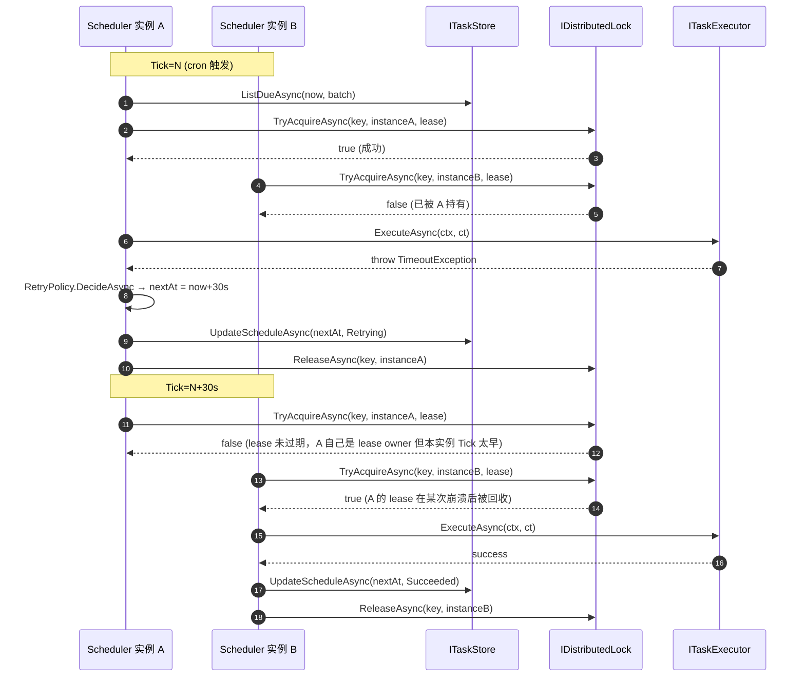

# Sim.Scheduling 通用调度基础库 — 设计基线

> 状态：基线设计；尚未实施。生产联调与增强项见第 19 节。
>
> 设计日期：2026-08-14
>
> 适用范围：所有 .NET 10（`net10.0`）项目，包括 ASP.NET Core / Worker Service / Console / WinForms / WPF / MAUI / 单元测试项目
>
> NuGet 形态：分层包，核心包 `Sim.Scheduling` 零三方依赖（仅 Cronos）；持久化、Hosting、健康检查分别独立可选包
>
> 结论：以 Cronos 作为 Cron 解析、以 `IHostedService` 与应用生命周期为托管形态、以 `ITaskStore` 抽象持久化、以 `ITaskExecutor` 与 `ITaskMiddleware` 抽象执行与横切，可同时支撑 B/S 高可用多活调度与 C/S 桌面单机调度；SimFramework 自身只是该库的一个消费方，集成层在 `docs/design/scheduling/SCHEDULE_TASK_SIMFRAMEWORK_INTEGRATION.md` 单独设计。

## 1. 目标与非目标

### 1.1 目标

1. **可移植**：被任何 .NET 10 项目引用，不强制依赖 ASP.NET Core、SqlSugar、EF Core、文件系统或特定数据库。
2. **分层 NuGet**：核心包只包含 BCL 抽象与纯 C# 实现；持久化、Hosting、HealthChecks 独立打包，使用者按需引入。
3. **B/S 与 C/S 同源**：同一套任务定义（`ITaskDefinition`）与执行器（`ITaskExecutor`）同时支撑 ASP.NET Core / Worker Service 和 WinForms / WPF / MAUI / Console。
4. **单机 / 集群自适应**：单实例自动跳过分布式抢锁；多实例通过 `ITaskStore` 暴露的乐观锁/悲观锁实现多活并行调度。
5. **Cron + 时区**：以 Cronos 作为唯一 Cron 解析器，原生支持时区、闰秒、夏令时边界。
6. **Misfire 三策略**：`Skip` / `RunOnce` / `RunAll`；与 Misfire 容忍窗口独立可配。
7. **节假日 Calendar**：可插拔的 `ICalendarProvider` 接口，内置 `Workday` / `Weekend` / `Custom` 三种实现，外部业务方可按需提供自定义源。
8. **失败退避重试**：内置 `ExponentialBackoffRetryPolicy`，支持抖动、`MaxRetryCount`、`RetryBaseSeconds` / `RetryMaxSeconds`。
9. **横切管道**：基于 `ITaskMiddleware` 的中间件管道（历史/超时/重试/异常翻译/日志作用域）由使用者自组装。
10. **可观测**：可选包 `Sim.Scheduling.HealthChecks` 提供 `IHealthCheck` 实现；核心包暴露 `SchedulerDiagnostics`（Counter / Histogram / Activity）。
11. **协议与 OpenTelemetry 友好**：核心包暴露 `System.Diagnostics.Metrics` 与 `System.Diagnostics.ActivitySource`，可由使用方接入 OpenTelemetry、Prometheus 或控制台。
12. **零依赖核心**：核心包 `Sim.Scheduling` 仅依赖 `Cronos`（MIT）与 BCL；满足信创审查对 Apache-2.0 / 商业依赖的严格要求。

### 1.2 非目标

- 不实现 Quartz 风格的 JobStore / Calendar `IntervalUnit` / `JobListener` 链 / 集群 check-in 协议；改用更简单的 `ITaskStore` + 乐观行锁 + `ITaskMiddleware` 管道。
- 不内置 ORM / 数据库驱动 / 消息队列 / 缓存；提供参考实现 + 接口约束，使用者按需替换。
- 不内置 Http 任务 / 命令任务 / ServiceMethod 任务的执行器；这些是消费方业务，由 SimFramework 集成层提供示例。
- 不实现跨进程长任务协调（Leader Election）；需要时由使用方在 `ITaskStore` 层加分布式锁，核心包不强制 Redis/ZooKeeper 依赖。
- 第一版不实现"任务编排 / DAG / 任务流"，仅支持独立任务触发。

## 2. 设计原则

### 2.1 核心原则

| 原则 | 含义 |
|------|------|
| **零强制三方依赖** | 核心包只依赖 `Cronos` + BCL；不引用 ASP.NET Core / Hosting / EF Core / SqlSugar / 任何文件 IO 库 |
| **接口与实现分离** | 核心包定义 `ITaskStore` / `ITaskExecutor` / `ITaskMiddleware` / `ICalendarProvider` / `IClock`；具体实现放在可选包 |
| **构造器模式配置** | 使用 `ISchedulingBuilder` 流式 API；`UseInMemoryStore()` / `UseSqlSugarStore(cs)` / `UseFileStore(path)` 互斥选择 |
| **AOT 友好** | 核心包启用 `PublishAot`；无反射热路径；`ITaskExecutor` 通过显式 `AddExecutor<T>()` 注册，DI 直接解析 |
| **线程安全** | `Scheduler` 内部状态全部使用不可变结构 + 锁；`ITaskStore` 接口要求实现方线程安全 |
| **取消一致** | 所有长操作接受 `CancellationToken`；与 `IHostApplicationLifetime` 联动 |
| **可测试** | 核心包提供 `FakeClock` / `InMemoryTaskStore`；`Scheduler` 单元可独立测 |

### 2.2 包依赖矩阵

```
                              ┌──────────────────────────────┐
                              │   Sim.Scheduling (core)      │
                              │   net10.0                    │
                              │   依赖: Cronos (MIT)         │
                              │   依赖: BCL only             │
                              └──────────────┬───────────────┘
                                             │
       ┌──────────────────┬──────────────────┼──────────────────┬──────────────────┐
       │                  │                  │                  │                  │
┌──────┴─────────┐ ┌───────┴──────┐ ┌────────┴──────────┐ ┌─────┴────────────┐ ┌──┴──────────────┐
│ .Hosting       │ │ .Health-     │ │ .Persistence.     │ │ .Persistence.    │ │ .Persistence.   │
│ net10.0        │ │   Checks     │ │   SqlSugar        │ │   EfCore         │ │   File          │
│ 依赖:          │ │ net10.0      │ │ net10.0           │ │ net10.0          │ │ net10.0         │
│ Microsoft.     │ │ 依赖:        │ │ 依赖:             │ │ 依赖:            │ │ 依赖:           │
│ Extensions.    │ │ Microsoft.   │ │ SqlSugarCore      │ │ Microsoft.       │ │ System.Text.Json│
│ Hosting.Abstr- │ │ Extensions.  │ │ (用户自选版本)     │ │ EntityFramework- │ │ (BCL)           │
│ actions        │ │ Diagnostics. │ │                   │ │ Core             │ │                 │
│ (ASP.NET Core) │ │ HealthChecks │ │                   │ │ (用户自选版本)   │ │                 │
└──────┬─────────┘ └──────┬───────┘ └────────┬──────────┘ └─────┬────────────┘ └───┬─────────────┘
       │                  │                  │                  │                  │
       │           ┌──────┴──────────────────┴──────────────────┴──────────────────┘
       │           │
┌──────┴───────────┴──────┐
│  Sim.Scheduling         │
│  .Persistence.InMemory  │  (test-only, 永远可选)
│  net10.0                │
└─────────────────────────┘

消费方（示例 / 集成层）：

┌─────────────────────────┐    ┌────────────────────────────────────┐
│ Sim.Scheduling.Sample   │    │ SimFramework 集成层                │
│ .AspNetCore             │    │ (Sim.System.Scheduling)            │
│ net10.0                 │    │ net10.0                            │
│ 依赖:                   │    │ 依赖:                               │
│  - Sim.Scheduling       │    │  - Sim.Scheduling                  │
│  - Sim.Scheduling       │    │  - Sim.Scheduling.Hosting          │
│    .Hosting             │    │  - Sim.Scheduling.HealthChecks     │
│  - Sim.Scheduling       │    │  - Sim.Scheduling.Persistence.     │
│    .HealthChecks        │    │    SqlSugar                        │
│  - Sim.Scheduling       │    │  - SqlSugarCore (项目内现成)        │
│    .Persistence.InMemory│    │  - Volo.Abp.* (项目内现成 2 个包)   │
└─────────────────────────┘    └────────────────────────────────────┘
```

## 3. 总体架构

### 3.1 核心组件图

```mermaid
flowchart TB
  subgraph "Sim.Scheduling (core, net10.0)"
    Builder["ISchedulingBuilder<br/>(fluent config)"]
    Scheduler["Scheduler<br/>(调度循环)"]
    Executor["TaskExecutorHost<br/>(执行器路由)"]
    Middleware["TaskPipeline<br/>(中间件链)"]
    Lock["TaskLockCoordinator<br/>(单机跳过/多机协调)"]
    Calendar["CalendarEvaluator<br/>(Calendar 评估)"]
    Misfire["MisfireResolver<br/>(Misfire 三策略)"]
    Retry["ExponentialBackoffRetryPolicy<br/>(退避重试)"]
    Clock["IClock (SystemClock/FakeClock)"]
    Cron["ICronExpression (Cronos)"]
    Diagnostics["SchedulerDiagnostics<br/>(Metrics + Activity)"]
  end

  subgraph "可插拔抽象 (core 暴露接口)"
    IStore["ITaskStore"]
    IExec["ITaskExecutor"]
    IMw["ITaskMiddleware"]
    ICal["ICalendarProvider"]
    ILock["IDistributedLock"]
  end

  subgraph "可选包 (按需引入)"
    Hosting["Sim.Scheduling.Hosting<br/>(IHostedService 适配)"]
    Health["Sim.Scheduling.HealthChecks"]
    SqlSugar["Sim.Scheduling.Persistence.SqlSugar"]
    EfCore["Sim.Scheduling.Persistence.EfCore"]
    File["Sim.Scheduling.Persistence.File"]
    InMemory["Sim.Scheduling.Persistence.InMemory"]
  end

  Builder --> Scheduler
  Scheduler --> Lock
  Scheduler --> Calendar
  Scheduler --> Misfire
  Scheduler --> Middleware
  Scheduler --> Executor
  Scheduler --> Diagnostics
  Executor --> IExec
  Middleware --> IMw
  Lock --> ILock
  Lock --> IStore
  Calendar --> ICal
  Misfire --> Cron
  Misfire --> Clock
  Retry --> Clock
  Scheduler --> IStore
  Scheduler --> Clock
  Scheduler --> Cron

  InMemory -.实现.-> IStore
  SqlSugar -.实现.-> IStore
  EfCore -.实现.-> IStore
  File -.实现.-> IStore
  Hosting -.适配.-> Scheduler
  Health -.适配.-> Scheduler
```



### 3.2 调度循环（核心伪代码）

```csharp
internal sealed class Scheduler
{
    public async Task RunAsync(CancellationToken stop)
    {
        while (!stop.IsCancellationRequested)
        {
            using var tickScope = _diagnostics.BeginTick();

            var now = _clock.UtcNow;
            var due = await _store.ListDueAsync(now, _options.BatchSize, stop);

            foreach (var task in due)
            {
                if (await _lock.TryAcquireAsync(task.Key, _instanceId, _options.LockLease, stop))
                {
                    // 抢锁成功 → 入队独立任务；继续抢下一个
                    _ = ExecuteTaskSafelyAsync(task, stop);
                }
                // 抢锁失败 → 跳过；其他实例在跑
            }

            await _clock.DelayAsync(_options.TickInterval, stop);
        }
    }

    private async Task ExecuteTaskSafelyAsync(ITaskDefinition task, CancellationToken stop)
    {
        var scope = _services.CreateScope();
        var ctx = new TaskExecutionContext(task, scope, _clock, _diagnostics, _instanceId);

        try
        {
            await _middlewarePipeline.InvokeAsync(ctx, () =>
                _executorHost.ExecuteAsync(ctx, stop), stop);

            // 成功 → 计算 NextRunTime（含 Calendar 校验 + Misfire 策略）+ 续写
            var next = await _resolver.NextRunTimeAsync(task, _clock.UtcNow, stop);
            await _store.UpdateScheduleAsync(task.Key, next, ScheduleState.Succeeded, stop);
        }
        catch (Exception ex)
        {
            // 决定重试 or 终态
            var decision = await _retryPolicy.DecideAsync(task, ex, _clock.UtcNow, stop);
            if (decision.ShouldRetry)
            {
                await _store.UpdateScheduleAsync(task.Key, decision.NextRunTime, ScheduleState.Retrying, stop);
            }
            else
            {
                await _store.UpdateScheduleAsync(task.Key, decision.NextRunTime, ScheduleState.Failed, stop);
                _diagnostics.RecordFailure(task.Key, ex);
            }
        }
        finally
        {
            await _lock.ReleaseAsync(task.Key, _instanceId, stop);
            await scope.DisposeAsync();
        }
    }
}
```

### 3.3 关键时序（多实例抢锁 + 失败重试）



## 4. 核心包 `Sim.Scheduling`

### 4.1 目录结构

```
src/Sim.Scheduling/
├── Sim.Scheduling.csproj            net10.0
├── Configuration/
│   ├── SchedulingOptions.cs
│   ├── ISchedulingBuilder.cs
│   ├── SchedulingBuilder.cs
│   └── ServiceCollectionExtensions.cs
├── Cron/
│   ├── ICronExpression.cs
│   ├── CronosCronExpression.cs
│   ├── CronParseException.cs
│   └── CronosCronExpressionFactory.cs
├── Time/
│   ├── IClock.cs
│   ├── SystemClock.cs
│   └── FakeClock.cs                 (test-only)
├── Calendar/
│   ├── ICalendarProvider.cs
│   ├── ICalendar.cs
│   ├── CalendarKey.cs
│   ├── BuiltinCalendars.cs
│   ├── WorkdayCalendar.cs
│   ├── WeekendCalendar.cs
│   ├── CustomCalendar.cs
│   └── CalendarEvaluator.cs
├── Lock/
│   ├── IDistributedLock.cs
│   ├── NoopDistributedLock.cs
│   └── InProcessSemaphoreLock.cs
├── Storage/
│   ├── ITaskStore.cs
│   ├── ITaskDefinition.cs
│   ├── TaskSnapshot.cs
│   ├── ScheduleState.cs
│   ├── TaskHistoryRecord.cs
│   ├── LockLease.cs
│   └── InMemoryTaskStore.cs          (test helper, 也对外暴露)
├── Misfire/
│   ├── MisfirePolicy.cs
│   └── MisfireResolver.cs
├── Retry/
│   ├── IRetryPolicy.cs
│   ├── ExponentialBackoffRetryPolicy.cs
│   ├── RetryDecision.cs
│   └── RetryContext.cs
├── Execution/
│   ├── ITaskExecutor.cs
│   ├── TaskExecutionContext.cs
│   ├── TaskExecutorHost.cs
│   ├── ExecutorDescriptor.cs
│   └── TaskTypeContract.cs
├── Middleware/
│   ├── ITaskMiddleware.cs
│   ├── TaskMiddlewareDelegate.cs
│   ├── TaskPipeline.cs
│   ├── HistoryMiddleware.cs
│   ├── TimeoutMiddleware.cs
│   ├── RetryMiddleware.cs
│   ├── ExceptionTranslationMiddleware.cs
│   ├── LogScopeMiddleware.cs
│   └── TaskPipelineBuilder.cs
├── Diagnostics/
│   ├── SchedulerDiagnostics.cs
│   ├── SchedulerMetrics.cs
│   ├── SchedulerActivitySource.cs
│   └── TaskOutcome.cs
├── Instance/
│   ├── IInstanceIdProvider.cs
│   ├── EnvironmentInstanceIdProvider.cs
│   └── DeterministicInstanceIdProvider.cs
├── Errors/
│   ├── SchedulingException.cs
│   ├── TaskNotFoundException.cs
│   ├── CronParseException.cs
│   └── SchedulingErrorCodes.cs
└── Internal/
    ├── Scheduler.cs
    ├── TaskCandidate.cs
    ├── TaskClock.cs
    └── TaskRunner.cs
```

### 4.2 公共接口（核心抽象）

#### 4.2.1 任务定义

```csharp
public interface ITaskDefinition
{
    string Key { get; }                                   // 唯一；如 "system.refresh-cache"
    string? Group { get; }                                // 可选分组；如 "System" / "Maintenance"
    string DisplayName { get; }
    string? Description { get; }
    string CronExpression { get; }
    string? TimeZoneId { get; }                           // null = UTC
    bool Enabled { get; }
    string TaskType { get; }                              // 用户自定义：Http/Command/ServiceMethod/Worker/...
    IReadOnlyDictionary<string, object?> Metadata { get; } // 类型相关参数；执行器按需解析
    string? CalendarKey { get; }
    string MisfirePolicy { get; }                         // "Skip" | "RunOnce" | "RunAll"
    int MisfireThresholdSeconds { get; }
    int MaxMisfireCatchup { get; }
    int MaxRetryCount { get; }
    int RetryBaseSeconds { get; }
    int RetryMaxSeconds { get; }
    int TimeoutSeconds { get; }                           // 单次执行硬超时
    string? LockToken { get; set; }                       // 调度器内部写回
    DateTimeOffset? LockedUntil { get; set; }
    DateTimeOffset NextRunTime { get; set; }
    DateTimeOffset? LastRunTime { get; set; }
    string LastOutcome { get; set; }
    int Attempt { get; set; }
}
```

#### 4.2.2 任务存储

```csharp
public interface ITaskStore
{
    Task<IReadOnlyList<ITaskDefinition>> ListAsync(CancellationToken ct);
    Task<IReadOnlyList<ITaskDefinition>> ListDueAsync(DateTimeOffset now, int limit, CancellationToken ct);

    /// <summary>
    /// 原子抢锁：仅当 (LockedUntil IS NULL OR LockedUntil &lt; now) 时把 LockToken 设为 instanceId、
    /// LockedUntil 设为 now+lease，返回 true；否则返回 false。
    /// </summary>
    Task<bool> TryAcquireAsync(string key, string instanceId, TimeSpan lease, CancellationToken ct);

    /// <summary>
    /// 续租：仅当 LockToken 仍为 instanceId 时延长 lease；返回 false 说明锁已丢失。
    /// </summary>
    Task<bool> RenewAsync(string key, string instanceId, TimeSpan lease, CancellationToken ct);

    Task ReleaseAsync(string key, string instanceId, CancellationToken ct);

    Task UpdateScheduleAsync(
        string key,
        DateTimeOffset nextRunTime,
        string outcome,
        int attempt,
        CancellationToken ct);

    Task AppendHistoryAsync(TaskHistoryRecord record, CancellationToken ct);
    Task<IReadOnlyList<TaskHistoryRecord>> ListHistoryAsync(string key, int skip, int take, CancellationToken ct);

    /// <summary>
    /// 健康检查：检查连接、查询响应时间、最近写入时间。
    /// </summary>
    Task<TaskStoreHealth> CheckHealthAsync(CancellationToken ct);
}

public sealed record TaskStoreHealth(
    bool IsHealthy,
    string? Description,
    TimeSpan Latency,
    DateTimeOffset? LastWriteAt);
```

#### 4.2.3 执行器

```csharp
public interface ITaskExecutor
{
    /// <summary>
    /// 与 ITaskDefinition.TaskType 一一对应。
    /// </summary>
    string TaskType { get; }

    /// <summary>
    /// 抛 OperationCanceledException 表示取消；
    /// 抛任意 Exception 表示业务失败（由 RetryPolicy 决定是否重试）。
    /// </summary>
    Task ExecuteAsync(TaskExecutionContext context, CancellationToken cancellationToken);
}

public sealed class TaskExecutionContext
{
    public ITaskDefinition Task { get; }
    public IServiceProvider ScopeServices { get; }    // 独立 DI scope
    public IClock Clock { get; }
    public IInstanceIdProvider Instance { get; }
    public ILogger Logger { get; }
    public CancellationToken CancellationToken { get; }
    public IReadOnlyDictionary<string, object?> Metadata => Task.Metadata;
    public T? GetMetadata<T>(string key) where T : class => ...;

    public TaskHistoryRecord CreateHistoryRecord(string status) => ...;
    public void RecordWarning(string message) => ...;
}
```

#### 4.2.4 中间件

```csharp
public delegate Task TaskMiddlewareDelegate(CancellationToken cancellationToken);

public interface ITaskMiddleware
{
    Task InvokeAsync(
        TaskExecutionContext context,
        TaskMiddlewareDelegate next,
        CancellationToken cancellationToken);
}
```

#### 4.2.5 Calendar

```csharp
public interface ICalendar
{
    string Key { get; }
    bool ShouldSkip(DateOnly date);            // true = 该日期不触发
    bool ShouldForce(DateOnly date);           // true = 即便默认不触发也强制触发（如 WorkdayOverride）
}

public interface ICalendarProvider
{
    Task<ICalendar?> GetAsync(string? key, CancellationToken ct);
}
```

#### 4.2.6 分布式锁

```csharp
public interface IDistributedLock
{
    /// <summary>
    /// 返回 true 表示本进程成功持有锁；false 表示锁被其他实例持有。
    /// </summary>
    Task<bool> TryAcquireAsync(string key, string instanceId, TimeSpan lease, CancellationToken ct);

    Task<bool> RenewAsync(string key, string instanceId, TimeSpan lease, CancellationToken ct);

    Task ReleaseAsync(string key, string instanceId, CancellationToken ct);
}
```

> 核心包提供 `NoopDistributedLock`（永远成功，单机用）与 `InProcessSemaphoreLock`（同进程内互斥），数据库/Redis 分布式锁由 `ITaskStore` 自身实现抢锁接口，无需单独的 `IDistributedLock` 实现。
> 接口保留是为多实例在同一进程内运行多个 Scheduler 时的并发保护。

#### 4.2.7 时钟

```csharp
public interface IClock
{
    DateTimeOffset UtcNow { get; }
    Task DelayAsync(TimeSpan delay, CancellationToken ct);
}

public sealed class SystemClock : IClock { ... }
public sealed class FakeClock : IClock       // 测试用；可手动推进时间
{
    public DateTimeOffset UtcNow { get; set; }
    public Task DelayAsync(TimeSpan delay, CancellationToken ct) => Task.CompletedTask;
}
```

#### 4.2.8 Cron

```csharp
public interface ICronExpression
{
    DateTimeOffset GetNextOccurrence(DateTimeOffset fromUtc, TimeZoneInfo? timeZone);
    bool IsValid { get; }
    string Original { get; }
}

public sealed class CronosCronExpression : ICronExpression { ... }
```

#### 4.2.9 实例 ID

```csharp
public interface IInstanceIdProvider
{
    string InstanceId { get; }
}

public sealed class EnvironmentInstanceIdProvider : IInstanceIdProvider
{
    // 优先：SIM_INSTANCE_ID 环境变量
    // 兜底：Environment.MachineName + 进程 ID
}
```

### 4.3 调度循环

#### 4.3.1 调度器入口

```csharp
public sealed class Scheduler : IAsyncDisposable
{
    public Task StartAsync(CancellationToken ct);
    public Task StopAsync(CancellationToken ct);
    public ValueTask DisposeAsync();
}
```

实现内部维护：
- `Task _runLoop`：调度循环主协程
- `Channel<TaskCandidate> _executionChannel`：BoundedChannel，控制并发度
- `List<Task> _inFlight`：in-flight 任务句柄，关闭时统一等待/取消
- `IInstanceIdProvider _instance`：当前实例 ID

#### 4.3.2 调度循环步骤

```
while (!stop) {
  1. now = clock.UtcNow
  2. due = store.ListDueAsync(now, batchSize, stop)
  3. for each task in due:
       - if (await store.TryAcquireAsync(task.Key, instanceId, lease, stop))
         - executionChannel.Writer.TryWrite(candidate)
       - else
         - diagnostics.RecordContended(task.Key)  // 抢锁失败
  4. await clock.DelayAsync(tickInterval, stop)
}
```

执行消费者（`TaskRunner`）：
```
while (await reader.WaitToReadAsync(stop)) {
  while (reader.TryRead(out var candidate)) {
    using var scope = services.CreateScope();
    var ctx = new TaskExecutionContext(candidate.Task, scope, ...);
    try {
      await pipeline.InvokeAsync(ctx, () => executorHost.ExecuteAsync(ctx, stop), stop);
      var next = await misfireResolver.NextRunTimeAsync(candidate.Task, now, stop);
      await store.UpdateScheduleAsync(candidate.Task.Key, next, "Succeeded", 0, stop);
    } catch (OperationCanceledException) when (candidate.Task.Attempt < candidate.Task.MaxRetryCount) {
      // 重试
    } catch (Exception ex) {
      var decision = retryPolicy.Decide(candidate.Task, ex, now);
      await store.UpdateScheduleAsync(candidate.Task.Key, decision.NextRunTime, decision.Outcome, decision.NextAttempt, stop);
    } finally {
      await store.ReleaseAsync(candidate.Task.Key, instanceId, CancellationToken.None);
      scope.Dispose();
    }
  }
}
```

#### 4.3.3 长任务续租

执行 > 30s 时，调度器启动一个 `RenewLoop(candidate, lease)` 后台协程，每 `lease/3` 时间尝试 `store.RenewAsync`。续租失败时：
1. 调度器认定自己已失去锁；
2. 调用 `ctx.CancellationTokenSource.Cancel()`；
3. 任务在收到取消后应尽快退出（由中间件 `TimeoutMiddleware` 保障）；
4. 写历史 `Status=Cancelled`、`TriggerType=LockLost`；
5. 写回 `LastOutcome="LockLost"`。

### 4.4 配置文件

`SchedulingOptions`：

```csharp
public sealed class SchedulingOptions
{
    public const string SectionName = "Scheduling";

    public TimeSpan TickInterval { get; set; } = TimeSpan.FromSeconds(1);
    public int BatchSize { get; set; } = 32;
    public int MaxConcurrentTasks { get; set; } = 32;
    public TimeSpan LockLease { get; set; } = TimeSpan.FromSeconds(60);
    public TimeSpan LockRenewThreshold { get; set; } = TimeSpan.FromSeconds(30);
    public TimeSpan ShutdownGrace { get; set; } = TimeSpan.FromSeconds(30);
    public bool EnableDiagnostics { get; set; } = true;
    public string InstanceId { get; set; } = "auto";   // auto = EnvironmentInstanceIdProvider
    public LogLevel LogLevel { get; set; } = LogLevel.Information;
}
```

### 4.5 流式 Builder

```csharp
public interface ISchedulingBuilder
{
    ISchedulingBuilder UseClock(IClock clock);
    ISchedulingBuilder UseCronExpressionFactory(Func<string, ICronExpression> factory);
    ISchedulingBuilder UseInMemoryStore();
    ISchedulingBuilder UseStore<TStore>() where TStore : class, ITaskStore;
    ISchedulingBuilder UseStore(ITaskStore store);

    ISchedulingBuilder AddExecutor<TExecutor>() where TExecutor : class, ITaskExecutor;
    ISchedulingBuilder AddExecutor(ITaskExecutor executor);

    ISchedulingBuilder AddMiddleware<TMiddleware>() where TMiddleware : class, ITaskMiddleware;
    ISchedulingBuilder AddMiddleware(ITaskMiddleware middleware);

    ISchedulingBuilder AddCalendar(ICalendar calendar);
    ISchedulingBuilder AddCalendarProvider<TProvider>() where TProvider : class, ICalendarProvider;

    ISchedulingBuilder AddWorkerProvider<TProvider>() where TProvider : class, IWorkerProvider;

    ISchedulingBuilder UseRetryPolicy<TPolicy>() where TPolicy : class, IRetryPolicy;
    ISchedulingBuilder UseRetryPolicy(IRetryPolicy policy);

    ISchedulingBuilder ConfigureOptions(Action<SchedulingOptions> configure);

    IServiceCollection Services { get; }
}
```

### 4.6 DI 注册（核心包）

```csharp
public static class ServiceCollectionExtensions
{
    public static IServiceCollection AddScheduling(
        this IServiceCollection services,
        Action<ISchedulingBuilder> configure)
    {
        var builder = new SchedulingBuilder(services);
        configure(builder);
        builder.Build();  // 校验 + 兜底注册
        return services;
    }
}
```

### 4.7 错误码

```csharp
public static class SchedulingErrorCodes
{
    public const string CronParseFailed         = "Scheduling:CronParseFailed";
    public const string TaskNotFound            = "Scheduling:TaskNotFound";
    public const string TaskTypeNotRegistered   = "Scheduling:TaskTypeNotRegistered";
    public const string CalendarNotFound        = "Scheduling:CalendarNotFound";
    public const string StoreUnavailable        = "Scheduling:StoreUnavailable";
    public const string LockContended           = "Scheduling:LockContended";
    public const string InvalidMisfirePolicy    = "Scheduling:InvalidMisfirePolicy";
    public const string MaxMisfireCatchupExceeded = "Scheduling:MaxMisfireCatchupExceeded";
}
```

### 4.8 诊断

```csharp
public static class SchedulerMetrics
{
    public static readonly Meter Meter = new("Sim.Scheduling", "1.0.0");
    public static readonly Counter<long> TasksExecuted = Meter.CreateCounter<long>("sim_scheduling_tasks_executed_total");
    public static readonly Counter<long> TasksFailed = Meter.CreateCounter<long>("sim_scheduling_tasks_failed_total");
    public static readonly Counter<long> TasksRetried = Meter.CreateCounter<long>("sim_scheduling_tasks_retried_total");
    public static readonly Counter<long> TasksSkipped = Meter.CreateCounter<long>("sim_scheduling_tasks_skipped_total");
    public static readonly Counter<long> LockContended = Meter.CreateCounter<long>("sim_scheduling_lock_contended_total");
    public static readonly Histogram<double> TickDurationMs = Meter.CreateHistogram<double>("sim_scheduling_tick_duration_ms");
    public static readonly Histogram<double> TaskDurationMs = Meter.CreateHistogram<double>("sim_scheduling_task_duration_ms");
}

public static class SchedulerActivitySource
{
    public static readonly ActivitySource Source = new("Sim.Scheduling", "1.0.0");
}
```

Activity 名称：
- `Sim.Scheduling.Tick`
- `Sim.Scheduling.Execute` (Tag: `task.key`, `task.type`, `task.attempt`)
- `Sim.Scheduling.AcquireLock` (Tag: `task.key`, `instance.id`, `outcome`)

## 5. 持久化包

### 5.1 `Sim.Scheduling.Persistence.InMemory`

`InMemoryTaskStore` + `InMemoryCalendarProvider`，纯内存实现，主要用于：
- 单元测试
- 临时内存场景
- 桌面应用单实例（重启即丢失，可选快照到本地）

线程安全：`ConcurrentDictionary` + `SemaphoreSlim`。

### 5.2 `Sim.Scheduling.Persistence.File`

`FileTaskStore` 与 `FileCalendarProvider`，把 `ITaskDefinition` 序列化为 JSON 持久化到本地目录：

```
%APPDATA%/Sim.Scheduling/
├── tasks/
│   ├── system.refresh-cache.json
│   └── maintenance.daily-cleanup.json
├── history/
│   └── 2026-08-14.jsonl
└── calendars/
    ├── builtin:workday.json
    └── builtin:weekend.json
```

线程安全：每文件 `SemaphoreSlim`，写入采用 `WriteAllText` 原子替换。
崩溃恢复：启动时扫描 `tasks/`，重算 `NextRunTime`。
AOT 友好：使用 `System.Text.Json` 源生成器。

### 5.3 `Sim.Scheduling.Persistence.SqlSugar`

`SqlSugarTaskStore` 与 `SqlSugarCalendarProvider`，把 `ITaskDefinition` 适配到任意 SqlSugar 支持的数据库（含国产库）。

```csharp
public sealed class SqlSugarTaskStore : ITaskStore
{
    public SqlSugarTaskStore(ISqlSugarClient client, IClock clock) { ... }

    public async Task<bool> TryAcquireAsync(string key, string instanceId, TimeSpan lease, CancellationToken ct)
    {
        var now = _clock.UtcNow;
        var leaseUntil = now + lease;
        // UPDATE sim_scheduling_task
        //    SET lock_token = @instanceId,
        //        locked_until = @leaseUntil
        //  WHERE key = @key
        //    AND (locked_until IS NULL OR locked_until < @now)
        var rows = await _client.Updateable<SchedulingTaskEntity>()
            .SetColumns(t => new SchedulingTaskEntity
            {
                LockToken = instanceId,
                LockedUntil = leaseUntil
            })
            .Where(t => t.Key == key && (t.LockedUntil == null || t.LockedUntil < now))
            .ExecuteCommandAsync();
        return rows == 1;
    }
}
```

实体（**仅在 SqlSugar 包内部定义**，**不暴露给核心包**）：

```csharp
[SugarTable("sim_scheduling_task")]
public sealed class SchedulingTaskEntity
{
    [SugarColumn(IsPrimaryKey = true, Length = 256)] public string Key { get; set; } = string.Empty;
    [SugarColumn(Length = 64)] public string? Group { get; set; }
    [SugarColumn(Length = 256)] public string DisplayName { get; set; } = string.Empty;
    [SugarColumn(Length = 1024)] public string? Description { get; set; }
    [SugarColumn(Length = 128)] public string CronExpression { get; set; } = string.Empty;
    [SugarColumn(Length = 64)] public string? TimeZoneId { get; set; }
    public bool Enabled { get; set; }
    [SugarColumn(Length = 64)] public string TaskType { get; set; } = string.Empty;
    [SugarColumn(ColumnDataType = StaticConfig.CodeFirst_BigString)] public string MetadataJson { get; set; } = "{}";
    [SugarColumn(Length = 64)] public string? CalendarKey { get; set; }
    [SugarColumn(Length = 16)] public string MisfirePolicy { get; set; } = "Skip";
    public int MisfireThresholdSeconds { get; set; }
    public int MaxMisfireCatchup { get; set; }
    public int MaxRetryCount { get; set; }
    public int RetryBaseSeconds { get; set; }
    public int RetryMaxSeconds { get; set; }
    public int TimeoutSeconds { get; set; }
    public DateTimeOffset NextRunTime { get; set; }
    public DateTimeOffset? LastRunTime { get; set; }
    [SugarColumn(Length = 32)] public string LastOutcome { get; set; } = "Idle";
    public int Attempt { get; set; }
    [SugarColumn(Length = 128)] public string? LockToken { get; set; }
    public DateTimeOffset? LockedUntil { get; set; }
    [SugarColumn(IsNullable = false)] public DateTimeOffset CreatedAt { get; set; }
    [SugarColumn(IsNullable = true)]  public DateTimeOffset? UpdatedAt { get; set; }
}
```

### 5.4 `Sim.Scheduling.Persistence.EfCore`

`EfCoreTaskStore` 与 `EfCoreCalendarProvider`，使用 EF Core 抽象（`DbSet<T>` + LINQ），覆盖更广的生态。

实体（包内定义）：
```csharp
public sealed class SchedulingTaskEntity
{
    public string Key { get; set; } = string.Empty;
    // ... 同上结构
}
```

DbContext 由使用方提供（包内不强制使用具体 DbContext）：

```csharp
services.AddScheduling(b => b
    .UseStore(sp => new EfCoreTaskStore(sp.GetRequiredService<MyDbContext>(), sp.GetRequiredService<IClock>())));
```

### 5.5 选型决策树

```
是否需要持久化？
├── 否 → InMemoryTaskStore
└── 是
    ├── 已有 ORM？
    │   ├── SqlSugar → SqlSugarTaskStore
    │   ├── EF Core → EfCoreTaskStore
    │   └── 其它（NHibernate / Dapper / 自研）→ 实现 ITaskStore
    └── 桌面无数据库？
        └── FileTaskStore（JSON）
```

## 6. Hosting 包 `Sim.Scheduling.Hosting`

### 6.1 适配

```csharp
public sealed class SchedulerHostedService : IHostedService
{
    public Task StartAsync(CancellationToken cancellationToken)
    {
        // 启动 scheduler；与 IHostApplicationLifetime.ApplicationStopping 联动
    }

    public Task StopAsync(CancellationToken cancellationToken)
    {
        // 等待 in-flight 任务直到 ShutdownGrace
    }
}
```

### 6.2 DI 扩展

```csharp
public static class ServiceCollectionExtensions
{
    public static IServiceCollection AddSchedulingHostedService(
        this IServiceCollection services,
        Action<SchedulingOptions>? configure = null)
    {
        services.Configure<SchedulingOptions>(o =>
        {
            configure?.Invoke(o);
        });
        services.AddHostedService<SchedulerHostedService>();
        return services;
    }
}
```

### 6.3 启动约定

| 阶段 | 行为 |
|------|------|
| 应用启动 | `SchedulerHostedService.StartAsync` → 校验 store / 加载任务 / 启动调度循环 |
| Tick | 每 `TickInterval` 扫描一次 |
| 应用停止 | `SchedulerHostedService.StopAsync` → 停止 Tick 接收 → 等待 `ShutdownGrace` → 取消 in-flight 任务 |
| 异常 | 任何 store / 锁调用异常进入 diagnostics 计数器；调度器继续运行；连续 N 次失败进入 `Degraded` 状态 |

## 7. 健康检查包 `Sim.Scheduling.HealthChecks`

### 7.1 适配

```csharp
public sealed class SchedulerHealthCheck : IHealthCheck
{
    public async Task<HealthCheckResult> CheckHealthAsync(
        HealthCheckContext context,
        CancellationToken cancellationToken = default)
    {
        var scheduler = ...;  // 从 DI 拿
        var storeHealth = await scheduler.CheckStoreHealthAsync(cancellationToken);
        var diagnostics = scheduler.GetDiagnosticsSnapshot();

        if (!storeHealth.IsHealthy) return Unhealthy(storeHealth.Description);
        if (diagnostics.LastTickDuration > TimeSpan.FromSeconds(5)) return Degraded("Tick slow");
        if (diagnostics.ConsecutiveTickFailures >= 3) return Degraded("Tick 连续失败");
        return Healthy();
    }
}
```

### 7.2 DI 扩展

```csharp
public static class HealthChecksBuilderExtensions
{
    public static IHealthChecksBuilder AddScheduling(
        this IHealthChecksBuilder builder,
        string name = "scheduling",
        HealthStatus? failureStatus = HealthStatus.Unhealthy,
        IEnumerable<string>? tags = null)
    {
        return builder.AddCheck<SchedulerHealthCheck>(name, failureStatus, tags);
    }
}
```

## 8. Cron 解析与时区

### 8.1 Cronos 适配

`CronosCronExpression` 包装 Cronos 的 `CronExpression.Parse`：

```csharp
public sealed class CronosCronExpression : ICronExpression
{
    private readonly Cronos.CronExpression _inner;
    public bool IsValid => _inner != null;
    public string Original => _inner.ToString();

    public DateTimeOffset GetNextOccurrence(DateTimeOffset fromUtc, TimeZoneInfo? timeZone)
    {
        var zone = timeZone ?? TimeZoneInfo.Utc;
        return _inner.GetNextOccurrence(fromUtc.UtcDateTime, zone, fromInclusive: false);
    }

    public static ICronExpression Parse(string expression)
    {
        try
        {
            var inner = Cronos.CronExpression.Parse(expression);
            return new CronosCronExpression(inner, expression);
        }
        catch (Cronos.CronFormatException ex)
        {
            throw new CronParseException(expression, ex);
        }
    }
}
```

### 8.2 时区策略

- 任务定义中的 `TimeZoneId` 默认 `null`（= UTC）。
- 多实例部署在不同时区时，**所有实例必须用同一时区**或全部 UTC，否则会重复触发。
- 文档明确要求：使用 `TimeZoneId` 时，所有实例的操作系统时区无关紧要；以 `TimeZoneId` 为准。

## 9. Calendar 节假日

### 9.1 内置 Calendar

| Key | 类型 | 行为 |
|-----|------|------|
| `builtin:workday` | Workday | 周末跳过；命中 `WorkdayOverride` 强制触发；命中 `Holiday` 跳过 |
| `builtin:weekend` | Weekend | 仅周末触发；命中 `Holiday` / `WorkdayOverride` 跳过 |
| `builtin:none` | None | 永远不跳过（默认） |

### 9.2 自定义 Calendar

```csharp
public sealed class ChineseHolidayCalendar : ICalendar
{
    public string Key => "custom:cn-holiday";
    private readonly HashSet<DateOnly> _holidays;

    public bool ShouldSkip(DateOnly date) => _holidays.Contains(date);
    public bool ShouldForce(DateOnly date) => false;
}
```

注册：`builder.AddCalendar(new ChineseHolidayCalendar())`。

### 9.3 数据源

Calendar 数据由使用方提供：
- **手动维护**：后台管理界面（消费方实现）
- **配置注入**：`builder.AddCalendar(...)` 在启动时注册
- **外部源**：实现 `ICalendarProvider` 从数据库 / API 拉取

第一版不内置任何中国法定节假日；使用者按需扩展。

## 10. Misfire 与重试

### 10.1 Misfire 策略

| 策略 | 行为 | 适用 |
|------|------|------|
| `Skip` | 过期即跳过本次；`NextRunTime` 推进到下一周期 | 大多数任务；防止雪崩 |
| `RunOnce` | 立即补跑一次；`NextRunTime` 推进到下一周期 | 关键同步任务 |
| `RunAll` | 补齐到当前所有未触发周期（最多 `MaxMisfireCatchup` 个）；按顺序执行 | 业务对账 |

Misfire 触发条件：`now - NextRunTime > MisfireThresholdSeconds`。

### 10.2 重试退避

```csharp
public sealed class ExponentialBackoffRetryPolicy : IRetryPolicy
{
    public RetryDecision Decide(ITaskDefinition task, Exception ex, DateTimeOffset now)
    {
        if (task.Attempt >= task.MaxRetryCount)
            return RetryDecision.Terminal("MaxRetryCountReached");

        var baseDelay = TimeSpan.FromSeconds(task.RetryBaseSeconds);
        var maxDelay = TimeSpan.FromSeconds(task.RetryMaxSeconds);
        var delaySeconds = baseDelay.TotalSeconds * Math.Pow(2, task.Attempt);
        var capped = Math.Min(delaySeconds, maxDelay.TotalSeconds);
        var jittered = capped * (1 + Random.Shared.NextDouble() * 0.1);
        return RetryDecision.Retry(now + TimeSpan.FromSeconds(jittered));
    }
}
```

## 11. 中间件管道

### 11.1 内置中间件

| 名称 | 顺序 | 职责 |
|------|------|------|
| `HistoryMiddleware` | 1 | 写 `Running` 历史 / 回写终态 |
| `TimeoutMiddleware` | 2 | `CancellationTokenSource` 包装 `TimeoutSeconds` |
| `RetryMiddleware` | 3 | 失败时按 RetryPolicy 调度重试 |
| `ExceptionTranslationMiddleware` | 4 | `OperationCanceledException` → `Status=Timeout/Cancelled` |
| `LogScopeMiddleware` | 5 | `BeginScope` 携带 `TaskKey / TaskId / Attempt / InstanceId` |

### 11.2 管道构建

```csharp
public sealed class TaskPipelineBuilder
{
    private readonly List<Func<TaskMiddlewareDelegate, TaskMiddlewareDelegate>> _components = new();

    public TaskPipelineBuilder Use<TMiddleware>() where TMiddleware : class, ITaskMiddleware;
    public TaskPipelineBuilder Use(Func<TaskExecutionContext, TaskMiddlewareDelegate, Task> component);
    public TaskMiddlewareDelegate Build(IServiceProvider sp, TaskMiddlewareDelegate terminal);
}
```

## 12. 集群与锁

### 12.1 抢锁接口

抢锁由 `ITaskStore.TryAcquireAsync` 实现，核心包只定义契约。

### 12.2 锁租约与续租

| 参数 | 默认 | 含义 |
|------|------|------|
| `LockLease` | 60s | 单次抢锁的租约时长 |
| `LockRenewThreshold` | 30s | 任务执行超过此值时启动续租循环 |
| `MaxRetryCount` | 0 | 业务级重试；与锁续租无关 |

### 12.3 续租失败兜底

- 任务执行过程中检测到 `RenewAsync` 返回 false → 立即 `ctx.Cancel()`；
- 中间件 `ExceptionTranslationMiddleware` 把 `OperationCanceledException` 翻译为 `Status=Cancelled` / `TriggerType=LockLost`；
- 不再写 `Succeeded` / `Failed`，避免业务执行被截断但被判定为成功。

## 13. 跨包版本兼容策略

### 13.1 SemVer 策略

- 核心包 `Sim.Scheduling` 采用 `MAJOR.MINOR.PATCH`：
  - `MAJOR`：破坏性接口变更（如 `ITaskStore` 增删方法）；
  - `MINOR`：向后兼容的新增（如新中间件、新 Calendar 类型）；
  - `PATCH`：Bug 修复。
- 持久化包、Hosting 包、HealthChecks 包独立版本号，但与核心包通过 `[CoreMinVersion]` 元数据标注最低兼容版本。

### 13.2 AOT 兼容

- 所有公开接口避免反射（`ITaskExecutor.TaskType` 是字符串匹配，不是类型反射）；
- JSON 序列化使用 `System.Text.Json` 源生成器；
- `Sim.Scheduling.csproj` 启用 `<IsAotCompatible>true</IsAotCompatible>` 并 CI 验证。

### 13.3 多目标

第一版只支持 `net10.0`；后续按社区反馈考虑 `net8.0` LTS。

## 14. 使用示例

### 14.1 ASP.NET Core（B/S，集群）

```csharp
// Program.cs
var builder = WebApplication.CreateBuilder(args);

builder.Services.AddScheduling(s => s
    .ConfigureOptions(o => o
    {
        o.TickInterval = TimeSpan.FromSeconds(1);
        o.MaxConcurrentTasks = 32;
    })
    .UseSqlSugarStore(connectionString)         // Sim.Scheduling.Persistence.SqlSugar
    .AddExecutor<HttpTaskExecutor>("Http")      // 用户实现的 HttpTaskExecutor
    .AddExecutor<CommandTaskExecutor>("Command")
    .AddExecutor<ServiceMethodExecutor>("ServiceMethod")
    .AddWorkerProvider<MyWorkerProvider>()
    .UseRetryPolicy<ExponentialBackoffRetryPolicy>()
    .AddMiddleware<LogScopeMiddleware>()
    .AddMiddleware<HistoryMiddleware>()
    .AddMiddleware<TimeoutMiddleware>()
    .AddMiddleware<RetryMiddleware>()
    .AddMiddleware<ExceptionTranslationMiddleware>()
    .AddCalendar(new ChineseHolidayCalendar("custom:cn-holiday")));

builder.Services.AddSchedulingHostedService();
builder.Services.AddHealthChecks().AddScheduling();

var app = builder.Build();
app.Run();
```

### 14.2 Worker Service（控制台型 B/S）

```csharp
// Program.cs
var builder = Host.CreateApplicationBuilder(args);

builder.Services.AddScheduling(s => s
    .UseSqlSugarStore(connectionString)
    .AddExecutor<DailyReportExecutor>("DailyReport"));

builder.Services.AddSchedulingHostedService();

var host = builder.Build();
await host.RunAsync();
```

### 14.3 Console（CLI 工具）

```csharp
// Program.cs
var services = new ServiceCollection();
services.AddLogging(b => b.AddConsole());
services.AddScheduling(s => s
    .UseInMemoryStore()
    .AddExecutor<HelloWorldExecutor>("HelloWorld")
    .AddCronTask("HelloWorld", "0/5 * * * * ?"));

await using var sp = services.BuildServiceProvider();
var scheduler = sp.GetRequiredService<Scheduler>();

using var cts = new CancellationTokenSource();
Console.CancelKeyPress += (_, e) => { e.Cancel = true; cts.Cancel(); };

await scheduler.StartAsync(cts.Token);
await Task.Delay(Timeout.Infinite, cts.Token);
await scheduler.StopAsync(CancellationToken.None);
```

### 14.4 WinForms（桌面 C/S）

```csharp
// Program.cs
[STAThread]
static async Task Main()
{
    Application.SetHighDpiMode(HighDpiMode.SystemAware);
    Application.EnableVisualStyles();
    Application.SetCompatibleTextRenderingDefault(false);

    var services = new ServiceCollection();
    services.AddLogging(b => b.AddDebug());
    services.AddScheduling(s => s
        .UseFileStore(Path.Combine(
            Environment.GetFolderPath(Environment.SpecialFolder.LocalApplicationData),
            "Sim.Scheduling"))
        .AddExecutor<RefreshCacheExecutor>("RefreshCache")
        .AddCronTask("RefreshCache", "0 0/5 * * * ?"));

    await using var sp = services.BuildServiceProvider();
    var scheduler = sp.GetRequiredService<Scheduler>();
    await scheduler.StartAsync();

    // 把 scheduler 注入 MainForm
    var mainForm = new MainForm(scheduler, sp);
    Application.Run(mainForm);

    await scheduler.StopAsync();
}
```

### 14.5 MAUI / WPF

同 WinForms，区别只是 `Application.Run` → `Application.Run` 或 `MainWindow.Show()`。

### 14.6 单元测试

```csharp
[Fact]
public async Task Task_runs_at_scheduled_time()
{
    var clock = new FakeClock { UtcNow = new DateTimeOffset(2026, 8, 14, 0, 0, 0, TimeSpan.Zero) };
    var store = new InMemoryTaskStore();
    await store.UpsertAsync(new TaskDefinition
    {
        Key = "test",
        CronExpression = "0/1 * * * * ?",
        Enabled = true,
        TaskType = "Hello",
    });

    var executed = new TaskCompletionSource();
    var executor = new TestExecutor("Hello", () => executed.TrySetResult());

    var services = new ServiceCollection();
    services.AddLogging();
    services.AddScheduling(s => s
        .UseClock(clock)
        .UseStore(store)
        .AddExecutor(executor));

    await using var sp = services.BuildServiceProvider();
    var scheduler = sp.GetRequiredService<Scheduler>();
    await scheduler.StartAsync();

    clock.UtcNow = clock.UtcNow.AddSeconds(1);
    await clock.AdvanceAsync(TimeSpan.FromSeconds(2));

    await executed.Task.WaitAsync(TimeSpan.FromSeconds(5));
    await scheduler.StopAsync();
}
```

## 15. 测试计划

### 15.1 单元测试（`tests/Sim.Scheduling.Tests`）

- `CronExpressionTests`：基本表达式、时区、DST 切换、闰年、错误格式；
- `MisfireResolverTests`：Skip / RunOnce / RunAll 三策略与 `MisfireThresholdSeconds` 边界；
- `ExponentialBackoffRetryPolicyTests`：退避公式、抖动范围、达到 `MaxRetryCount` 终止；
- `InMemoryTaskStoreTests`：ListDue、TryAcquire 并发、Renew、Release、UpdateSchedule；
- `SchedulerTests`：Tick 触发、Calendar 跳过、抢锁失败跳过、续租失败取消、ShutdownGrace；
- `TaskPipelineTests`：中间件顺序、异常传递、`OperationCanceledException` 翻译；
- `CalendarEvaluatorTests`：3 个内置 Calendar + 自定义 Calendar。

### 15.2 集成测试（`tests/Sim.Scheduling.IntegrationTests`）

- `SqlSugarTaskStoreTests`：在 SQLite 内存库跑全部接口；
- `EfCoreTaskStoreTests`：用 InMemory provider 跑；
- `FileTaskStoreTests`：临时目录 + 崩溃恢复；
- `HostingTests`：WebApplicationFactory + SchedulerHostedService 启动/停止；
- `HealthCheckTests`：Healthy / Degraded / Unhealthy 三态切换。

### 15.3 多实例场景（`tests/Sim.Scheduling.MultiInstance.Tests`）

- docker-compose 启动 3 个实例 + PostgreSQL；
- 配置 1 个 `*/1 * * * * ?` 任务，观察 5 分钟内：
  - 每次触发只有 1 个实例执行；
  - 杀掉持有锁的实例，剩余实例在 `LockedUntil` 过期后接管；
- 配置 `RunOnce` Misfire：把系统时间快进 1 小时，验证只补跑 1 次；
- 配置 `RunAll` Misfire：快进 10 个周期，验证只补齐 `MaxMisfireCatchup` 个。

### 15.4 端到端示例

- `samples/Sim.Scheduling.Sample.AspNetCore`：最小可运行 ASP.NET Core 项目；
- `samples/Sim.Scheduling.Sample.WinForms`：WinForms 项目演示 FileTaskStore；
- `samples/Sim.Scheduling.Sample.Maui`：MAUI 项目（iOS/Android 兼容性测试）；
- `samples/Sim.Scheduling.Sample.Console`：CLI 工具演示。

### 15.5 性能 / 稳定性

- 1000 条任务、Tick=1s、每条平均 100ms：CPU < 30%、store TPS < 50；
- 持续 24h：内存增长 < 50MB；
- 模拟 store 故障 30s：调度器进入 `Degraded`，恢复后自动恢复 `Healthy`。

## 16. 性能与扩展性

### 16.1 性能预算

| 指标 | 目标 |
|------|------|
| Tick 延迟（1000 任务） | < 100ms |
| 任务派发延迟（抢锁成功 → 执行） | < 50ms |
| 单实例 in-flight 任务上限 | `MaxConcurrentTasks`（默认 32） |
| 续租延迟 | < 100ms |

### 16.2 扩展点

| 扩展点 | 接口 | 适用场景 |
|--------|------|---------|
| 存储 | `ITaskStore` | 替换 ORM、加缓存、读写分离 |
| 锁 | `IDistributedLock` | 跨进程锁（虽然 `ITaskStore` 已含） |
| Calendar | `ICalendar` / `ICalendarProvider` | 接入外部节假日源 |
| Cron | `ICronExpression` | 替换为非 Cronos 实现 |
| 时钟 | `IClock` | 测试 / 模拟时钟 |
| 重试 | `IRetryPolicy` | 自定义重试策略 |
| 实例 ID | `IInstanceIdProvider` | K8s Pod ID / Nomad Alloc ID |
| 监控 | `SchedulerMetrics` | 接入 OpenTelemetry / Prometheus |

## 17. 实施步骤

| 阶段 | 步骤 | 涉及文件数 | 验证 |
|------|------|-----------|------|
| **P0 核心骨架** | 新建 `Sim.Scheduling` 项目；定义全部接口（`ITaskStore` / `ITaskExecutor` / `ITaskMiddleware` / `IClock` / `ICronExpression` / `ICalendar` / `IDistributedLock` / `IRetryPolicy`） | ~40 | `dotnet build` 通过；`Sim.Scheduling.Tests` 编译通过 |
| **P1 核心实现** | `Scheduler` 调度循环 + `InMemoryTaskStore` + `CronosCronExpression` + `ExponentialBackoffRetryPolicy` + 3 个内置 Calendar + 5 个内置中间件 | ~25 | 单元测试覆盖率 ≥ 80% |
| **P2 持久化包** | `InMemory`（已有）+ `File` + `SqlSugar` + `EfCore` 4 个独立项目 | ~30 | 集成测试：4 种 store 全跑通 |
| **P3 Hosting & Health** | `Sim.Scheduling.Hosting` + `Sim.Scheduling.HealthChecks` | ~10 | ASP.NET Core 启动/停止 + 健康检查三态 |
| **P4 诊断** | `SchedulerMetrics` + `SchedulerActivitySource` + `SchedulerHealthCheck` 集成 | ~8 | OpenTelemetry 测试通过 |
| **P5 文档与示例** | 5 个 sample + README + 中文文档 | ~20 | 5 个 sample 全部能 `dotnet run` 启动 |
| **P6 NuGet 发包准备** | `.nuspec` / `Directory.Packages.props` / LICENSE（MIT）/ 强命名 / 源链接 | ~5 | `dotnet pack` + `nuget push --dry-run` 通过 |
| **P7 多实例验证** | docker-compose 集群测试 + 性能压测 | 0 | 15.3 / 15.5 通过 |

总文件数 ~138（含示例与文档），核心代码 ~95 文件，预计 4 周（含评审与回归）。

## 18. 风险清单与缓解措施

| 风险 | 影响 | 概率 | 缓解 |
|------|------|------|------|
| 自研调度器长期稳定性 < Quartz | 全量 | 中 | 充分单测 + 集成测试；保留 Quartz NuGet 缓存；提供回退 PR 模板 |
| 多实例时钟漂移导致重复触发 | 任务重复执行 | 低 | 锁租约 + `Attempt` 校验 + 任务幂等性（业务侧保证） |
| 长任务占用锁 | 调度延迟 | 中 | 默认 Lease=60s + 续租 + 失锁取消 |
| Misfire `RunAll` 雪崩 | 大量补跑 | 中 | `MaxMisfireCatchup` 限制 |
| Cron 解析时区与 DST 边界 | 任务错位 | 低 | Cronos 内建 + 单元测试覆盖 DST |
| Calendar 数据缺失 | 业务误判 | 中 | 启动校验所有 `CalendarKey` 存在；缺失则禁用并 WARN |
| FileTaskStore 写入竞争 | 数据损坏 | 低 | 文件锁 + 原子写 + 单文件互斥 |
| SqlSugar 实体与 SimFramework 集成层冲突 | 启动失败 | 中 | SqlSugar 实体只在持久化包内定义；集成层做映射转换 |
| EF Core 多 DbContext 冲突 | 配置复杂 | 中 | 使用方提供 DbContext；包内不强制 |
| AOT 编译失败 | 不能 Native AOT 发布 | 中 | CI 启用 `PublishAot` 验证；源生成器覆盖所有序列化点 |
| 跨包版本漂移 | 集成层与核心不兼容 | 中 | `[CoreMinVersion]` 元数据 + 集成测试覆盖升级路径 |
| 国产数据库（达梦 / 金仓 / GaussDB）行锁语义差异 | 抢锁失效 | 中 | SqlSugar 适配器在达梦 / 金仓验证 `UPDATE ... WHERE` 行为 |
| 桌面应用重启后状态丢失 | File 路径错 | 中 | FileTaskStore 默认放在 `%APPDATA%`；提供重算 `NextRunTime` 兜底 |
| 多个调度器在同一进程 | 端口冲突 / 资源争抢 | 低 | 同进程用 `InProcessSemaphoreLock` 互斥；不同进程用 `ITaskStore` 行锁 |
| Activity/Meter 命名冲突 | 与其他库冲突 | 低 | 命名空间统一 `Sim.Scheduling.*`；提供 `MeterFactory` 自定义能力 |

## 19. 后续增强项（首版不做）

- 任务流（DAG 编排）：任务依赖、工作流；
- 调度中心可视化（Web UI）：任务状态、最近 N 次执行、集群视图；
- 动态 Cron 任务模板（拖拽式）；
- 第三方节假日 API 适配器（Workday API、中国节假日库）；
- Prometheus exporter 独立包；
- EF Core 迁移脚本生成器；
- Quartz 11 表的最终清理（消费方业务）；
- gRPC 远程调度协议；
- K8s Operator 集成。

## 20. 验收标准（Definition of Done）

- [ ] `Sim.Scheduling` 核心包单元测试覆盖率 ≥ 80%，无任何三方包依赖（除 Cronos）；
- [ ] `Sim.Scheduling.Hosting` 在 ASP.NET Core / Worker Service 启动、停止正常；
- [ ] `Sim.Scheduling.HealthChecks` 在 `health/ready` 中返回正确三态；
- [ ] 4 个持久化包（InMemory / File / SqlSugar / EfCore）全部通过集成测试；
- [ ] 多实例场景：3 实例同时启动，1 个 `*/1 * * * * ?` 任务 5 分钟内触发次数与单实例基本一致（误差 ≤ 1）；
- [ ] 性能压测：1000 任务、平均 100ms、Tick=1s，CPU < 30%、store TPS < 50、内存增长 < 50MB；
- [ ] AOT 编译：`PublishAot` 成功，无警告；
- [ ] 5 个 sample 全部能 `dotnet run` 启动并通过 README 中的操作步骤；
- [ ] README 包含中英文双语，许可证为 MIT；
- [ ] `dotnet pack` 成功生成 `.nupkg`；`nuget verify` 通过；
- [ ] NuGet 发布到私有 feed 或 nuget.org（按用户决定）；
- [ ] 跨包版本兼容：核心包升级一个 MINOR 版本，集成层无需改动。

## 21. 开放问题

1. **License**：核心包采用 MIT？MIT 与 SimFramework（未明确开源协议）是否兼容？是否需要 LGPL/Apache-2.0？
2. **包命名空间**：核心包命名空间是 `Sim.Scheduling.*` 还是 `SimFramework.Scheduling.*`？影响消费方引用写法。
3. **首版 NuGet 发布渠道**：nuget.org 公开 vs 私有 feed（如 Azure Artifacts / 自建 Nexus）？
4. **示例项目归属**：5 个 sample 放在 `samples/` 目录还是独立仓库？
5. **Cronos 替代品**：除 Cronos 之外，是否有更轻的解析器（如 NCrontab）？Cronos 的 MIT 协议需要署名，是否有合规要求？
6. **MAUI 兼容性**：MAUI 桌面与移动端对 `IHostedService` 不友好，是否需要单独的 `IApplicationLifecycle` 抽象？
7. **EF Core 8 vs 9 vs 10**：现在支持哪个版本？是否需要多目标？
8. **AOT 范围**：第一版是否强制 AOT 兼容？还是允许部分包（如 EF Core）放弃 AOT？
9. **实例 ID 持久化**：在 SqlSugar 模式下，是否需要把 InstanceId 持久化到 store，便于 `StaleRunning` 兜底时判断"哪台机器挂了"？
10. **首次公开发布前是否需要先在 SimFramework 内部用 1-2 个迭代**？

## 22. 附录 A：项目结构

```
sim-scheduling/                                  # 独立仓库（推荐）
├── Directory.Packages.props
├── Directory.Build.props
├── global.json
├── LICENSE                                       (MIT)
├── README.md
├── README.zh-Hans.md
├── docs/
│   ├── architecture.md
│   ├── cron-format.md
│   ├── calendar.md
│   ├── misfire-and-retry.md
│   └── upgrade-guide.md
├── src/
│   ├── Sim.Scheduling/                          (核心)
│   ├── Sim.Scheduling.Hosting/
│   ├── Sim.Scheduling.HealthChecks/
│   ├── Sim.Scheduling.Persistence.InMemory/
│   ├── Sim.Scheduling.Persistence.File/
│   ├── Sim.Scheduling.Persistence.SqlSugar/
│   └── Sim.Scheduling.Persistence.EfCore/
├── samples/
│   ├── Sim.Scheduling.Sample.AspNetCore/
│   ├── Sim.Scheduling.Sample.WorkerService/
│   ├── Sim.Scheduling.Sample.Console/
│   ├── Sim.Scheduling.Sample.WinForms/
│   └── Sim.Scheduling.Sample.Maui/
└── tests/
    ├── Sim.Scheduling.Tests/
    ├── Sim.Scheduling.IntegrationTests/
    └── Sim.Scheduling.MultiInstance.Tests/
```

> 推荐拆为独立仓库（`sim-scheduling`）发布；与 SimFramework 仓库的版本管理、CI、Issue 跟踪解耦。SimFramework 通过 Git Submodule / NuGet 引用。

## 23. 附录 B：消费方决策树

```
我要选哪种 store？
│
├─ 没有持久化需求
│   └─ InMemory
│
├─ 桌面应用，无数据库
│   └─ File
│
├─ 已用 SqlSugar
│   └─ SqlSugar
│
├─ 已用 EF Core
│   └─ EfCore
│
└─ 其它 ORM（NHibernate / Dapper / 自研）
    └─ 自定义 ITaskStore

我要不要 Hosting 包？
│
├─ ASP.NET Core / Worker Service
│   └─ 是 → AddSchedulingHostedService
│
└─ Console / WinForms / WPF / MAUI
    └─ 否 → 手动 StartAsync/StopAsync
```

---

> 评审签字位：
>
> - [ ] 通用库维护负责人
> - [ ] SimFramework 集成负责人
> - [ ] 信创审查负责人
> - [ ] 发布运营负责人
>
> 变更记录：
>
> | 日期 | 作者 | 变更 |
> |------|------|------|
> | 2026-08-14 | Mavis | 首版基线：分层 NuGet 通用库设计 |
> | 2026-08-14 | Mavis | 修正定位：移除 SimFramework 私有抽象，定位为开源可移植基础库 |
