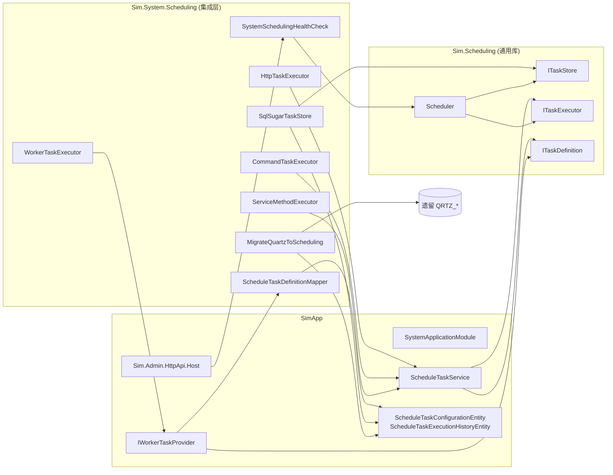
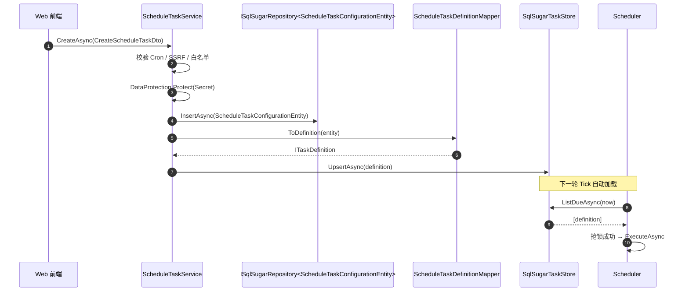

# SimApp × Sim.Scheduling 集成层设计

> 状态：基线设计；尚未实施。
>
> 设计日期：2026-08-14
>
> 适用范围：SimApp 后端（`api/` 目录），以 `Sim.System.Scheduling` 为核心集成模块
>
> 上游依赖：[`docs/design/scheduling/SCHEDULE_TASK_DESIGN.md`](SCHEDULE_TASK_DESIGN.md)（Sim.Scheduling 通用库设计基线）
>
> 结论：在 SimApp 内部以 `Sim.Scheduling` 通用库替换 Quartz 3.x；通过集成层 `Sim.System.Scheduling` 适配 SqlSugar 仓库、DataProtection 加密、SSRF/命令白名单、ABP 权限模型和现有管理 API；保留前端 `ScheduleTaskDto` 契约；Quartz 11 张表由 `MigrateQuartzToScheduling` 一次性迁移；总工作量约 1-1.5 周（在通用库 P0–P7 实施完成之后）。

## 1. 目标与非目标

### 1.1 目标

1. **去掉 Quartz 3.x**：从 `Directory.Packages.props` 移除 `Quartz.Extensions.DependencyInjection` 与 `Quartz.Serialization.Json`；删除 11 张 `QRTZ_*` 表。
2. **复用通用库**：以 `Sim.Scheduling` 通用库承担调度循环、Cron 解析、Misfire / 重试 / Calendar / 中间件，集成层只负责与 SimApp 现有体系对接。
3. **零业务破坏**：现有 `IScheduleTaskService` 接口和 `ScheduleTaskDto` 保持；前端无需改动；权限、本地化、审计保持。
4. **统一数据源**：调度数据写入 `system_schedule_task_config` 与 `system_schedule_task_execution_history`（沿用现有业务表，仅扩展字段）。
5. **保留安全基线**：SSRF 防护（私网/保留地址/重定向）、命令白名单（`ScheduleTaskExecution:AllowedCommands`）、DataProtection 加密 `ProtectedConfiguration`、执行历史/重试历史。
6. **多活并行调度**：在 SimApp 多实例部署下，调度器自动通过 SqlSugar 行锁抢锁。
7. **Worker Job 统一进调度器**：`SystemHeartbeatJob` / `CleanupExpiredRefreshTokensJob` 改造为 `IWorkerTask`，由 `IWorkerTaskProvider` 注册。
8. **平滑迁移**：`MigrateQuartzToScheduling` 命令行工具一次性把 Quartz 表数据搬到新表；`SchedulingHealthCheck` 检测未迁移任务时返回 `Degraded`。

### 1.2 非目标

- 不修改前端 `ScheduleTask` 视图组件（DTO 字段扩展在第二迭代再做）；
- 不重写 `IScheduleTaskService` 业务逻辑（保持 CRUD + TriggerNowAsync + GetServiceMethodsAsync）；
- 不实现 Quartz 风格 Calendar `IntervalUnit`、JobListener 链、Cluster Check-in 协议；
- 不实现 Quartz 跨实例分片；
- 不重新设计通知告警（沿用现有 `INotificationEventPublisher` 通道；失败告警作为后续增强项）。

## 2. 现状与约束

### 2.1 仓库现状

- 后端是 .NET 10 模块化单体，业务模块按 `Domain.Shared` / `Domain` / `Application.Contracts` / `Application` / `SqlSugar` 分层。
- SqlSugar 是项目唯一 ORM（`SqlSugarCoreNoDrive` 5.1.4.216），通过 `ISqlSugarRepository<TEntity>` 提供仓储。
- 当前定时任务由 Quartz 3.15.0 承担，关键实现位于 `api/modules/system/Sim.System.Application/ScheduleTask/`：
  - `ScheduleTaskRuntime` 维护 DB 配置与 Quartz Job/Trigger 的双向同步；
  - `DynamicScheduleTaskJob` 执行 Http / Command / ServiceMethod 三类动态任务；
  - `ScheduleTaskExecutionHistoryListener : IJobListener` 写执行历史；
  - `ScheduleTaskService` 提供后台管理 API；
  - `ScheduleTaskConfigurationProtection` 用 DataProtection 加密任务 Secret；
  - `ScheduleTaskHttpTargetValidator` / `ScheduleTaskCommandPolicy` 提供 SSRF 与白名单校验；
  - `QuartzDatabaseInitializer` 自动建表；
  - `QuartzSchedulerHealthCheck` 与 `SystemManagementStartupService` 完成启动与健康检查。
- System 模块以 `IJob` 形式实现内置任务：`SystemHeartbeatJob`、`CleanupExpiredRefreshTokensJob`。
- ABP 仅保留 `Volo.Abp.Core`（模块体系）与 `Volo.Abp.Localization`（本地化）2 个包。

### 2.2 必须保持的边界

- 业务模块只发布"需要在何时执行什么"和"如何执行"，不直接依赖 Quartz 或 `Sim.Scheduling`。
- 集成层 `Sim.System.Scheduling` 是 SimApp 内部的"通用库适配器"，对通用库 1:1 包装。
- SqlSugar 实体定义（含 `[SugarTable]` / `[SugarColumn]` / `[SugarIndex]`）只能出现在 `Sim.System.Domain` 和 `Sim.System.Application`；通用库不感知。
- Quartz 11 张 `QRTZ_*` 表迁移完成后保留 7 天只读快照，由 DBA 手动 DROP。
- 任何业务模块、Host、SqlSugar 项目不引用 `Quartz.*` 程序集。
- 集成层不重复实现通用库已有的能力（Cron 解析、Misfire、重试、Calendar、中间件管道）。

## 3. 集成层架构

### 3.1 模块布局

```
api/
├── framework/
│   └── Sim.System.Scheduling/                   ← 新建，集成层核心
│       ├── Sim.System.Scheduling.csproj
│       ├── Configuration/
│       │   └── SystemSchedulingOptions.cs    继承 SchedulingOptions
│       ├── Storage/
│       │   ├── SqlSugarTaskStore.cs             实现 ITaskStore
│       │   ├── SqlSugarCalendarProvider.cs
│       │   └── Mapping/
│       │       ├── ScheduleTaskDefinitionMapper.cs    业务实体 ↔ ITaskDefinition
│       │       └── ScheduleTaskConfigurationEntityMap.cs
│       ├── Executors/
│       │   ├── HttpTaskExecutor.cs
│       │   ├── CommandTaskExecutor.cs
│       │   ├── ServiceMethodExecutor.cs
│       │   └── WorkerTaskExecutor.cs
│       ├── Middleware/
│       │   ├── DataProtectionMiddleware.cs      用 IDataprotector 保护 Metadata 中的 Secret
│       │   └── HistoryPersistenceMiddleware.cs  写 system_schedule_task_execution_history
│       ├── Calendars/
│       │   ├── BuiltinCalendars.cs
│       │   └── SystemCalendarProvider.cs        持久化到 system_schedule_calendar
│       ├── Hosted/
│       │   └── SystemSchedulingStartupService.cs
│       ├── HealthChecks/
│       │   └── SystemSchedulingHealthCheck.cs
│       ├── Migration/
│       │   ├── MigrateQuartzToScheduling.cs
│       │   └── VerifyQuartzMigration.cs
│       ├── Errors/
│       │   └── SystemSchedulingErrorCodes.cs
│       └── ServiceCollectionExtensions.cs
├── modules/
│   ├── system/
│   │   └── Sim.System.Application/
│   │       ├── ScheduleTask/                    ← 改造
│   │       │   ├── ScheduleTaskService.cs       适配
│   │       │   ├── ScheduleTaskConfigurationProtection.cs
│   │       │   ├── ScheduleTaskHttpTargetValidator.cs
│   │       │   ├── ScheduleTaskCommandPolicy.cs
│   │       │   ├── ScheduleTaskExecutionOptions.cs
│   │       │   ├── FileStorageInitializationScheduleTaskHandler.cs
│   │       │   ├── MigrateSchedulingDatabaseInitializer.cs
│   │       │   └── Migration/
│   │       │       └── SystemSchedulingSchema.cs    CREATE TABLE SQL
│   │       └── Jobs/
│   │           ├── CleanupExpiredRefreshTokensWorkerTask.cs    新增
│   │           ├── CleanupExpiredRefreshTokensScheduleTaskProvider.cs    改造
│   │           ├── SystemHeartbeatWorkerTask.cs                 新增
│   │           └── SystemHeartbeatScheduleTaskProvider.cs       改造
│   └── system/Sim.System.Domain/
│       └── ScheduleTask/
│           ├── ScheduleTaskConfigurationEntity.cs               扩展字段
│           ├── ScheduleTaskExecutionHistoryEntity.cs            扩展字段
│           ├── ScheduleTaskRetryHistoryEntity.cs                新增
│           ├── ScheduleCalendarEntity.cs                        新增
│           └── ScheduleCalendarDateEntity.cs                    新增
```

### 3.2 关键适配图



### 3.3 关键时序（创建动态任务）



## 4. 核心适配

### 4.1 实体扩展

`ScheduleTaskConfigurationEntity` 在通用库字段基础上扩展：

```csharp
[CodeFirst]
[SugarTable("system_schedule_task_config")]
public class ScheduleTaskConfigurationEntity : AuditedAggregateRoot
{
    // === 基础（沿用） ===
    public string Key { get; set; }
    public string Group { get; set; }
    public string DisplayName { get; set; }
    public string? Description { get; set; }
    public string CronExpression { get; set; }
    public bool Enabled { get; set; }
    public string TaskType { get; set; } = ScheduleTaskTypes.Worker;
    public bool IsBuiltIn { get; set; } = true;
    public string? ProtectedConfiguration { get; set; }   // DataProtection 加密的 Secret

    // === 通用库字段（新增） ===
    public string? TimeZoneId { get; set; }
    public string MisfirePolicy { get; set; } = "Skip";
    public int MisfireThresholdSeconds { get; set; } = 60;
    public int MaxMisfireCatchup { get; set; } = 1;
    public int MaxRetryCount { get; set; } = 0;
    public int RetryBaseSeconds { get; set; } = 30;
    public int RetryMaxSeconds { get; set; } = 3600;
    public int TimeoutSeconds { get; set; } = 120;
    public string? CalendarKey { get; set; }
    public DateTimeOffset NextRunTime { get; set; }
    public DateTimeOffset? LastRunTime { get; set; }
    public string LastOutcome { get; set; } = "Idle";
    public int Attempt { get; set; }
    public string? LockToken { get; set; }
    public DateTimeOffset? LockedUntil { get; set; }
    public string? LastExecutorId { get; set; }
}
```

`ScheduleTaskExecutionHistoryEntity` 扩展：

```csharp
[CodeFirst]
[SugarTable("system_schedule_task_execution_history")]
public class ScheduleTaskExecutionHistoryEntity : CreationAuditedEntity
{
    public Guid ScheduleTaskId { get; set; }
    public string TaskGroup { get; set; }
    public string TaskKey { get; set; }
    public DateTimeOffset StartedAt { get; set; }
    public DateTimeOffset? CompletedAt { get; set; }
    public long DurationMs { get; set; }
    public string Status { get; set; }       // Running / Success / Failed / Timeout / Cancelled / Retrying / Skipped / SkippedByCalendar / LockLost
    public string? Error { get; set; }
    public string? ExecutedBy { get; set; }
    public string TriggerType { get; set; } // Cron / Manual / Retry
    public int Attempt { get; set; }
    public Guid? RetryOfHistoryId { get; set; }
    public string? ExecutorId { get; set; }
}
```

新增 `ScheduleTaskRetryHistoryEntity`、`ScheduleCalendarEntity`、`ScheduleCalendarDateEntity` 三张表（与通用库 SqlSugar 包字段一致）。

### 4.2 SqlSugar 适配器

`SqlSugarTaskStore` 把通用库 `ITaskStore` 映射到 `ISqlSugarRepository<ScheduleTaskConfigurationEntity>` 与 `ISqlSugarRepository<ScheduleTaskExecutionHistoryEntity>`：

```csharp
public sealed class SqlSugarTaskStore(
    ISqlSugarRepository<ScheduleTaskConfigurationEntity> configRepo,
    ISqlSugarRepository<ScheduleTaskExecutionHistoryEntity> historyRepo,
    IClock clock) : ITaskStore
{
    public async Task<IReadOnlyList<ITaskDefinition>> ListDueAsync(
        DateTimeOffset now, int limit, CancellationToken ct)
    {
        var entities = await configRepo.GetListAsync(c =>
            c.Enabled && c.NextRunTime <= now &&
            (c.LockedUntil == null || c.LockedUntil < now));
        return entities
            .OrderBy(c => c.NextRunTime)
            .Take(limit)
            .Select(ScheduleTaskDefinitionMapper.ToDefinition)
            .ToList();
    }

    public async Task<bool> TryAcquireAsync(
        string key, string instanceId, TimeSpan lease, CancellationToken ct)
    {
        var now = clock.UtcNow;
        var leaseUntil = now + lease;
        var rows = await configRepo.UpdateByFieldsAsync(
            entity: new ScheduleTaskConfigurationEntity { /* set */ },
            properties: c => new { c.LockToken, c.LockedUntil },
            ignoreNullColumns: false,
            toSql: false);
        // 详见 §4.3 抢锁原子性
    }

    // ... 其余接口类似
}
```

### 4.3 抢锁原子性

`UpdateByFieldsAsync` 默认按主键更新，无法附加 WHERE 条件。集成层使用 `ISqlSugarClient.Ado.ExecuteCommandAsync` 直接执行原子 SQL：

```sql
UPDATE system_schedule_task_config
   SET lock_token = @instanceId,
       locked_until = @leaseUntil
 WHERE key = @key
   AND (locked_until IS NULL OR locked_until < @now)
```

> 关键点：`UpdateByFieldsAsync` 不支持自定义 WHERE；为保证"仅当锁过期才抢占"的原子性，集成层**显式使用 SqlSugar Ado** 执行带条件的 UPDATE。这是 SimApp 内部决策，不影响通用库。

### 4.4 Mapper

```csharp
public static class ScheduleTaskDefinitionMapper
{
    public static ITaskDefinition ToDefinition(ScheduleTaskConfigurationEntity entity)
    {
        var metadata = JsonSerializer.Deserialize<Dictionary<string, object?>>(
            entity.ProtectedConfiguration ?? "{}") ?? new();

        return new TaskDefinition
        {
            Key = entity.Key,
            Group = entity.Group,
            DisplayName = entity.DisplayName,
            Description = entity.Description,
            CronExpression = entity.CronExpression,
            TimeZoneId = entity.TimeZoneId,
            Enabled = entity.Enabled,
            TaskType = entity.TaskType,
            Metadata = metadata,
            CalendarKey = entity.CalendarKey,
            MisfirePolicy = entity.MisfirePolicy,
            MisfireThresholdSeconds = entity.MisfireThresholdSeconds,
            MaxMisfireCatchup = entity.MaxMisfireCatchup,
            MaxRetryCount = entity.MaxRetryCount,
            RetryBaseSeconds = entity.RetryBaseSeconds,
            RetryMaxSeconds = entity.RetryMaxSeconds,
            TimeoutSeconds = entity.TimeoutSeconds,
            NextRunTime = entity.NextRunTime,
            LastRunTime = entity.LastRunTime,
            LastOutcome = entity.LastOutcome,
            Attempt = entity.Attempt,
        };
    }

    public static void ApplyTo(ITaskDefinition definition, ScheduleTaskConfigurationEntity entity)
    {
        entity.CronExpression = definition.CronExpression;
        entity.Enabled = definition.Enabled;
        entity.NextRunTime = definition.NextRunTime;
        entity.LastRunTime = definition.LastRunTime;
        entity.LastOutcome = definition.LastOutcome;
        entity.Attempt = definition.Attempt;
        entity.LockToken = definition.LockToken;
        entity.LockedUntil = definition.LockedUntil;
        entity.LastExecutorId = definition.InstanceId;
    }
}
```

### 4.5 DataProtection 中间件

`DataProtectionMiddleware` 拦截执行器调用前后的 Metadata，保护 Http 任务的 Secret：

```csharp
public sealed class DataProtectionMiddleware(
    IDataProtectionProvider provider,
    IClock clock) : ITaskMiddleware
{
    private readonly IDataProtector _protector = provider.CreateProtector(
        "SimApp.System.ScheduleTaskConfiguration.v1");

    public async Task InvokeAsync(
        TaskExecutionContext context,
        TaskMiddlewareDelegate next,
        CancellationToken cancellationToken)
    {
        // 把 ProtectedConfiguration 还原到 Metadata.Secret（执行器按需读取）
        if (context.Task.Metadata.TryGetValue("__encrypted", out var encryptedObj)
            && encryptedObj is string encrypted
            && !string.IsNullOrEmpty(encrypted))
        {
            var json = _protector.Unprotect(encrypted);
            var secret = JsonSerializer.Deserialize<Dictionary<string, object?>>(json);
            context.AddEphemeral("Secret", secret);
        }
        await next(cancellationToken);
    }
}
```

### 4.6 SSRF / 命令白名单

完全沿用现有 `ScheduleTaskHttpTargetValidator` / `ScheduleTaskCommandPolicy`：

```csharp
public sealed class HttpTaskExecutor(
    IHttpClientFactory httpClientFactory,
    ScheduleTaskHttpTargetValidator validator) : ITaskExecutor
{
    public string TaskType => ScheduleTaskTypes.Http;

    public async Task ExecuteAsync(TaskExecutionContext context, CancellationToken ct)
    {
        var secret = context.GetEphemeral<Dictionary<string, object?>>("Secret") ?? new();
        var url = (string)secret["url"];
        var method = (string)(secret.GetValueOrDefault("method") ?? "GET");
        var uri = await validator.ValidateAsync(url, ct);
        // ... 沿用 DynamicScheduleTaskJob.ExecuteHttpAsync 逻辑
    }
}
```

### 4.7 Worker 任务适配

`IWorkerTaskProvider` 把内置 Worker 任务注册为 `ITaskDefinition`：

```csharp
public sealed class SystemWorkerTaskProvider(
    IEnumerable<IWorkerTask> tasks,
    ISqlSugarRepository<ScheduleTaskConfigurationEntity> repo,
    IClock clock) : IWorkerTaskProvider
{
    public async Task<IReadOnlyList<ITaskDefinition>> GetDefinitionsAsync(CancellationToken ct)
    {
        var existing = (await repo.GetAll())
            .ToDictionary(e => $"{e.Group}:{e.Key}");

        var definitions = new List<ITaskDefinition>();
        foreach (var task in tasks)
        {
            var key = $"{task.Group}:{task.Key}";
            var entity = existing.GetValueOrDefault(key);
            if (entity == null)
            {
                entity = new ScheduleTaskConfigurationEntity
                {
                    Key = task.Key,
                    Group = task.Group,
                    DisplayName = task.DisplayName,
                    Description = task.Description,
                    CronExpression = task.DefaultCronExpression,
                    Enabled = task.DefaultEnabled,
                    TaskType = ScheduleTaskTypes.Worker,
                    IsBuiltIn = true,
                    NextRunTime = clock.UtcNow,  // SchedulerBootstrapper 校正
                    MisfirePolicy = "RunOnce",
                };
                await repo.InsertAsync(entity);
            }
            definitions.Add(ScheduleTaskDefinitionMapper.ToDefinition(entity));
        }
        return definitions;
    }
}
```

具体 Worker 实现：

```csharp
public sealed class SystemHeartbeatWorkerTask(ILogger<SystemHeartbeatWorkerTask> logger) : IWorkerTask
{
    public string Key => "SystemHeartbeatJob";
    public string Group => "Worker";
    public string DisplayName => "系统 Worker 心跳";
    public string Description => "由 System 模块定义的内置任务，用于验证调度器运行状态。";
    public string DefaultCronExpression => "0 0/5 * * * ?";
    public bool DefaultEnabled => true;

    public Task ExecuteAsync(WorkerTaskContext context, CancellationToken cancellationToken)
    {
        context.Logger.LogInformation("System worker heartbeat completed");
        return Task.CompletedTask;
    }
}

public sealed class CleanupExpiredRefreshTokensWorkerTask(
    IRefreshTokenRepository repo,
    ILogger<CleanupExpiredRefreshTokensWorkerTask> logger) : IWorkerTask
{
    // ... 同上
    public Task ExecuteAsync(WorkerTaskContext context, CancellationToken cancellationToken)
    {
        // 沿用 CleanupExpiredRefreshTokensJob.Execute 逻辑
    }
}
```

### 4.8 管理 API 兼容

`IScheduleTaskService` 保持现有契约；实现改为通过 `ITaskStore` 间接操作业务实体：

```csharp
public sealed class ScheduleTaskService(
    ISqlSugarRepository<ScheduleTaskConfigurationEntity> repo,
    ITaskStore store,                    // 新增注入
    ScheduleTaskConfigurationProtection protection,
    ScheduleTaskCommandPolicy commandPolicy,
    IEnumerable<IScheduleTaskServiceMethodHandler> serviceMethodHandlers,
    ILogger<ScheduleTaskService> logger) : ApplicationService, IScheduleTaskService
{
    public async Task<List<ScheduleTaskDto>> GetListAsync(CancellationToken cancellationToken = default)
    {
        await _bootstrapper.EnsureInitializedAsync(cancellationToken);
        var entities = await repo.GetAll();
        return entities
            .OrderByDescending(e => e.IsBuiltIn)
            .ThenBy(e => e.Group)
            .ThenBy(e => e.DisplayName)
            .Select(e => MapToDto(e))
            .ToList();
    }

    public async Task<ScheduleTaskDto> CreateAsync(CreateScheduleTaskDto input, CancellationToken cancellationToken = default)
    {
        // 1. 校验 Cron / SSRF / 白名单
        // 2. 构造 entity
        // 3. 写入 entity（InsertAsync）
        // 4. 同步推送到 store.UpsertAsync（让调度器即时可见）
        // 5. 返回 DTO
    }

    public async Task TriggerNowAsync(Guid id, CancellationToken cancellationToken = default)
    {
        // 集成层提供一个"立即触发"扩展：把任务的 NextRunTime 设为 now，并 LockedUntil 清空
        // 下一轮 Tick 会立即加载并执行
    }
}
```

`TriggerNowAsync` 的实现策略（不引入额外接口）：
- 把 `NextRunTime = now`、`LastOutcome = "ManualTrigger"`、`Attempt = 0` 写回 entity；
- 调度器下一轮 Tick（默认 1s）会立即加载并执行。

### 4.9 启动流程

替换 `SystemManagementStartupService` 的 Quartz 相关代码：

```csharp
public sealed class SystemManagementStartupService(
    IServiceScopeFactory scopeFactory,
    ISchedulingBootstrapper bootstrapper,
    IOptions<SchedulingOptions> schedulingOptions) : IHostedService
{
    public async Task StartAsync(CancellationToken cancellationToken)
    {
        using var scope = scopeFactory.CreateScope();

        // 1. 文件存储初始化（沿用）
        await scope.ServiceProvider.GetRequiredService<FileStorageConfigurationInitializer>()
            .EnsureInitializedAsync();

        // 2. 通知初始化（沿用）
        await scope.ServiceProvider.GetRequiredService<NotificationConfigurationInitializer>()
            .EnsureInitializedAsync(cancellationToken);

        // 3. Sim.Scheduling 业务表初始化（替换 QuartzDatabaseInitializer）
        await scope.ServiceProvider.GetRequiredService<MigrateSchedulingDatabaseInitializer>()
            .EnsureTablesAsync(cancellationToken);

        // 4. Quartz 一次性数据迁移（首次启动执行；后续启动仅做校验）
        await scope.ServiceProvider.GetRequiredService<QuartzMigrationRunner>()
            .RunAsync(cancellationToken);

        // 5. 加载 Worker 任务 + 校正 NextRunTime
        await bootstrapper.EnsureInitializedAsync(cancellationToken);
    }

    public Task StopAsync(CancellationToken cancellationToken) => Task.CompletedTask;
    // SchedulerHostedService 已经处理 ShutdownGrace
}
```

### 4.10 健康检查

```csharp
public sealed class SystemSchedulingHealthCheck(
    ISchedulerDiagnostics diagnostics,
    ITaskStore store) : IHealthCheck
{
    public async Task<HealthCheckResult> CheckHealthAsync(
        HealthCheckContext context,
        CancellationToken cancellationToken = default)
    {
        var storeHealth = await store.CheckHealthAsync(cancellationToken);
        if (!storeHealth.IsHealthy)
            return HealthCheckResult.Unhealthy($"Store unavailable: {storeHealth.Description}");

        var snapshot = diagnostics.GetSnapshot();
        if (snapshot.ConsecutiveTickFailures >= 3)
            return HealthCheckResult.Degraded($"Scheduler tick 连续失败 {snapshot.ConsecutiveTickFailures} 次");

        if (snapshot.LastTickDuration > TimeSpan.FromSeconds(5))
            return HealthCheckResult.Degraded($"Tick 耗时 {snapshot.LastTickDuration.TotalSeconds:F1}s");

        return HealthCheckResult.Healthy(
            $"Scheduler running. LastTick={snapshot.LastTickDuration.TotalMilliseconds:F0}ms, " +
            $"Active={snapshot.ActiveTasks}, Pending={snapshot.PendingTasks}");
    }
}
```

## 5. Quartz 数据迁移

### 5.1 迁移工具

`MigrateQuartzToScheduling` 是 `dotnet run -- --migrate-scheduling` 触发的命令行任务：

1. 读取 `sim_QRTZ_JOB_DETAILS` / `sim_QRTZ_TRIGGERS` / `sim_QRTZ_CRON_TRIGGERS`；
2. 按 `JobKey = (Group, Name)` 映射到 `ScheduleTaskConfigurationEntity`：
   - JobClassName 命中白名单（`Sim.System.Application.Jobs.*`）→ `IsBuiltIn=true`、`TaskType=Worker`；
   - 带 `ScheduleTaskConfigurationId` JobData → 视作遗留 dynamic，需要人工 review；
   - 其它 → 报警并跳过；
3. 写入 `system_schedule_task_config`；
4. 输出迁移报告（`migration-report.json`）；
5. 保留 Quartz 11 张表为只读。

### 5.2 校验

`SchedulingHealthCheck` 在启动时检查：

- 如果 `sim_QRTZ_JOB_DETAILS` 仍有非迁移记录 → 返回 `Degraded` + 报告路径；
- 如果 7 天后 Quartz 表仍在 → 日志 WARN + 报警邮件（可选）。

### 5.3 回退

第一版不提供自动化回退；如需回退：
- 保留 Quartz 程序集在 NuGet 缓存；
- 部署前备份 `system_schedule_task_*` 与 `sim_QRTZ_*`；
- 回退脚本（手写 SQL + EF/SqlSugar 命令）通过 PR 评审提前准备。

## 6. 配置变更

`appsettings.json` 移除 `Quartz` 节，新增 `Scheduling` 节（与通用库同名）：

```jsonc
{
  "Scheduling": {
    "TickInterval": "00:00:01",
    "BatchSize": 32,
    "MaxConcurrentTasks": 32,
    "LockLease": "00:01:00",
    "LockRenewThreshold": "00:00:30",
    "ShutdownGrace": "00:00:30",
    "InstanceId": "auto",
    "LogLevel": "Information"
  },
  "ScheduleTaskExecution": {
    "AllowedCommands": ["echo"]      // 沿用
  }
}
```

`appsettings.Production.json` 不再需要配置 `Quartz:JobStore:Provider`。

## 7. 包依赖变更

### 7.1 移除

`api/Directory.Packages.props`：
```diff
- <PackageVersion Include="Quartz.Extensions.DependencyInjection" Version="3.15.0" />
- <PackageVersion Include="Quartz.Serialization.Json" Version="3.15.0" />
```

`eng/dependency-license-policy.json`：
```diff
- "Quartz.Extensions.DependencyInjection": "Apache-2.0",
- "Quartz.Serialization.Json": "Apache-2.0",
```

### 7.2 新增

通用库通过 NuGet 私有 feed / 本地 feed 引用：
- `Sim.Scheduling` (MIT)
- `Sim.Scheduling.Hosting` (MIT)
- `Sim.Scheduling.HealthChecks` (MIT)
- `Sim.Scheduling.Persistence.SqlSugar` (MIT)

Cronos 走 NuGet 公共源（MIT）。

## 8. 实施步骤

| 阶段 | 步骤 | 涉及文件数 | 验证 |
|------|------|-----------|------|
| **I0 基础设施** | 新建 `Sim.System.Scheduling` 项目；扩展 `ScheduleTaskConfigurationEntity` 字段；新增 3 张表实体 | ~15 | 实体编译通过；`SqlSugar.CodeFirst` 自动建表 |
| **I1 通用库接入** | 在 `SystemApplicationModule` 注册 `AddScheduling` + `AddSchedulingHostedService` + `AddSchedulingHealthChecks`；`SchedulingOptions` 绑定 | ~5 | ASP.NET Core 启动；`/health/ready` 包含 `scheduling` |
| **I2 SqlSugar 适配器** | `SqlSugarTaskStore` + `SqlSugarCalendarProvider` + `Mapper` | ~8 | 集成测试：4 类 store 接口全跑通 |
| **I3 业务执行器** | `HttpTaskExecutor` / `CommandTaskExecutor` / `ServiceMethodExecutor` / `WorkerTaskExecutor` + 沿用 SSRF/白名单 | ~10 | 集成测试：4 类执行器全部跑通 |
| **I4 中间件** | `DataProtectionMiddleware` + `HistoryPersistenceMiddleware` + 通用库 5 个内置中间件 | ~6 | 写历史与加密正确 |
| **I5 Worker 迁移** | 改造 `SystemHeartbeatJob` → `SystemHeartbeatWorkerTask`；`CleanupExpiredRefreshTokensJob` → `CleanupExpiredRefreshTokensWorkerTask`；`IWorkerTaskProvider` | ~6 | 内置任务正常调度 |
| **I6 管理 API** | 改造 `ScheduleTaskService` 通过 `ITaskStore` 适配；保持接口与 DTO | ~5 | 现有集成测试通过 |
| **I7 Quartz 迁移** | `MigrateQuartzToScheduling` + `VerifyQuartzMigration` | ~5 | 旧 Quartz 数据成功迁移 |
| **I8 文档与清理** | 更新 `ARCHITECTURE.md` / `DEVELOPMENT.md` / `ENTERPRISE_SYSTEM_GUIDE.md`；移除 `Quartz.*` 包 | ~5 | 文档评审通过；`dotnet build` 成功 |
| **I9 多实例验证** | docker-compose 集群测试 + 性能压测 | 0 | 13.3 / 13.5 通过 |

总文件数 ~65（含测试与文档），预计 1-1.5 周（前置条件：通用库 P0–P7 已完成）。

## 9. 风险清单与缓解措施

| 风险 | 影响 | 概率 | 缓解 |
|------|------|------|------|
| `UpdateByFieldsAsync` 不支持自定义 WHERE 导致抢锁失败 | 多实例重复执行 | 高 | 集成层使用 `ISqlSugarClient.Ado.ExecuteCommandAsync` 直接执行原子 SQL（§4.3） |
| DataProtection Key 丢失 | 历史/任务配置解密失败 | 低 | 沿用现有 `DataProtection__KeysPath` 部署要求；启动校验 |
| 旧 Quartz 任务未迁移 | 调度失效 | 中 | §5.2 校验 + WARN + 启动 `Degraded` |
| `TriggerNowAsync` 延迟 | 用户感知 1s 延迟 | 中 | UI 提示"已加入调度队列"；未来引入实时通道 |
| 国产数据库行锁差异 | 抢锁失效 | 中 | 在达梦 / 金仓 / GaussDB 验证原子 UPDATE 行为 |
| 内置任务迁移遗漏 | 任务丢失 | 中 | 迁移前后清单对比；集成测试覆盖每个内置任务 |
| 通用库版本与集成层不匹配 | API 漂移 | 中 | 集成层固定通用库版本范围；CI 跑跨包兼容性 |
| 通知告警链路过长 | 失败任务无感知 | 低 | 复用现有 `INotificationEventPublisher`；Channel 配置按业务方引导 |
| `system_schedule_calendar*` 表数据缺失 | 业务误判 | 中 | 启动校验所有 `CalendarKey` 存在；缺失则禁用并 WARN |
| 旧 11 张 QRTZ_* 表空间未回收 | 磁盘占用 | 低 | DBA 7 天后手动 DROP；提供清理脚本 |

## 10. 验收标准（Definition of Done）

- [ ] `Sim.Scheduling` 通用库 P0–P7 已完成（参见主设计文档第 17 节）；
- [ ] `Sim.System.Scheduling` 集成层单测 + 集成测试覆盖率 ≥ 80%；
- [ ] 多实例场景：3 实例同时启动，1 个 `*/1 * * * * ?` 任务 5 分钟内触发次数与单实例基本一致（误差 ≤ 1）；
- [ ] 性能压测：1000 任务、平均 100ms、Tick=1s，CPU < 30%、store TPS < 50、内存增长 < 50MB；
- [ ] `Quartz.*` 包从 `Directory.Packages.props` 与所有 `.csproj` 中移除；`eng/dependency-license-policy.json` 同步清理；
- [ ] 旧 Quartz 表数据成功迁移到 `system_schedule_task_config`；`MigrateQuartzToScheduling` 工具命令可用；
- [ ] Web 端 `ScheduleTask` 视图显示新增的 `MisfirePolicy / CalendarKey / MaxRetryCount / Attempt / ExecutorId` 字段（可选迭代）；
- [ ] `health/ready` 包含 `scheduling` 检查项，CI 与本地均可观察；
- [ ] 文档 `ARCHITECTURE.md` / `DEVELOPMENT.md` / `ENTERPRISE_SYSTEM_GUIDE.md` 同步更新；
- [ ] 生产环境切换有回退预案（Quartz 包缓存 + SQL 备份 + 旧 service 回滚 PR 模板）。

## 11. 开放问题

1. 通用库 License（MIT vs Apache-2.0 vs LGPL）对 SimApp 内部使用与对外发布的兼容性？
2. `TriggerNowAsync` 是否需要立即同步返回执行结果（UI 想要 loading → 成功/失败）？还是接受异步 fire-and-forget？
3. 失败告警通知是否默认开启（`System.ScheduleTask.Failed` 事件预置规则）？
4. Web 端是否在第一迭代就显示新增字段（`MisfirePolicy` / `CalendarKey` / `MaxRetryCount` / `Attempt` / `ExecutorId`）？
5. Quartz 11 表的最终清理时间窗口（7 天 vs 30 天）？
6. 集成层是否需要同时提供 ABP `IApplicationService` 包装（旧 `ScheduleTaskService` 继承 `ApplicationService`）？

---

> 评审签字位：
>
> - [ ] SimApp 架构负责人
> - [ ] System / Worker 业务负责人
> - [ ] 运维 / 数据库负责人
> - [ ] 信创 / 合规负责人
>
> 变更记录：
>
> | 日期 | 作者 | 变更 |
> |------|------|------|
> | 2026-08-14 | Mavis | 首版基线：SimApp × Sim.Scheduling 集成层设计 |
