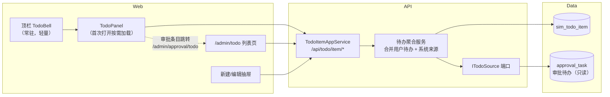

# 全站待办设计

> 状态：设计完成，尚未实施（2026-10-29）。
>
> 设计日期：2026-10-29
>
> 适用范围：`api`、`web`。
>
> 结论：新增独立 `todo` 业务模块保存用户自建待办；审批待办不落库、不做副本，由审批模块以 `ITodoSource` 端口实时聚合，点击暂时跳转到审批中心「我的待办」。顶栏提供待办面板作为主入口，完整列表页只承担管理与检索。

## 1. 需求与范围

### 1.1 需求原文拆解

| 需求 | 设计落点 |
| --- | --- |
| 全站待办 | 顶栏常驻入口 + 下拉面板 + 完整列表页 `/admin/todo`，所有后台页面可见 |
| 美观的待办面板 | 复用 Paper Ocean 令牌与 2px 硬边框/硬阴影体系，新增待办面板，不引入第二套视觉语言 |
| 不同待办事项有默认期限 | 按类型给出默认时长，服务端兜底、前端预填；用户新建时可改 |
| 新增时也可以设置期限 | 新建/编辑抽屉内提供日期时间选择；默认值仅在用户未手动修改时随类型联动 |
| 任务地址可选且必须有任务名 | `LinkUrl` 与 `LinkTitle` 成对出现；有地址必有任务名；界面只显示任务名链接，永不显示 URL 原文 |
| 审批任务暂时跳转到审批中我的待办 | 审批待办作为系统来源实时聚合，点击进入 `/admin/approval/todo`；本期不内嵌审批动作 |

### 1.2 目标

1. 任意后台页面都能在两次点击内看到并新增待办。
2. 用户自建待办具备：标题、类型、期限、可选任务链接、完成/撤销完成、编辑、删除。
3. 审批待办进入同一面板与列表，但只读、只跳转，不在待办模块内处理审批。
4. 期限语义统一：逾期、今天、本周、更晚四档，面板与列表使用同一判定函数。
5. 个人数据严格按「当前用户 + 租户」隔离，不存在跨用户读取或写入路径。

### 1.3 非目标（本期明确不做）

- 不做待办指派、共享、协作、评论、子任务、标签、排序拖拽、附件。
- 不做重复待办、日程视图、日历集成。
- 不做到期提醒推送（站内信/邮件/Web Push）；面板即首版提醒载体，扫描 Job 留到后续阶段。
- 不在面板内直接审批、转交、加签；审批动作仍只属于审批模块。
- 只覆盖 Web 端；接口按用户维度设计，后续客户端可直接复用。
- 不引入新的前端状态库；面板状态与顶栏通知一致，保存在组件本地。

## 2. 设计结论



关键取舍：

1. **审批待办不复制到待办表**。复制会产生状态漂移、删除竞态和二次同步任务；审批任务表已经是唯一权威（审批设计文档的既有结论）。待办模块只读取聚合结果。
2. **面板与列表共用一套接口与判定函数**，避免两处规则分叉。
3. **逾期/临期语义复用审批模块的 `resolveDueState`**：逾期 `< now`，临期 `≤ 24h`，其余正常；抽到待办模块的 `utils.ts`，不反向依赖审批模块。

## 3. 数据模型

### 3.1 表 `sim_todo_item`

沿用 `AuditedAggregateRoot`（`TenantId`、审计字段、`Version` 乐观并发），仓储自动追加租户过滤。

| 字段 | 类型 | 约束 | 说明 |
| --- | --- | --- | --- |
| `Id` | Guid | PK | |
| `TenantId` | Guid? | 索引 | Host 为空，租户为租户 Id |
| `UserId` | Guid | 索引 | 待办归属人，唯一权限依据 |
| `Title` | string(200) | 非空 | 展示标题，去首尾空白后非空 |
| `Type` | int | 非空 | `TodoType`：Task=1、Reminder=2、Other=3；`Approval=0` 仅系统来源使用，禁止用户创建 |
| `Status` | int | 非空 | `Pending=0`、`Completed=1` |
| `DueAt` | DateTime | 非空 | UTC；创建时由请求或类型默认值补齐 |
| `CompletedAt` | DateTime? | | 完成时间；撤销完成时清空 |
| `LinkTitle` | string(100)? | | 任务名；有地址时必填 |
| `LinkUrl` | string(500)? | | 任务地址；可为站内相对路径或 http(s) 绝对地址 |
| `Version` | int | 非空 | 乐观并发，沿用审批模块做法 |
| 审计字段 | | | `CreationTime`、`CreatorId`、`LastModificationTime`、`LastModifierId` |

索引：

- `idx_todo_item_owner_due`：`(TenantId, UserId, Status, DueAt)`，覆盖面板与列表的主查询。
- 不建唯一索引；同一用户允许重复标题。

删除为物理删除（项目当前无软删除基础设施）。`Status` 与 `DueAt` 分开存，撤销完成不会改变原期限。

### 3.2 类型与默认期限

| 类型 | 默认期限 | 用户可创建 | 说明 |
| --- | --- | --- | --- |
| `Approval` 审批 | 取审批任务 `DueAt`；缺失时 `now + 24h` | 否 | 来源固定为 `approval` |
| `Task` 任务 | `now + 72h` | 是 | 新建默认类型 |
| `Reminder` 提醒 | `now + 24h` | 是 | 轻量提醒 |
| `Other` 其他 | `now + 168h` | 是 | 无明确归类 |

约定：

- 默认值集中在 `Sim.Todo.Domain.Shared/TodoDefaults.cs`，通过 `GET /api/todo/item/type-defaults` 暴露，前端不硬编码。
- 创建请求允许省略 `DueAt`，由服务端按类型补齐；前端新建抽屉始终显式提交预填值，保证所见即所得。
- 前端把默认期限向上取整到下一个 30 分钟再展示，避免出现 `14:07` 这类毛边时间；服务端兜底值不做取整。
- 后续如需要按租户配置默认期限，只替换 `TodoDefaults` 的读取实现，不改接口。

### 3.3 任务链接规则

- `LinkTitle` 与 `LinkUrl` 必须同时为空或同时非空；任一单独出现即拒绝（`Sim:Todo:LinkIncomplete`）。
- `LinkTitle` 去空白后 1–100 字符；`LinkUrl` 去空白后 1–500 字符。
- 允许的地址：
  - `http://` 或 `https://` 绝对地址；
  - 以单个 `/` 开头的站内路径（如 `/admin/approval/todo`）。
- 拒绝：`javascript:`、`data:`、`vbscript:`、`file:`、协议相对地址 `//host`，以及任何无法解析为上述两种形态的值。
- 界面只渲染 `LinkTitle`，不显示 URL 原文；外链新窗口打开并带 `rel="noopener noreferrer"`，站内路径走路由跳转。
- 审批来源的链接固定为 `/admin/approval/todo?instanceId={instanceId}`；审批列表页读取该参数做预过滤，参数无效时回退完整列表。

## 4. 后端设计

### 4.1 模块分层

新增五项目，与 approval 同构：

```text
api/modules/todo/
├── Sim.Todo.Domain.Shared        # TodoType、TodoStatus、默认期限、错误码
├── Sim.Todo.Domain               # TodoItem 实体、ITodoItemRepository、TodoDefaults
├── Sim.Todo.Application.Contracts# DTO、ITodoItemAppService、ITodoSource、TodoSourceItemDto
├── Sim.Todo.Application          # TodoItemAppService、聚合服务、Mapperly 映射
└── Sim.Todo.SqlSugar             # TodoItemRepository、建表映射
```

依赖方向：

- `todo` 不引用 `approval`；`approval` 引用 `Sim.Todo.Application.Contracts` 实现 `ITodoSource`，与审批引用 System Contracts 的方式一致，不构成环。
- Host 新增对 `Sim.Todo.Application`、`Sim.Todo.SqlSugar` 的引用，并在 `[DependsOn]` 中声明；Swagger 增加 `todo` 分组并纳入 `all`。
- 表结构由 `[CodeFirst]` 自动创建（新表，无数据迁移）；不新增权限项、不新增后端菜单种子，前端为静态路由模块。

### 4.2 应用服务与路由

`TodoItemAppService : ApplicationService, ITodoItemAppService`，类级 `[Authorize]`，按常规控制器约定生成路由；所有方法内部以 `CurrentUser.Id` 为唯一用户来源，请求体中不接受 `UserId`。

| 方法 | 动词与路由 | 说明 |
| --- | --- | --- |
| `CreateAsync` | `POST /api/todo/item/create` | 创建用户待办；补齐默认期限、校验链接 |
| `UpdateAsync` | `PUT /api/todo/item/update` | 修改标题/类型/期限/链接；仅本人 |
| `DeleteAsync(id)` | `DELETE /api/todo/item/{id}` | 物理删除；仅本人 |
| `CompleteAsync(id)` | `POST /api/todo/item/complete/{id}` | 置为已完成，写 `CompletedAt` |
| `ReopenAsync(id)` | `POST /api/todo/item/reopen/{id}` | 撤销完成，保留原 `DueAt` |
| `GetMyAsync(TodoItemQueryDto)` | `GET /api/todo/item/my` | 用户待办分页列表，支持状态/类型/关键字 |
| `GetSystemAsync` | `GET /api/todo/item/system` | 聚合系统来源（审批），上限 100 条 |
| `GetPanelAsync(maxItems)` | `GET /api/todo/item/panel` | 面板一次性数据：计数 + 合并后的前 N 条 |
| `GetCountsAsync` | `GET /api/todo/item/counts` | 轻量角标计数 |
| `GetTypeDefaultsAsync` | `GET /api/todo/item/type-defaults` | 类型与默认期限 |

`TodoItemQueryDto : PagedAndSortedResultRequestDto`：

```text
Status?          Pending | Completed（默认 Pending）
Type?            Task | Reminder | Other（不接受 Approval 作为过滤值以外的行为）
Keyword?         标题模糊匹配
```

### 4.3 聚合端口

```csharp
public interface ITodoSource
{
    string Source { get; } // "approval"
    Task<IReadOnlyList<TodoSourceItemDto>> GetPendingAsync(Guid userId, CancellationToken ct = default);
}

public sealed class TodoSourceItemDto
{
    public string Source { get; init; } = "";
    public string SourceId { get; init; } = "";
    public string Title { get; init; } = "";
    public string? LinkTitle { get; init; }
    public string? LinkUrl { get; init; }
    public DateTime? DueAt { get; init; }
    public DateTime CreationTime { get; init; }
}
```

- `ApprovalTodoSource` 位于 `Sim.Approval.Application/Todo/`，注入 `IApprovalTaskRepository`，查询 `AssigneeUserId == userId && Status == Pending`，连实例取标题；映射为 `Title = instanceTitle`、`LinkTitle = instanceTitle`、`LinkUrl = /admin/approval/todo?instanceId={id}`、`DueAt = task.DueAt ?? now+24h`。
- 在 `ApprovalApplicationModule` 中以 `AddTransient<ITodoSource, ApprovalTodoSource>()` 注册；未启用审批模块时 `IEnumerable<ITodoSource>` 为空，待办功能仍可用。
- 聚合服务：用户待办取 `Pending`，系统来源逐条合并且同一 `Source` 内按 `SourceId` 去重；统一按 `DueAt` 升序、`CreationTime` 降序排序；`GetPanelAsync` 截断到 `maxItems`（默认 20，上限 50），`GetCountsAsync` 统计全量。

### 4.4 DTO 形态

```ts
interface TodoItemDto {
  id: string
  title: string
  type: 'Approval' | 'Task' | 'Reminder' | 'Other'
  status: 'Pending' | 'Completed'
  dueAt: string
  completedAt?: string | null
  linkTitle?: string | null
  linkUrl?: string | null
  isSystem: boolean       // true 时不可编辑/删除/勾选完成
  source?: string | null  // 'approval'
  sourceId?: string | null
}

interface TodoCountsDto { pendingCount: number; overdueCount: number; todayCount: number }

interface TodoPanelDto { counts: TodoCountsDto; items: TodoItemDto[] }

interface CreateTodoItemDto {
  title: string
  type: 'Task' | 'Reminder' | 'Other'
  dueAt?: string
  linkTitle?: string
  linkUrl?: string
}
```

系统来源条目的 `id` 使用 `approval:{taskId}` 形式的合成键，避免与用户待办 Guid 冲突；`sourceId` 保留原始任务 Id。

### 4.5 校验、并发与错误码

- 标题：去空白后非空，≤200；超长直接拒绝，不做截断。
- 期限：创建时必须晚于当前时间，且不晚于 `now + 5 年`；编辑允许调整到未来任意合法值，不因已逾期而阻止保存标题。
- 链接：见 3.3；服务端为最终校验方，前端同规则预校验。
- 越权：任何按 Id 的读/写先按 `Id + UserId` 查询，未命中统一返回 `Sim:Todo:ItemNotFound`，不区分「不存在」与「不属于你」。
- 并发：更新与完成携带 `Version`；版本不匹配返回 `Sim:Todo:ConcurrencyConflict`，前端提示刷新。
- 错误码：`Sim:Todo:TitleRequired`、`InvalidDueAt`、`LinkIncomplete`、`InvalidLinkUrl`、`CannotCreateSystemType`、`ItemNotFound`、`ConcurrencyConflict`。
- 日志：只记录数量与错误码，不记录待办标题、链接等用户内容。

### 4.6 租户与安全

- 实体实现 `IMultiTenant`，仓储自动追加 `TenantId` 过滤；Host 用户 `TenantId` 为空。
- `CurrentUser.Id` 为空直接抛未授权；不提供任何「按用户 Id 查询他人待办」的参数。
- 系统来源只返回当前用户的审批任务，复用审批仓储的租户过滤。
- 不对 URL 做服务端抓取或探测，避免 SSRF；只做格式校验。
- 待办为个人功能，不新增权限码；登录即具备本功能，管理端不提供他人待办查看。

## 5. 前端设计

### 5.1 模块与路由

```text
web/src/modules/todo/
├── index.ts                 # todoModule：静态模块，layout 'admin'，enabled true
├── routes.ts                # /admin/todo；beforeEnter 加载 todo 语言包
├── views/index.vue          # 全量待办列表
├── components/TodoBell.vue  # 顶栏入口（轻量，常驻）
├── components/TodoPanel.vue # 面板内容（首次打开异步加载）
├── components/TodoItemRow.vue
├── components/TodoEditor.vue# 新建/编辑抽屉
├── components/TodoTypeTag.vue
├── api/index.ts             # 包装生成的 todo SDK
├── utils.ts                 # 分组、期限判定、默认值取整、链接校验
└── utils.test.ts
```

- 在 `config/modules.ts` 注册 `todoModule`（`id: 'todo-module'`，参考 `home-module`）。
- 路由 `/admin/todo`：`name: 'TodoIndex'`、`meta.title: 'Menu:Todo'`、`menu: true`、`tab: true`、`keepAlive: true`、`icon: 'ListBoxes'`、`order: 50`（位于工作台之后、审批之前）。
- `Header.vue` 在通知铃铛前插入 `<TodoBell />`；`TodoBell.vue` 只负责按钮、角标和按需加载 `TodoPanel.vue`，避免把面板逻辑打进入口包。
- 语言包：顶栏、面板与菜单标题进入 eager 的 `core` 包（`Header:Todo*`、`Menu:Todo`）；列表页、抽屉、错误提示进入新的 lazy `todo` 包，在路由 `beforeEnter` 中 `ensureMessagePacks(['todo'])`，与 account 模块做法一致。中英文两套必须同键，通过现有 `consistency.test.ts`。

### 5.2 顶栏入口与面板

入口：

- 复用 `.po-icon-btn`（40×40、2px 边框、999px 圆角），图标 `carbon:CheckmarkOutline`，`aria-label="Header:Todo"`。
- 角标为数字胶囊：`min-width 18px`、高 18px、背景 `--po-accent`、文字 `--po-paper`；有逾期时背景换 `--po-coral`；数量 >99 显示 `99+`；为 0 时隐藏。
- ≤680px 时仍保留入口（仅密度切换按钮会隐藏），面板宽度自适应为 `calc(100vw - 24px)`。

面板（`n-popover`，`trigger="click"`、`placement="bottom-end"`，沿用全局 2px 边框、16px 圆角、硬阴影）：

```text
┌────────────────────────────────────────────┐
│ 待办  12            逾期 3                 │  ← 标题 + 计数胶囊
│ ┌──────────────────────────────────┬─────┐ │
│ │ 添加待办，回车创建               │  +  │ │  ← 快速新增（默认“任务”，72h）
│ └──────────────────────────────────┴─────┘ │
│ 已逾期 3                                   │
│  ○ 提交季度预算说明        [任务]  3小时前 │
│  ◉ 审批：报销申请          [审批]  昨天 18:00 → │
│ 今天 4                                     │
│  ○ 更新部署文档            [提醒]  今天 18:00 │
│ 本周 2                                     │
│  …（max-height 420px，主题化滚动条）        │
│ 查看全部待办                        →      │  ← 底部固定
└────────────────────────────────────────────┘
```

交互与视觉细则：

| 项 | 规范 |
| --- | --- |
| 面板宽度 | `min(420px, calc(100vw - 24px))`；内边距 0，分区自带 12px 横向内边距 |
| 分区标题 | 12px、`--po-ink-faint`、`letter-spacing: .08em`，右侧同色数量 |
| 行高 | 最小 44px；上下 8px、左右 12px；悬停整行 `--po-accent-soft`，圆角 10px |
| 勾选圈 | 20px 圆形、2px `--po-ink`；悬停填充 `--po-accent-soft`；完成时勾选并 180ms 划除后收起 |
| 类型胶囊 | 复用 `.po-pill`：任务 sky、提醒 sun、其他 outline、审批 lilac |
| 期限文本 | 11px；逾期 `--po-danger`、临期 `--po-warn`、其余 `--po-ink-faint`；显示相对时间（`formatRelativeTime`） |
| 链接 | 仅有链接时显示：若 `linkTitle === title`，标题本身渲染为链接；否则标题后追加 12px 链接胶囊（链图标 + 任务名）。URL 永不出现在界面 |
| 系统行 | 不显示勾选圈，显示右箭头；整行可点击跳转；无编辑/删除 |
| 行内操作 | 悬停显示 24px 编辑/删除图标按钮；不与标题抢位 |
| 完成反馈 | 乐观更新 + 3 秒 Toast「已完成」并提供撤销；失败回滚并提示 |
| 空态 | 单行「暂无待办」，不使用插画或说明段落 |
| 加载态 | 3 条 44px 骨架行 |
| 错误态 | 单行「加载失败」+ 重试按钮，不弹全局错误 |
| 可访问性 | 面板 `role="region"` + `aria-label`；勾选为 `button` + `aria-pressed`；Tab 顺序为快速新增 → 行 → 底部链接；焦点环统一 coral |

快速新增：

- 输入框回车或点击 `+` 立即创建：类型 `Task`、期限 `now + 72h`（向上取整到 30 分钟）、无链接。
- 输入框右侧 `+` 在输入非空时展开为「更多」入口，携带当前文字打开抽屉，用于设置类型、期限和任务链接。
- 创建成功后清空输入、插入分组、角标 +1；不关闭面板。

面板数据策略：

- 打开时调用 `GET /api/todo/item/panel?maxItems=20` 一次取回计数与条目，不单独轮询列表。
- 角标计数：挂载时调用 `counts`；`visibilitychange` 变为可见、完成/新增/删除后刷新；收到现有通知 Hub 的 `notificationChanged` 时一并刷新；页面可见时每 5 分钟兜底刷新一次。
- 不新增 Pinia store，状态保存在 `TodoBell` 内，与通知铃铛一致；面板关闭不销毁已加载数据。

### 5.3 完整列表页 `/admin/todo`

- 布局遵循现有列表页规范：`po-page--fill`、窄吸顶 `po-toolbar`、紧凑卡片、无页脚、无限滚动。
- 工具栏：状态切换（待办/已完成）、类型筛选（全部/任务/提醒/其他）、关键字、刷新、主按钮「新建待办」。
- 列表：
  - 待办视图合并「用户待办 + 系统来源」并按期限升序分组：已逾期 / 今天 / 本周（未来 7 天，不含今天）/ 更晚。
  - 系统来源一次加载（≤100），用户待办每页 20 条无限滚动；滚动加载继续按期限插入分组。
  - 已完成视图只含用户待办，按 `CompletedAt` 降序，同样无限滚动。
- 卡片行：勾选圈、标题（含链接规则）、类型胶囊、期限、操作（编辑/删除；系统行为「去处理」）。
- 新建/编辑抽屉：右侧 `n-drawer` 440px（窄屏退化为 `n-modal`），字段顺序：标题、类型分段选择、期限、任务名、任务地址；底部取消/保存。切换类型时，仅当用户未手动改过期限才重新预填默认值；任务地址非空但任务名为空时阻止保存并定位到任务名。
- 系统行在列表中不提供任何写操作，避免与审批模块产生双写语义。

### 5.4 状态与视觉验收

- 全部颜色、边框、阴影、圆角取自 `styles/theme-variables.css`，不新增硬编码色值；Naive 覆盖仍只在 `config/theme.ts` 中维护。
- 深色「夜航」主题通过令牌自动适配，需在明暗两套下各截图验收一次。
- 面板为异步 chunk，入口 JS 体积不得超过 `performance-budget.json`；`TodoBell` 自身不引入面板组件依赖。

## 6. 关键流程

### 6.1 新建待办

```text
面板快速新增 → 前端本地生成默认期限 → POST create
  → 服务端校验标题/期限/链接 → 写入 sim_todo_item → 返回 DTO
  → 面板插入对应分组、角标 +1
```

### 6.2 完成与撤销

```text
勾选 → 乐观置灰划除 → POST complete/{id}（带 Version）
  → 成功：从待办分组移除，Toast 可撤销 3 秒
  → 撤销：POST reopen/{id}，恢复原 DueAt 与分组
  → 失败：回滚 UI，提示刷新
```

### 6.3 审批待办

```text
打开面板/列表 → GET panel 或 system
  → ApprovalTodoSource 查当前用户 Pending 任务 → 合成条目
  → 点击条目 → /admin/approval/todo?instanceId=xxx
  → 审批待办页读取 instanceId 预过滤（本次实现的小改动）
```

审批侧状态变化由审批模块自身通知链路驱动；待办侧在下次打开面板、页面重新可见或收到 `notificationChanged` 时重新聚合，不做服务端推送待办副本。

## 7. 验收标准

1. 顶栏入口在所有后台页面可见；角标数量等于「用户待办 + 审批待办」未完成总数，逾期时变珊瑚色。
2. 面板按「已逾期 / 今天 / 本周 / 更晚」分组；四类文案、期限颜色与相对时间正确；面板在 360px 宽视口不溢出。
3. 新建时切换类型会更新预填期限；手动改过期限后不再被类型覆盖；保存后立即出现在正确分组。
4. 填写任务地址但未填任务名时无法保存；仅填任务名时也无法保存；合法链接在界面只显示任务名，外链新窗口、站内路径路由跳转。
5. 审批待办显示「审批」胶囊，点击进入审批中心我的待办；待办模块内无法完成、编辑或删除审批条目。
6. 撤销完成恢复原期限；跨用户与跨租户访问均返回「不存在」，无越权路径。
7. 中英文语言包键一致；明暗主题截图验收通过；入口包体积不超出预算。
8. 后端测试覆盖：默认期限补齐、链接成对校验、所有权与租户隔离、并发版本冲突、审批来源映射；前端单测覆盖分组、逾期判定、期限取整与链接校验。

## 8. 实施顺序

| 阶段 | 内容 | 验证 |
| --- | --- | --- |
| P0 后端 | todo 五项目、实体与仓储、AppService、校验与错误码、`ITodoSource`、审批来源、Host 接线、OpenAPI | 单测 + Host 集成测试；Swagger 分组 |
| P1 前端面板 | 静态模块与路由、TodoBell、TodoPanel、快速新增、角标刷新、core 文案 | 明暗主题截图；360/1440 宽验收 |
| P2 前端页面 | 列表页、分组与无限滚动、新建/编辑抽屉、已完成视图、lazy 语言包 | E2E：新建→完成→撤销→删除→审批跳转 |
| P3 收尾 | 审批列表读取 `instanceId`、文档状态更新、性能预算与一致性测试 | 全量 lint/test/build |

P0 完成前不合并前端入口，避免出现不可用的全局按钮。

## 9. 风险与后续

| 风险 | 处理 |
| --- | --- |
| 审批待办数量过大拖慢面板 | 聚合上限 100 条、面板只取 20 条；计数由审批仓储直接统计 |
| 用户填写外部链接诱导跳转 | 仅允许 http(s) 与站内单斜杠路径；界面不展示 URL，外链加 `noopener noreferrer` |
| 待办与审批双写产生语义冲突 | 审批条目不落库、不可写；唯一权威仍是审批任务表 |
| 完成项无限增长 | 本期保留全部；后续按租户配置清理已完成超过 N 天的数据 |
| 未来需要到期提醒 | 复用 Quartz + 通知平台新增扫描 Job，不改表结构；届时补充「已提醒时间」字段与 Job 设计 |

后续阶段（不在本期）：到期/逾期提醒 Job、审批内联处理、待办指派与共享、重复待办、完成项归档策略。

## 10. 待确认项

1. 默认期限取值（任务 72h / 提醒 24h / 其他 168h）是否合适，是否要求统一按「天」而非小时展示。
2. 已完成待办是否需要在列表默认隐藏（当前设计为独立「已完成」视图，默认不展示）。
3. 审批跳转是否需要携带 `instanceId` 并在审批待办页高亮对应行（建议需要，成本为审批页增加一个查询参数读取）。
4. 面板是否需要「全部标记完成」入口（建议不做，避免误操作与审批条目不可完成的语义冲突）。

## 11. 文档影响

- 本设计新增 `docs/design/todo/SITE_TODO_DESIGN.md`，并更新 `docs/README.md` 设计索引。
- 本期不修改代码，故根 `README.md`、`api/README.md`、`web/README.md`、`docs/core/ARCHITECTURE.md`、`docs/core/DEVELOPMENT.md`、`docs/core/ENTERPRISE_SYSTEM_GUIDE.md` 暂不更新；实施时按新增模块、接口、数据表、路由的触发矩阵同步：
  - `ARCHITECTURE.md` / `api/docs/ARCHITECTURE.md`：模块清单与依赖方向；
  - `api/README.md`：新增 `todo` 模块、接口与表；
  - `web/README.md` / `web/docs/ARCHITECTURE.md`：静态模块、顶栏入口与语言包；
  - `ENTERPRISE_SYSTEM_GUIDE.md`：新增模块、接口、表与前端路由对应的检查项与维护记录。
