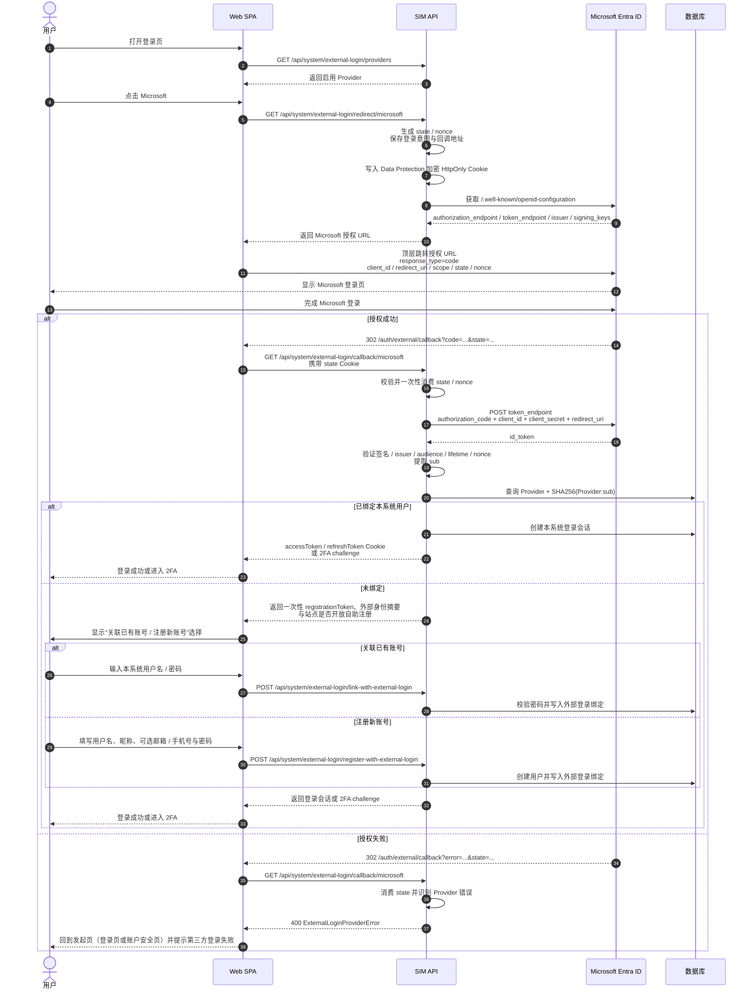
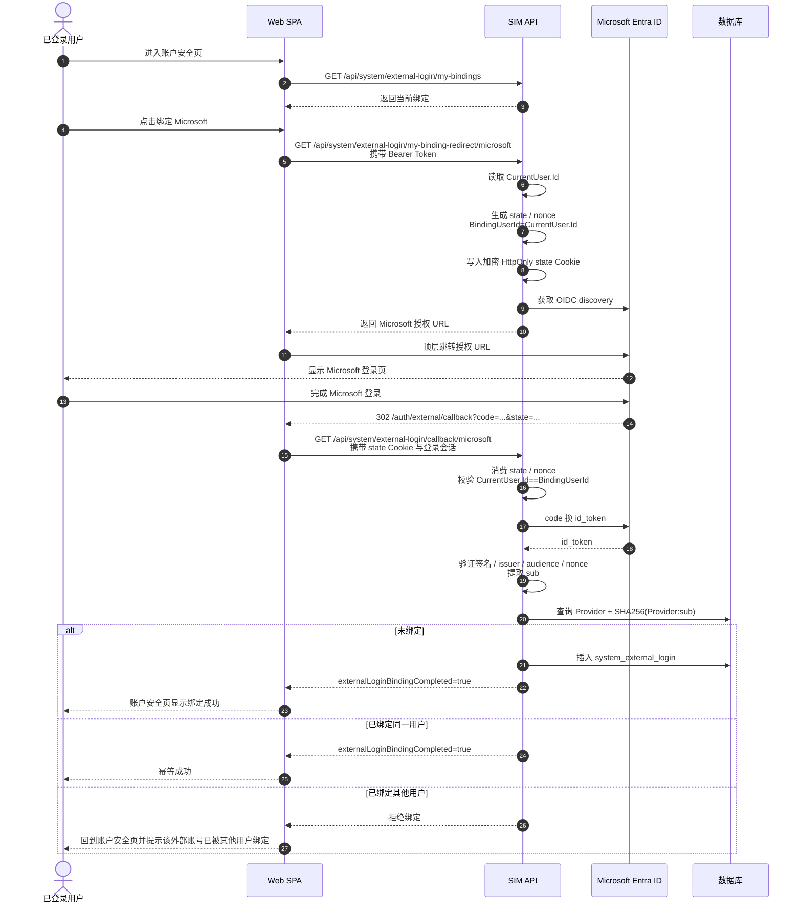

# 第三方登录技术设计

本文档固化 System 模块的外部登录 / 第三方登录设计，覆盖协议边界、前后端交互、state/nonce 安全、未绑定身份的关联已有账号 / 注册新账号分支、已有账号绑定与解绑，以及 Microsoft OIDC 登录时序。外部登录属于 System/RBAC 用户身份体系，用于人类用户登录或绑定本系统账号；它不是机器对机器的系统对接。

配套图解（OAuth/OIDC 原理、时序与业务系统接入）：[OAUTH_OPENID_VISUAL_GUIDE.html](OAUTH_OPENID_VISUAL_GUIDE.html)。

## 1. 范围与协议矩阵

| Provider | 协议 | 身份来源 | 说明 |
| --- | --- | --- | --- |
| Microsoft | OIDC Authorization Code Flow | ID Token `sub` | 后端 Confidential Client 换取并验证 `id_token` |
| Google | OIDC Authorization Code Flow | ID Token `sub` | 后端 Confidential Client 换取并验证 `id_token` |
| WeChat | OAuth 2.0 | Provider 用户信息接口 | OAuth token 仅在后端内存中完成身份获取 |
| QQ | OAuth 2.0 | Provider 用户信息接口 | OAuth token 仅在后端内存中完成身份获取 |
| Steam | OpenID 2.0 | SteamID | 校验 Provider 返回的签名声明 |

所有 Provider 必须实现 `IExternalLoginProvider` 并注册到 `IExternalLoginProviderRegistry`。Registry 只向 Provider 列表和跳转入口暴露 `Enabled=true` 的 Provider；禁用后 redirect/callback/绑定发起均 fail-closed，账户安全页也不会展示该 Provider 的绑定/解绑操作。协议细节保留在各 Provider 内，登录服务只消费统一身份结果，不出现协议分支。

## 2. 关键代码位置

| 职责 | 位置 |
| --- | --- |
| Provider 抽象与 Registry | `api/modules/system/Sim.System.Application/Security/ExternalLogin/ExternalLoginAbstractions.cs` |
| state/nonce 会话与 Cookie | `api/modules/system/Sim.System.Application/Security/ExternalLogin/ExternalLoginStateService.cs` |
| Microsoft/Google OIDC Provider | `api/modules/system/Sim.System.Application/Security/ExternalLogin/OidcExternalLoginProvider.cs` |
| WeChat/QQ/Steam Provider | `api/modules/system/Sim.System.Application/Security/ExternalLogin/*ExternalLoginProvider.cs` |
| 登录、关联/注册与绑定服务 | `api/modules/system/Sim.System.Application/Security/ExternalLogin/ExternalLoginService.cs` |
| 账号创建、绑定与登录会话 | `api/modules/system/Sim.System.Application/User/UserService.cs` |
| 外部登录绑定实体 | `api/modules/system/Sim.System.Domain/ExternalLogin/ExternalLoginEntity.cs` |
| 前端回调落点（无界面） | `web/src/views/auth/ExternalCallback.vue` |
| 登录页与未绑定身份的分支步骤 | `web/src/views/login.vue` |
| 账户安全绑定/解绑页 | `web/src/modules/authorization/views/user/Security.vue` |
| 前端 pending 结果与发起页接力 | `web/src/modules/authorization/utils/externalAuth.ts` |

## 3. 端点契约

### 匿名端点

| 方法 | 路径 | 用途 |
| --- | --- | --- |
| GET | `/api/system/external-login/providers` | 获取启用 Provider |
| GET | `/api/system/external-login/redirect/{providerId}` | 创建登录 state 会话并返回 Provider 授权 URL |
| GET | `/api/system/external-login/callback/{providerId}` | 消费一次性 state，完成登录 / 关联选择 / 绑定 |
| POST | `/api/system/external-login/register-with-external-login` | 使用一次性注册令牌创建本系统账号并绑定 |
| POST | `/api/system/external-login/link-with-external-login` | 使用一次性注册令牌校验已有账号密码并绑定 |

### 已登录用户端点

| 方法 | 路径 | 用途 |
| --- | --- | --- |
| GET | `/api/system/external-login/my-bindings` | 查询当前账号外部绑定 |
| GET | `/api/system/external-login/my-binding-redirect/{providerId}` | 创建绑定意图 state 会话 |
| DELETE | `/api/system/external-login/my-binding/{providerId}` | 解绑当前账号的指定 Provider |

修改上述接口后必须重新生成 OpenAPI 契约，并执行 Web API 类型生成，保持前后端契约一致。

## 4. 配置基线

配置节为 `ExternalLogin`，示例如下：

```json
{
  "ExternalLogin": {
    "CallbackBaseUrl": "https://your-domain/auth/external/callback",
    "StateCookieName": "sim_external_login_state",
    "StateCookieSecure": true,
    "StateExpirationMinutes": 10,
    "Microsoft": {
      "Enabled": true,
      "Authority": "https://login.microsoftonline.com/common/v2.0",
      "ClientId": "<client-id>",
      "ClientSecret": "<client-secret>",
      "Scopes": ["openid", "profile", "email"]
    }
  }
}
```

要求：

- `CallbackBaseUrl` 必须是固定绝对 URL；本地开发仅允许 `http://localhost/...`，生产必须 HTTPS。
- `CallbackBaseUrl` 不能包含 query 或 fragment，并且必须与 Provider 控制台登记的 Redirect URI 完全一致。
- OIDC `Scopes` 必须包含 `openid`；默认 `openid profile email`。
- Microsoft/Google 必须提供 HTTPS `Authority`、`ClientId`、`ClientSecret`；Microsoft `Authority` 还必须与应用注册的账号受众匹配，仅个人账号使用 `https://login.microsoftonline.com/consumers/v2.0`。
- 本地 HTTP 开发可临时设置 `StateCookieSecure=false`；生产必须为 `true`。
- Client Secret 只能来自本机 ignored 配置、Secret Manager、环境变量或密钥管理系统，不得提交到仓库。
- 多实例部署必须共享 Data Protection 密钥环，否则不同实例无法解密彼此生成的 state Cookie。

## 5. 登录流程

1. 登录页加载启用 Provider。
2. 用户点击 Provider，例如 Microsoft。
3. Web 调用后端 redirect 端点。
4. 后端生成 `state` 与 OIDC `nonce`，把 provider、随机值、回调地址、过期时间和登录/绑定意图写入 Data Protection 加密会话。
5. 加密会话写入路径限定为 `/api/system/external-login` 的 HttpOnly Cookie。
6. 后端读取 Provider discovery，构造授权 URL 并返回给 Web。
7. 浏览器顶层跳转到 Provider 授权页。
8. Provider 认证用户后回调到 `/auth/external/callback`。
9. Web 从 `state` 前缀恢复 Provider，携带 Provider 返回的 query 和 state Cookie 调用统一后端 callback。
10. 后端一次性消费 state，校验协议返回值和外部身份。
11. 若外部身份已绑定，进入本系统登录或本地 2FA；若未绑定，返回一次性注册令牌、Provider 身份摘要和站点注册开关状态，前端进入“关联已有账号 / 注册新账号”选择页，而不是直接落到注册表单。
12. 回调落点不渲染界面：登录成功进入后台默认页，未绑定身份 / 2FA 把响应接力到登录页，失败时回到登录页并弹出错误消息。

### Microsoft 登录时序图



## 6. 未绑定身份的继续方式：关联已有账号或注册新账号

系统不依据 email 自动关联已有账号，也不自动创建无密码用户。未绑定 Provider 身份回调后：

1. 后端返回 `RequiresExternalLoginRegistration=true`，响应包含一次性 `ExternalLoginRegistrationToken`、Provider 展示名、从 ID Token / Provider 用户信息得到的默认用户信息，以及 `ExternalLoginRegistrationAllowed`（站点配置 `security.registration-enabled` 的当前值，默认关闭）。
2. Web 把该响应短期保存在 `sessionStorage`，进入登录页的选择步骤：用户选择“关联已有账号”或“注册新账号”。此时不显示密码登录的欢迎标题，两个分支各有独立标题与表单。
3. 关联已有账号：用户输入本系统用户名与密码，调用 `link-with-external-login`。后端解密令牌、校验过期时间、按登录同款规则校验密码（失败计数与锁定策略一致），成功后写入绑定并签发会话或返回 2FA challenge。关联不创建用户，因此不受注册开关约束。
4. 注册新账号：用户填写本系统用户名、昵称（必填）、邮箱与手机号（均为选填）以及密码，调用 `register-with-external-login`。后端解密注册令牌、校验过期时间，并再次校验注册开关（防止令牌签发后管理员关闭注册），校验用户名 / 昵称 / 邮箱唯一，创建用户、按 `security.registration-role-codes` 分配角色（与普通自助注册一致，仅非内置角色，默认 `User`）并写入绑定。
5. 注册表单未填写邮箱时沿用 Provider 身份携带的邮箱；已存在的邮箱占用会被拒绝并提示改用“关联已有账号”。
6. 注册或关联成功后签发本系统登录会话；账号开启 2FA 时仍进入既有 challenge 流程。

注册开关关闭时回调不再报错，而是只提供“关联已有账号”，前端以 `ExternalLoginRegistrationAllowed=false` 隐藏注册入口并提示只能关联。

注册用户的角色随后端系统配置即时变化；配置中的角色代码按英文逗号分隔，内置角色（如 Admin）不会被分配。

注册令牌与 2FA challenge 均不放入 URL，避免泄漏到浏览器历史、Referer 或服务端访问日志。

## 7. 已有账号绑定流程

1. 已登录用户进入账户安全页。
2. Web 调用 `my-bindings` 获取当前绑定，调用 `providers` 获取启用 Provider。
3. 用户点击绑定 Provider。
4. Web 携带 Bearer Access Token 调用 `my-binding-redirect/{providerId}`。
5. 后端从当前登录用户解析 `BindingUserId`，并把它写入加密 state 会话。
6. 用户完成 Provider 认证后回到统一回调落点 `/auth/external/callback`（无界面）。
7. Web 恢复 Provider，调用统一 callback；此时请求同时携带 state Cookie 与当前登录会话。
8. 后端要求 `CurrentUser.Id == state.BindingUserId`，防止把外部身份绑定到其他用户。
9. 后端按 `Provider + SHA256(Provider:sub)` 查询唯一绑定。
10. 未绑定时写入 `system_external_login`；已绑定同一用户时幂等返回成功；已绑定其他用户时拒绝。
11. 成功进入账户安全页并刷新绑定列表；失败回到账户安全页并弹出错误消息。

### Microsoft 绑定时序图



## 8. state / nonce / 绑定关系安全

- `state` 由 Provider ID 前缀和密码学随机数组成；Web 仅用前缀恢复 Provider，不信任前端传入的意图。
- state 会话包含 Provider、state、nonce、回调地址、过期时间和可选 `BindingUserId`。
- state 会话由 Data Protection 加密后写入 HttpOnly、`SameSite=Lax`、路径限定 Cookie。
- callback 消费 state 后立即删除 Cookie；重复刷新旧回调 URL 会得到 `InvalidExternalLoginState`。
- OIDC 授权 URL 携带 `nonce`；后端在 ID Token 中做精确匹配，防重放。
- ID Token 校验签名、签发者、受众、有效期和必需声明；`common` Authority 的模板 issuer 会按 `tid` 解析。
- 绑定表只保存 `Provider + ProviderKey` 的 SHA-256 摘要，不保存 Provider access token 或 refresh token。
- `ProviderKey` 使用 Provider 的稳定用户 ID（Microsoft/Google 使用 `sub`），不用 email 作为身份键。
- email 只作为展示和注册默认值，不用于自动关联已有账号；注册表单中邮箱、手机号可选，邮箱为空时沿用 Provider 邮箱。
- 已绑定用户开启本地 2FA 时，外部登录仍必须完成原有 challenge，不允许绕过。
- 外部登录出站 HTTP 日志与 Trace 不导出 query，避免 Provider 要求放在 URL 中的凭据泄漏。

## 9. 前端回调与失败处理

`/auth/external/callback` 是 Provider 控制台登记的固定回调地址，必须与 `ExternalLogin:CallbackBaseUrl` 完全一致，因此路由保留；但它不再是需要用户停留和选择的中间页，而是无界面的回调落点：

1. 从 `state` 前缀恢复 Provider；`state` 缺失或无效时按失败处理。
2. 把 Provider 返回的全部 query 传给统一后端 callback。
3. 绑定成功时跳转账户安全页，并提示绑定成功；账户安全页挂载时重新拉取绑定列表。
4. 未绑定身份或 2FA 时把响应短期保存到 `sessionStorage`，再跳转登录页处理。
5. 登录成功时应用会话并进入后台默认页。
6. 失败时不渲染任何错误界面：把错误消息写入短期 `sessionStorage` 提示（不放进 URL，避免进入浏览器历史和服务端访问日志），再回到发起页由发起页弹出错误消息。
7. 发起页由发起登录 / 绑定时写入的来源标记决定：登录页发起回到登录页，账户安全页发起回到账户安全页。标记缺失或过期时按当前登录态兜底——已登录回账户安全页，未登录回登录页；若最终回到登录页但当前已登录，则改回账户安全页，避免登录路由把已登录用户重定向到后台而丢失提示。

错误覆盖 Provider 返回 `error`、state 无效或过期、身份校验失败、绑定冲突以及后端 Provider 调用失败。

不要通过刷新旧回调 URL 重试。state 是一次性会话，失败后必须从登录页或账户安全页重新发起。

## 10. Microsoft Authority 与账号受众

Microsoft 应用注册的账号受众必须与 Authority 匹配：

| 目标账号 | Authority | 应用注册要求 |
| --- | --- | --- |
| 仅个人 Microsoft 账号 | `https://login.microsoftonline.com/consumers/v2.0` | Consumer / Personal Microsoft Accounts |
| 工作或学校账号，多组织 | `https://login.microsoftonline.com/organizations/v2.0` | 支持组织账号 |
| 工作或学校账号，单一租户 | `https://login.microsoftonline.com/{tenantId}/v2.0` | 单租户应用 |
| 工作或学校账号 + 个人账号 | `https://login.microsoftonline.com/common/v2.0` | All / `AzureADandPersonalMicrosoftAccount` |

典型错误：

```text
error=invalid_request
The request is not valid for the application's 'userAudience' configuration.
In order to use /common/ endpoint, the application must not be configured
with 'Consumer' as the user audience.
```

含义是应用注册为 Consumer，但请求使用了 `/common`。修复二选一：

- 保持应用仅支持个人账号，把 Authority 改为 `/consumers/v2.0`。
- 保持 `/common/v2.0`，把 Microsoft 应用注册的 Supported account types 改为 All。

Microsoft 应用注册还应检查：

- Redirect URI 平台选择 Web，而不是 SPA；本实现由后端 Confidential Client 使用 client secret 换 token。
- Redirect URI 与 `CallbackBaseUrl` 完全一致，本地开发通常为 `http://localhost:5173/auth/external/callback`。
- Client Secret 未过期，且只保存在受控密钥源。
- 生产部署使用 HTTPS 并设置 `StateCookieSecure=true`。

## 11. 验证清单

新增或修改 Provider 时至少验证：

1. `Enabled=false` 时 Provider 不出现在列表，redirect/callback 均拒绝。
2. `Enabled=true` 且配置完整时能返回授权 URL。
3. Provider 授权成功回调中出现 `code` 与原 `state`。
4. Provider 授权失败回调能返回统一业务错误，且不泄漏 secret。
5. state 被消费后重复回调失败。
6. OIDC nonce 不匹配时身份校验失败。
7. 已绑定用户登录成功；开启 2FA 的用户仍必须完成 challenge。
8. 未绑定用户进入“关联已有账号 / 注册新账号”选择：关联需本系统口令校验通过后写绑定，注册创建账号并写绑定；选择页不显示密码登录的欢迎标题。
9. 绑定意图只能绑定当前登录用户。
10. 同一外部身份不能绑定到两个本系统用户。
11. 解绑后可重新绑定，且历史 provider key 摘要不外泄。
12. 回调失败时回到发起页（登录页或账户安全页）并弹出错误消息，不出现需要用户选择返回目标的中间页；刷新旧回调 URL 不会重复消费 state。
13. 外部登录 HTTP 日志与 Trace 不包含 query。
14. OpenAPI 契约与 Web 生成类型已更新且无漂移。

后端与 Web 验证命令：

```bash
cd api && dotnet build Sim.slnx
cd web && pnpm type-check && pnpm lint:check
```
